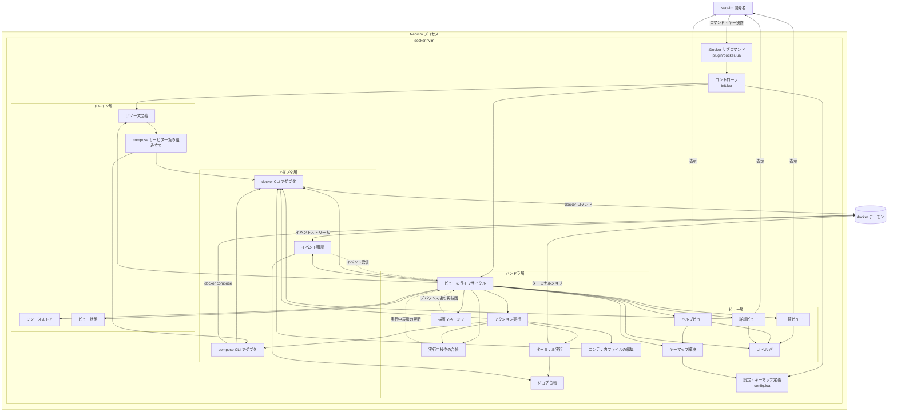

<!-- product-mode: cli -->

# docker.nvim 概要設計

- 種別: 概要設計書
- 対象: docker.nvim
- 作成日: 2026-07-29
- ステータス: 実装完了（2026-07-31 時点）
- 詳細: [DESIGN_DETAIL_APP.md](DESIGN_DETAIL_APP.md)（アプリ実装） / [DESIGN_DETAIL_INFRA.md](DESIGN_DETAIL_INFRA.md)（CI・配布・運用）
- 前提: [USER_STORIES.md](USER_STORIES.md) / [USECASES.md](USECASES.md) / [FEASIBILITY.md](FEASIBILITY.md) / [GLOSSARY.md](GLOSSARY.md) / [DOMAIN_MODEL.md](DOMAIN_MODEL.md)

## 目次

- [1. 共通](#1-共通)
  - [1.1 目的とスコープ](#11-目的とスコープ)
  - [1.2 機能要件](#12-機能要件)
  - [1.3 ゴール](#13-ゴール)
  - [1.4 全体構成図](#14-全体構成図)
  - [1.5 技術スタック](#15-技術スタック)
  - [1.6 決定一覧](#16-決定一覧)
  - [1.7 検討した代替案](#17-検討した代替案)
  - [1.8 制約と前提](#18-制約と前提)
  - [1.9 未解決の論点](#19-未解決の論点-open-issues)
  - [1.10 リスク](#110-リスク)
- [2. アプリケーション概要](#2-アプリケーション概要)
- [3. インフラ概要](#3-インフラ概要)

---

## 1. 共通

### 1.1 目的とスコープ

**目的**: Neovim から離れずに Docker のリソースを閲覧・操作できるようにし、`docker ps` や `docker compose logs` のためにターミナルを往復する手間をなくす。

**スコープに含むもの**: コンテナ・イメージ・ボリューム・ネットワークの一覧と操作、存在するすべての compose プロジェクトを統合したサービス一覧と、そのサービス／プロジェクト操作、コンテナがどの compose プロジェクトのどのサービス由来かの可視化、`docker events` によるライブ更新、`:Docker` のサブコマンド補完と引数なし起動時の使い方表示。

**スコープに含まないもの（非ゴール）**: [USER_STORIES.md](USER_STORIES.md) の Won't と 1 対 1 で対応させる。

| 非ゴール | 対応 ID | 理由 |
| --- | --- | --- |
| Docker Hub のイメージ検索・pull | WN-001 | 利用頻度が低く、代替（`docker pull`）が容易 |
| Docker Swarm / Kubernetes 連携 | WN-003 | k8s.nvim の領域 |
| イメージのビルド（`docker build`） | WN-004 | ビルドコンテキスト指定の UI が必要でスコープが膨らむ |
| volume / network の作成 | WN-005 | compose か docker CLI で行うのが通常 |
| `:checkhealth` による自己診断 | WN-006 | 環境問題は起動時のメッセージで切り分けられる |
| コンテナの CPU / メモリ使用率の表示 | WN-008 | コンテナごとに `docker stats` のストリームを張ることになり、優先度に見合わない |

compose ファイルの場所が分からないプロジェクトでは起動（`u` / `U`）だけを行わない。これは非ゴールではなく縮退動作であり、条件と代替経路は [1.8](#18-制約と前提) に置く。

### 1.2 機能要件

**MUST**（[USER_STORIES.md](USER_STORIES.md) の US-001〜US-015）

- コンテナとイメージの一覧表示、および compose サービスの一覧表示
- コンテナのライフサイクル操作（start / stop / restart / kill）と削除
- コンテナのログ追従・シェル起動・コマンド実行・詳細表示
- イメージの一覧と削除
- compose サービスの up / stop / restart / ログ、プロジェクトの up -d / down
- `docker events` によるライブ更新と `R` による手動再取得
- docker 未検出・デーモン未起動・権限不足の区別されたメッセージ
- UI をブロックしない非同期実行、ヘルプ表示

**NICE to have**（US-016〜US-031）

キーマップのカスタマイズ、使い捨てコンテナ実行、ボリューム／ネットワークの一覧・詳細・削除、イメージの詳細表示、公開ポートのブラウザ起動、ファイルのコピーと編集、ビュー間切替、進行表示と二重実行防止、全ビューのライブ更新、ドリルダウン、一括削除、pause / unpause、絞り込み。

扱うリソース種別は container / image / volume / network / service の 5 種だが、このうちボリュームとネットワークは Must ではない（US-018 / US-019 は Should）。ただし実装順序としては、リソース定義の追加のみで済むためコンテナ・イメージと同じフェーズで扱う（[TODO.md](TODO.md) のフェーズ 8）。

`:Docker` は `nargs = "?"` で定義し、サブコマンドを補完する。引数なしで呼ばれたときは受け付けられるサブコマンド名を並べた使い方を通知する（[DESIGN_DETAIL_APP.md の 6.1](DESIGN_DETAIL_APP.md#61-コマンド体系)）。

### 1.3 ゴール

- G1: `:Docker containers` を実行すると、停止中を含む全コンテナが NAME / PROJECT / SERVICE / IMAGE / STATUS / PORTS のカラムで表示され、compose 由来のコンテナには PROJECT / SERVICE の値が入る
- G2: コンテナ一覧で `u` / `d` / `r` / `<C-k>` を押すと対象コンテナの状態が変化し、一覧の STATUS 列に反映される（`p` / `P` による一時停止・再開は Could 扱いの US-030 のため、このゴールには含めない）
- G3: `D` を押すと確認プロンプトが出て、`y` のときのみ削除される。`y` 以外では docker に削除要求が送られない
- G4: `t` / `a` / `e` でターミナルバッファが開き、そのバッファを閉じると対応する docker の子プロセスが 0 件になる
- G5: `<CR>` で inspect の JSON が表示され、`q` で直前の一覧に戻ってカーソル位置が復元される
- G6: `:Docker images` / `:Docker volumes` / `:Docker networks` がそれぞれ一覧表示され、`D` の確認を経て削除できる
- G7: compose プロジェクトの外のディレクトリで `:Docker services` を実行しても、存在するすべての compose プロジェクトのサービスが PROJECT 列付きで並び、コンテナが起動していないサービスが状態 `none` として表示される
- G8: サービス一覧で `u` / `d` / `r` / `t` がサービス単位に、`U` / `D` がプロジェクト単位に作用し、いずれも行のプロジェクトを `-p` で名指しして実行される（他のプロジェクトを巻き込まない）
- G9: 一覧を開いている状態で別プロセスがコンテナを起動・停止すると、1 秒以内に一覧の該当行が更新される
- G10: `R` を押すと一覧が再取得され、イベント購読が切断されていれば再開される
- G11: docker 未検出・デーモン未起動・ソケット権限不足・`docker compose` サブコマンド不在の 4 状況が、それぞれ区別できるメッセージで通知される
- G12: `?` でそのビューの有効なキー一覧が表示され、`setup()` で変更したキーが反映される。一覧ビュー以外のバッファではプラグインのキーが作用しない
- G13: 一覧・ターミナルを開いたまま `:qa` で Neovim を終了すると、プラグインが起動した子プロセスが 0 件になる
- G_E2E: MVP の全ユースケースが、headless の Neovim から実際の docker に対して通しで実行でき、各ステップの結果（一覧の内容・状態変化・プロセスの残留有無）が assert される

検証手順は [DESIGN_DETAIL_APP.md の検証手順](DESIGN_DETAIL_APP.md#9-検証手順) に 1 対 1 で対応させる。

### 1.4 全体構成図

実線はモジュール間の `require` による依存（矢元が矢先を呼ぶ）。破線はコールバック（登録した側へ制御が戻る経路）を表す。依存元が多い共有ヘルパ（`notify.lua` / `format.lua` / `version.lua` / `resources/fields.lua` / `resources/ports.lua`）は線が輻輳するため図から省く（責務は [2.1](#21-主要コンポーネントと責務) の表を参照）。



### 1.5 技術スタック

| 区分 | 技術 | 選定理由 |
| --- | --- | --- |
| 実装言語 | Lua（Neovim 0.10 以上） | Neovim の標準実行環境。外部ランタイムを要求しない |
| Docker との通信 | `docker` CLI のサブプロセス実行 | Engine API を直接叩くと HTTP と Unix ソケットを自前実装することになる。CLI なら DOCKER_HOST・docker context・SSH 越し接続の解決を CLI に任せられる |
| 一覧の取得形式 | フィールドごとに `{{json ...}}` で組み立てた NDJSON（`--no-trunc` 付き） | PoC で `--format json` の `Labels` が解析不能と判明したため（[1.7](#17-検討した代替案)） |
| compose 情報の取得 | 4 経路の組み合わせ: `docker compose ls -a --format json`（プロジェクトの列挙）＋ コンテナの compose ラベル（サービスの実体と compose ファイルの所在）＋ カレントディレクトリでの `docker compose config --format json`（未起動プロジェクトの合流。BR-003）＋ `docker compose -p <project> config --format json`（各プロジェクトのサービス定義の全件） | 前 2 者はコンテナのラベル由来のため、compose プロジェクトの外から実行しても全プロジェクトを列挙できる。一度も起動していないプロジェクトはラベルに現れないので、3 番目でのみ拾える。`config` は未起動のサービスも含めて全件が取れ、`-p` で名指しすればディレクトリ名から決まる既定名とのずれで取り違えない |
| ライブ更新 | `docker events --format '{{json .}}'` の単一ジョブ購読 | 1 本のストリームで container / image / volume / network すべてのイベントが取れることを PoC で確認 |
| UI 基盤 | Neovim 標準 API（`nvim_open_win` の `border` / `title`、`winbar`、extmark、`zindex`） | PoC で nui.nvim と比較し、コード量に差が無く（63 行 対 64 行）、nui は headless テストで Neovim が落ちるため |
| 非同期実行 | `vim.system`（単発）/ `vim.fn.jobstart`（ストリーム・ターミナル） | Neovim 0.10 以降の標準機能。追加依存が不要 |
| 入力・選択 UI | `vim.ui.input` / `vim.ui.select` | 利用者が導入済みの UI プラグインにそのまま乗る |
| テスト | plenary.nvim（busted 互換） | Neovim プラグインの事実上の標準。開発時のみの依存 |
| CI | GitHub Actions | リポジトリと同居し追加コストが無い |
| Lint / 整形 / 型検査 | luacheck / stylua / lua-language-server | k8s.nvim で運用実績がある組み合わせ |

### 1.6 決定一覧

後から変更するコストが高い決定を 1 行ずつ並べる。同じ決定の説明は詳細節に重複させず、ここから参照先をたどる。

| 決定 | 理由 | 詳細 |
| --- | --- | --- |
| docker との通信は `docker` CLI のサブプロセス実行で行う | Engine API を直接叩くと HTTP・Unix ソケット・DOCKER_HOST・context の解決まで Lua で自前実装することになる | [1.7](#17-検討した代替案) |
| 一覧はフィールドごとに `{{json ...}}` を並べた NDJSON で取り、`Labels` は分割しない | `--format json` の `Labels` はラベル値のカンマと偽ラベルの混入で誤った値を掴む | [1.7](#17-検討した代替案) / [DESIGN_DETAIL_APP.md 5.1](DESIGN_DETAIL_APP.md#51-一覧取得) |
| サービス一覧は存在するすべての compose プロジェクトを統合して 1 つの一覧に出す | compose ディレクトリの外でも一覧が開け、停止中のプロジェクトも列挙できる | [1.7](#17-検討した代替案) / [DESIGN_DETAIL_APP.md 5.3](DESIGN_DETAIL_APP.md#53-compose) |
| compose の操作は行のプロジェクトを `-p <project>` で名指しし、`-f` は渡さない | ディレクトリ名から決まる既定のプロジェクト名は `-p` 起動・`COMPOSE_PROJECT_NAME`・`name:` ディレクティブでずれる | [DESIGN_DETAIL_APP.md 4.5](DESIGN_DETAIL_APP.md#45-状態変更操作の一貫性) |
| compose ファイルの場所（`working_dir`）は「カレントディレクトリ → コンテナのラベル → `compose ls` の `ConfigFiles`」の優先順で逆算する | プロジェクトの外から起動系の操作を実行するには compose ファイルのある場所が要る | [DESIGN_DETAIL_APP.md 5.3](DESIGN_DETAIL_APP.md#53-compose) |
| 場所が分からないプロジェクトでは起動（`u` / `U`）だけを拒否し、停止・再起動・破棄・ログはプロジェクト名の名指しで実行する（BR-024） | 起動には compose ファイルの定義そのものが要るが、その他はプロジェクト名だけで足りる | [1.8](#18-制約と前提) / [DESIGN_DETAIL_APP.md 4.5](DESIGN_DETAIL_APP.md#45-状態変更操作の一貫性) |
| ライブ更新は `docker events` の購読で行い、切断時の縮退先は手動更新（`R`）にする | ポーリングは反映が遅れ、間隔を詰めるとデーモンへの負荷が上がる | [1.7](#17-検討した代替案) |
| UI は Neovim 標準 API のみで作り、ランタイムの Lua ライブラリ依存を持たない | nui.nvim とコード量が変わらず、nui は headless テストで Neovim を落とす | [1.7](#17-検討した代替案) |
| 一覧はフロートウィンドウで表示し、詳細・ヘルプはその上に `zindex` で重ねる | 上層を閉じたときに下層の内容とカーソル位置がそのまま残る | [2.3](#23-主要エンティティ) |
| 既定のキー割り当ては denops-docker.vim を踏襲し、絞り込みだけ k8s.nvim と同じ `<C-f>` にする | 参照実装の割り当てをそのまま使い、独自のキー体系を増やさない。`/` を残すとそのバッファで Neovim 本来の検索が使える | [DESIGN_DETAIL_APP.md 6.2](DESIGN_DETAIL_APP.md#62-キーマップ) |
| 実装は Must（US-001〜US-015）を通しで仕上げてから Should 以降へ進む。ただし Must と同じモジュールに手を入れる Should は同じフェーズに含める | モジュールの二度手間を避ける | [TODO.md](TODO.md) |

### 1.7 検討した代替案

[1.6](#16-決定一覧) の決定のうち、却下した案とその理由を残すものを挙げる。

| 決定事項 | 採用案 | 却下案 | 却下理由 |
| --- | --- | --- | --- |
| Docker との通信手段 | docker CLI のサブプロセス実行 | Docker Engine API を Unix ソケットで直接叩く | HTTP のチャンク応答処理を Lua で自前実装することになる。DOCKER_HOST・docker context・SSH 越し接続・TLS の解決も自前になり、対応環境が CLI より狭まる。denops-docker.vim は Deno のソケット API があったため API を選べたが、Lua には同等の土台が無い |
| 一覧の出力形式 | フィールドごとに `{{json ...}}` を並べた NDJSON | `docker ps --format json` | `Labels` が全ラベルをカンマ連結した 1 本の文字列で、compose が付与する `com.docker.compose.project.config_files` の値自体にカンマを含む。さらにラベル値に `,com.docker.compose.project=偽値` を仕込むと同名キーが複数現れ、先頭一致でも末尾一致でも誤った値を掴むことを実測した（[FEASIBILITY.md の PoC 結果](FEASIBILITY.md#docker-list-json-labels--verified-confidence-09)） |
| サービス一覧の対象範囲 | `docker compose ls -a` の列挙とコンテナの compose ラベル（`com.docker.compose.project` / 同 `.project.working_dir`）から、存在する全プロジェクトを逆算する | カレントディレクトリで `docker compose config` を 1 回実行し、そのプロジェクトだけを扱う | compose ディレクトリの外では一覧が空になり、`:Docker services` を開く前に `cd` を強いる。ラベル由来なら停止中のプロジェクトも含めて列挙でき、compose ファイルの所在まで同時に分かる |
| compose サービス定義の取得 | `docker compose -p <project> config --format json` | `docker compose config --services` | 25 回の実行で出力順が 3 通りに揺れ、一覧の行順が実行のたびに変わる |
| compose プロジェクト名の解決 | `compose ls` の `Name` とコンテナのラベル `com.docker.compose.project`（操作は `-p <project>` で名指しする） | カレントディレクトリ名をプロジェクト名とみなす（lazydocker 方式） | `-p` 指定・`COMPOSE_PROJECT_NAME`・`name:` ディレクティブ・サブディレクトリからの実行の 4 ケースで誤る |
| UI 基盤 | Neovim 標準 API のみ | nui.nvim を唯一のランタイム依存として採用（k8s.nvim 方式） | 同等のビューを実装したコード量が 63 行 対 64 行で差が無く、依存を増やす利点が無い。さらに nui は headless テストで 10 回中 10 回 Neovim を SIGSEGV させ、レイアウトを決定的に検証するテストが書けない |
| ライブ更新の方式 | `docker events` の購読 | 一定間隔のポーリング（`docker ps` の再実行） | ポーリングは反映が遅れ、間隔を詰めるとデーモンへの負荷が上がる。イベント購読は PoC で取りこぼし 0 件を確認済み。ただし切断時の縮退先としてポーリングではなく手動更新（`R`）を用意する |

### 1.8 制約と前提

- Neovim 0.10 以上（`vim.system` を使う）。CI では 0.10 と stable の 2 系統で検証する
- `docker` コマンドが PATH 上にあること。compose 機能には `docker compose` サブコマンドが必要（無い場合も compose 以外の機能は動作する）
- ランタイムの Lua ライブラリ依存は持たない
- 対象プラットフォームは macOS と Linux。Windows は検証対象外とする
- サービス一覧は存在するすべての compose プロジェクトを対象とし、各操作は行のプロジェクトを `-p` で名指しして実行する。カレントディレクトリは一覧を開いた時点で固定し、そのディレクトリの compose プロジェクト（未起動でラベルに現れないもの）を一覧へ合流させることと、そのプロジェクトの compose ファイルの場所を決めることに使う（BR-003）
- compose の定義を引けないプロジェクト（compose ファイルの場所が分からない、または場所で `config` に失敗した）は、コンテナが実在するサービスのみ一覧に出す。起動（`u` / `U`）は場所が分からないときだけ docker を呼ばずに警告し、停止・再起動・破棄・ログはプロジェクト名の名指しで実行する（BR-024）

### 1.9 未解決の論点 (Open Issues)

なし。

### 1.10 リスク

| リスク | 対策・状態 |
| --- | --- |
| 全 compose プロジェクトを 1 つの一覧に統合するため、別プロジェクトの行を対象に操作しかねない | 行の先頭に PROJECT 列を置いて所属を常に見せ、破棄（`D`）は確認プロンプトを必須にする。操作は行のプロジェクトを `-p` で名指しするため、他のプロジェクトは巻き込まない（G8 / [DESIGN_DETAIL_APP.md 4.5](DESIGN_DETAIL_APP.md#45-状態変更操作の一貫性)）。対処済み |
| サービス一覧の取得コストが compose プロジェクト数に比例する（結果をキャッシュしないため、イベントのたびに取り直す） | 取得の各段階を並列に実行し、イベント由来の取り直しは 100 ms のデバウンスで 1 回にまとめる。実測値と G9（1 秒以内）が成立する前提は [DESIGN_DETAIL_APP.md 11.3](DESIGN_DETAIL_APP.md#113-実測で確定した値) に置く。監視継続 |
| compose のラベル仕様（`com.docker.compose.project.working_dir`）に依存している | ラベルが無い環境（compose v2.17 より前が作ったコンテナ）向けに `compose ls` の `ConfigFiles` を第 2 の出典として持ち、どちらも得られない場合は起動系のみ拒否して縮退する（BR-024）。仕様変更は [DESIGN_DETAIL_APP.md 13](DESIGN_DETAIL_APP.md#13-依拠する外部事実) の再検証で検出する。監視継続 |

---

## 2. アプリケーション概要

詳細は [DESIGN_DETAIL_APP.md](DESIGN_DETAIL_APP.md) を参照。

### 2.1 主要コンポーネントと責務

| コンポーネント | 責務 | 依存先 |
| --- | --- | --- |
| コマンド定義（`plugin/`） | `:Docker <サブコマンド>` の定義・補完とコントローラへの委譲 | コントローラ・リソース定義・バージョン判定 |
| コントローラ（`init.lua`） | `setup()` の受け付け、ビューを開く・閉じる、サブコマンド名からリソース種別への解決 | 設定・ハンドラ層・リソース定義・バージョン判定 |
| 設定（`config.lua`） | デフォルト設定と利用者設定の合成、キーマップ定義の保持と検証 | 通知 |
| バージョン判定（`version.lua`） | 要求 Neovim バージョン（0.10 以上）の判定と、満たさない場合の文言 | なし |
| 通知（`notify.lua`） | `vim.notify` への通知の集約（情報・警告・エラー）とデバッグログの出し分け | なし |
| 出力形式（`format.lua`） | docker の出力テンプレートの組み立てと NDJSON の解析。アダプタ層とリソース定義の双方から使うため、どちらにも属さない共有位置に置く | なし |
| リソース定義（`resources/`） | リソース種別ごとの取得コマンド・カラム・行への変換・状態の取り出しを宣言的に保持。単一コマンドで取れない compose サービス一覧のみ、複数の取得結果の突き合わせも担う | なし（compose サービス一覧の組み立てのみアダプタ層） |
| リソースストア（`state/`） | 観測したリソースの保持と、ビュー状態の不変更新 | なし |
| ハンドラ層（`handlers/`） | アクションの実行、描画の集約とデバウンス、ビューのライフサイクル、実行中操作とジョブの台帳、ターミナル実行とコンテナ内ファイルの編集 | ドメイン層・アダプタ層・ビュー層 |
| ビュー層（`views/`, `ui/`） | ビュー状態のバッファへの投影、ウィンドウとキーマップの管理 | 設定・UI ヘルパ（詳細ビューのみアダプタ層） |
| アダプタ層（`adapters/`） | docker / docker compose CLI の実行、出力の解析、イベントストリームの購読 | なし（外界との境界） |

### 2.2 レイヤーと依存の方向

```
plugin/  → init.lua → handlers/ → { state/, resources/, adapters/, views/, ui/ }
init.lua → resources/registry.lua      サブコマンド名からリソース種別を解決する
resources/service_loader.lua → adapters/   compose サービス一覧の組み立てのみ
views/ → ui/, config.lua               詳細ビューのみ adapters/ も呼ぶ
adapters/docker/compose.lua → adapters/docker/cli.lua
```

- 依存は上から下への一方向。`state/` と `adapters/` はビューを知らない
- `resources/` は原則として外界に触れないが、compose サービス一覧だけは 3 種の取得結果を突き合わせる多段の非同期処理になるためアダプタ層を呼ぶ。呼ぶのはこの組み立てモジュール（`resources/service_loader.lua`）に限り、宣言的定義（`resources/registry.lua`）からは分離する
- 外界（docker コマンドの実行・時刻・ジョブ起動）はすべてアダプタ層に閉じ込め、テストでは差し替えられるようにする。外界に触れる処理はモジュール内部で直接呼ばず、差し替え口（`_set_executor` など）から注入する
- 再描画はハンドラ層が起点になる。ストアはビューを知らず、購読者への通知にも依存しない（[DESIGN_DETAIL_APP.md 11.1](DESIGN_DETAIL_APP.md#111-採用パターン)）
- リソース種別の追加は「リソース定義の追加 ＋ キーマップ定義の追加」で完結させ、ビューやハンドラの分岐を増やさない

### 2.3 主要エンティティ

[DOMAIN_MODEL.md](DOMAIN_MODEL.md) で定義した集約とエンティティを実装に対応させる。フィールドの詳細は [DESIGN_DETAIL_APP.md](DESIGN_DETAIL_APP.md#4-データ構造) を参照。

| エンティティ | 識別子 | 保持場所 |
| --- | --- | --- |
| コンテナ / イメージ / ボリューム / ネットワーク | ID または名前 | リソースストア |
| compose サービス | プロジェクト名 ＋ サービス名（`<プロジェクト名>/<サービス名>`） | リソースストア |
| ビュー | ビュー種別（`container` / `image` / `volume` / `network` / `service`） | ビューのライフサイクル（種別 → ハンドルの写像） |
| 実行中操作 | 対象 ID ＋ 操作名 | 実行中操作の台帳 |

ビューは種別ごとに 1 つだけ保持し、履歴のスタックは持たない。詳細・ヘルプは一覧を置き換えず、その上に `zindex` で重ねる。上層を `q` で閉じると下層の一覧の内容とカーソル位置がそのまま残るため、復元処理が要らない。

### 2.4 非機能要件（アプリ側）

| 項目 | 目標 | 実測・状態 |
| --- | --- | --- |
| 応答性 | docker コマンドの実行中に Neovim の入力がブロックされない（同期実行を使わない） | 達成（G_E2E の US-013 のステップで確認） |
| 更新の反映 | イベント受信から画面反映まで 1 秒以内。連続イベントはデバウンスで 1 回にまとめる | デバウンス幅 100 ms に確定（[DESIGN_DETAIL_APP.md 11.3](DESIGN_DETAIL_APP.md#113-実測で確定した値)） |
| 一覧の描画 | コンテナ 200 件で初回描画 500 ms 以内 | 達成。`docker ps` の実行を含めて 20〜60 ms（[DESIGN_DETAIL_APP.md 11.3](DESIGN_DETAIL_APP.md#113-実測で確定した値)） |
| プロセス管理 | ビュー破棄時と Neovim 終了時に、プラグインが起動した子プロセスを 0 件にする | 達成（G4 / G13） |
| 依存 | ランタイムの Lua ライブラリ依存を持たない | 達成（`docker` コマンドのみ） |

### 2.5 テスト戦略（方針）

- **単体・結合テスト中心**: アダプタ層を差し替えて docker 無しで実行できるようにし、リソース定義の変換・ストアの更新・ビューの描画内容・キーからアクションへの解決を検証する
- **E2E は G_E2E の 1 本に絞る**: 実際の docker に対する通し確認は G_E2E のスクリプトのみとし、個別機能は単体・結合で担保する
- テストは実装ファイルと同じディレクトリに `*_spec.lua` として置く（コロケーション）
- カバレッジの数値目標は置かず、[USER_STORIES.md](USER_STORIES.md) の受け入れ基準を単体・結合テストで網羅することを基準とする

---

## 3. インフラ概要

このプロダクトは Neovim プラグインであり、サーバー・クラウドリソース・デプロイ先を持たない。インフラ章の対象は CI と配布のみとなる。詳細は [DESIGN_DETAIL_INFRA.md](DESIGN_DETAIL_INFRA.md) を参照。

### 3.1 実行環境と配布

| 項目 | 内容 |
| --- | --- |
| 実行環境 | 利用者の Neovim（0.10 以上）。サーバー側の実行環境は無い |
| 配布 | GitHub リポジトリをプラグインマネージャ（lazy.nvim 等）が直接取得する。パッケージレジストリへの公開は行わない |
| 環境の面数 | 1（利用者のローカル環境のみ）。ステージング・本番の区別は無い |

### 3.2 CI 方針

GitHub Actions で、プッシュとプルリクエストをトリガーに次を実行する。

| ジョブ | 内容 |
| --- | --- |
| test | plenary.nvim による単体・結合テスト。Neovim 0.10 と stable のマトリクス |
| lint | luacheck |
| format | stylua の差分チェック |
| typecheck | lua-language-server による静的検査 |
| e2e | 実際の docker に対する G_E2E の通し確認（Linux ランナー同梱の docker を使用） |

G_E2E は実際の docker デーモンを必要とするため、CI では Linux ランナーの docker を使って実行する。詳細は [DESIGN_DETAIL_INFRA.md](DESIGN_DETAIL_INFRA.md#3-cicd-パイプライン) を参照。

### 3.3 非機能要件（インフラ側）

| 項目 | 内容 |
| --- | --- |
| 可用性 | 該当なし（常時稼働するサービスを持たないため） |
| スケーラビリティ | 該当なし（同上） |
| 監視 | 該当なし。障害の検知は利用者からの Issue による |
| シークレット管理 | 該当なし（CI で外部サービスの認証情報を使わないため） |
