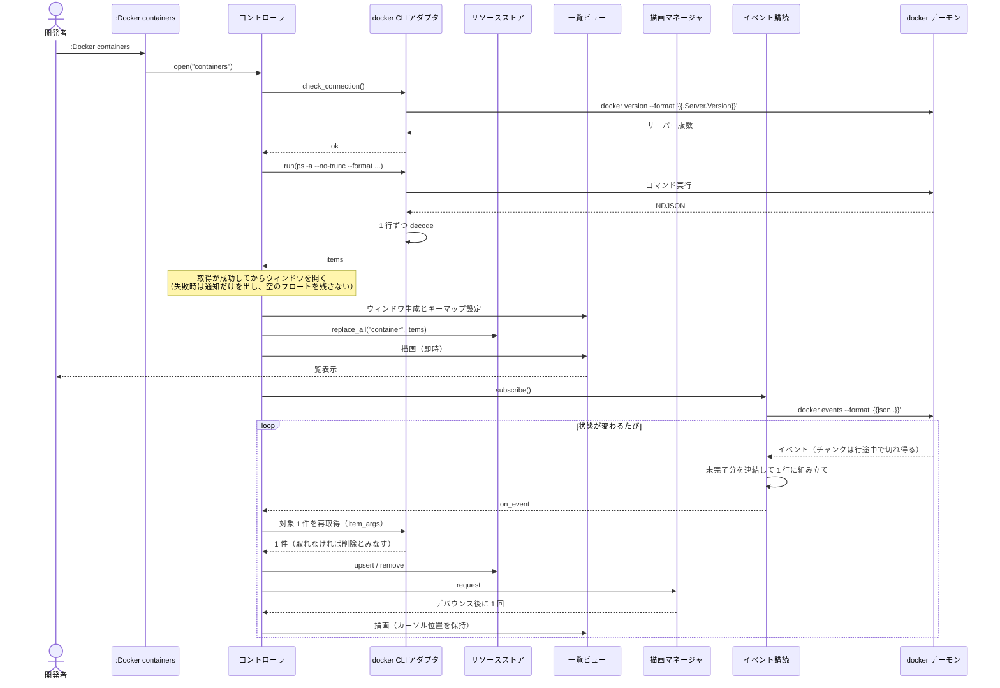
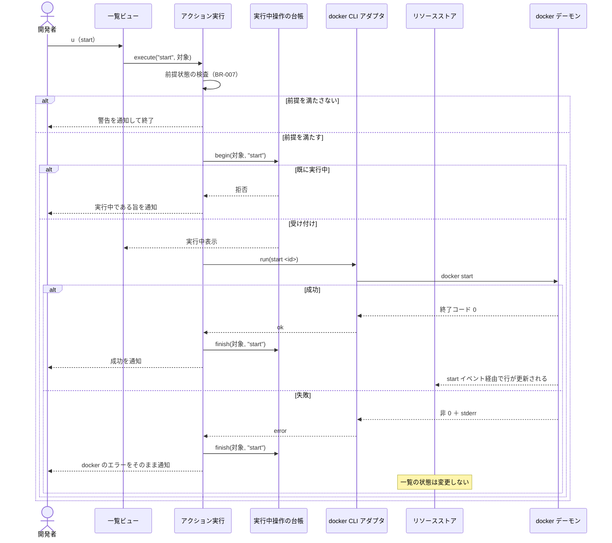
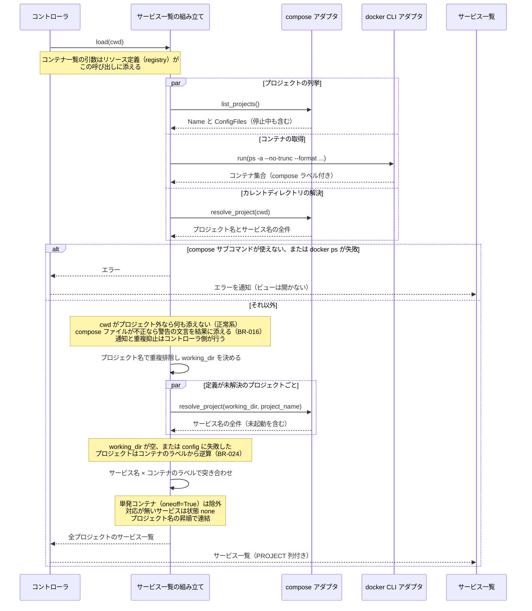
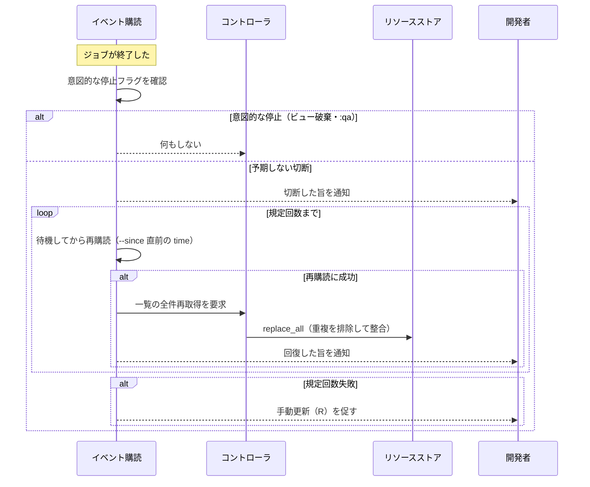

# docker.nvim アプリ詳細設計

- 種別: 詳細設計書（アプリケーション）
- 対象: docker.nvim
- 作成日: 2026-07-29
- ステータス: 実装完了（2026-07-31 時点）
- 概要設計: [DESIGN.md](DESIGN.md) / インフラ詳細: [DESIGN_DETAIL_INFRA.md](DESIGN_DETAIL_INFRA.md)
- 前提: [USECASES.md](USECASES.md) / [DOMAIN_MODEL.md](DOMAIN_MODEL.md) / [FEASIBILITY.md](FEASIBILITY.md)

## 目次

- [1. プロジェクトセットアップ](#1-プロジェクトセットアップ)
- [2. ディレクトリ構造とモジュール責務](#2-ディレクトリ構造とモジュール責務)
- [3. モジュール間インターフェース](#3-モジュール間インターフェース)
- [4. データ構造](#4-データ構造)
- [5. docker コマンド仕様](#5-docker-コマンド仕様)
- [6. CLI インターフェース仕様](#6-cli-インターフェース仕様)
- [7. データフロー詳細](#7-データフロー詳細)
- [8. エラー戦略](#8-エラー戦略)
- [9. 検証手順](#9-検証手順)
- [10. テスト戦略](#10-テスト戦略)
- [11. 実装ガイド](#11-実装ガイド)
- [12. 用語・成果物一覧](#12-用語成果物一覧)
- [13. 依拠する外部事実](#13-依拠する外部事実)

---

## 1. プロジェクトセットアップ

新規リポジトリに次の構成を作る。スキャフォールドツールは使わず、ファイルを直接作成する。

```bash
cd /Users/skanehira/dev/github.com/skanehira/docker.nvim

mkdir -p lua/docker/{resources,state,handlers,adapters/docker,views,ui} plugin doc tests scripts
```

作成する設定ファイル:

| ファイル | 用途 |
| --- | --- |
| `.luacheckrc` | luacheck の設定（`vim` をグローバルとして許可） |
| `stylua.toml` | 整形設定（インデント幅・行長） |
| `.luarc.json` | lua-language-server の設定（Neovim のランタイムパスを型解決に含める） |
| `Makefile` | `test` / `test-file` / `test-e2e` / `plugin-check` / `spec-layout-check` / `lint` / `format` / `format-check` / `typecheck` / `check` / `help`（内訳は [10.4](#104-実行コマンド)） |
| `tests/minimal_init.lua` | テスト用の最小 init。plenary.nvim を `runtimepath` に追加する |

CI の定義ファイル（`.github/workflows/`）はアプリのセットアップに含めない。作成は [DESIGN_DETAIL_INFRA.md の 3. CI/CD パイプライン](DESIGN_DETAIL_INFRA.md#3-cicd-パイプライン) が扱う。

`make test-file` は、指定されたファイルが存在しない場合に非 0 で終了すること。ゴールの検証コマンドがファイル名を名指しするため、ファイル不在が「成功」と解釈されると検証が空虚になる。

初回の動作確認:

```bash
make test        # テストが 0 件でも正常終了すること
make lint        # luacheck が警告 0 で終了すること
make typecheck   # lua-language-server が診断 0 で終了すること
```

## 2. ディレクトリ構造とモジュール責務

テストは実装と同じディレクトリに `<名前>_spec.lua` として置く（コロケーション）。

```
plugin/docker.lua                  :Docker コマンド（補完込み）と <Plug> マッピングの定義
lua/docker/init.lua                setup / open / close、サブコマンド名からリソース種別への解決
lua/docker/config.lua              デフォルト設定・キーマップ定義・合成・検証
lua/docker/version.lua             要求 Neovim バージョン（0.10 以上）の判定と文言
lua/docker/notify.lua              利用者への通知（情報・警告・エラー）とデバッグログ
lua/docker/format.lua              出力テンプレートの組み立てと NDJSON の解析
lua/docker/resources/registry.lua  リソース種別ごとの宣言的定義（サービス種別の取得は service_loader へ委譲）
lua/docker/resources/fields.lua    生データから表示値を取り出すヘルパ（状態・ポート・経過時間）
lua/docker/resources/ports.lua     PORTS 文字列からブラウザで開ける URL への変換
lua/docker/resources/service_loader.lua compose サービス一覧の取得（3 種の取得を並列に実行して突き合わせる）
lua/docker/resources/services.lua  サービス行の組み立て（1 プロジェクト分・全プロジェクト分）とラベルからのサービス名の逆算
lua/docker/state/store.lua         リソースストア（種別ごとの保持・更新・削除）
lua/docker/state/view.lua          ビュー状態の生成と更新（不変更新）、絞り込みの適用
lua/docker/handlers/actions.lua    アクション名から実処理への振り分け
lua/docker/handlers/render.lua     描画要求の集約とデバウンス
lua/docker/handlers/lifecycle.lua  ビューの生成・表示・破棄、キーマップ設定、イベント購読と再描画の起点
lua/docker/handlers/operations.lua 実行中操作の台帳
lua/docker/handlers/jobs.lua       ジョブ台帳（VimLeavePre で一括終了）
lua/docker/handlers/terminal.lua   ターミナルバッファでのコマンド実行
lua/docker/handlers/file_edit.lua  コンテナ内ファイルの取り出しと書き戻し（docker://<container><path>）
lua/docker/adapters/docker/cli.lua      docker コマンドの実行（単発）と接続確認
lua/docker/adapters/docker/events.lua   docker events の購読と再購読
lua/docker/adapters/docker/compose.lua  docker compose CLI の実行、compose プロジェクトの列挙と解決
lua/docker/views/list.lua          一覧ビュー
lua/docker/views/inspect.lua       詳細ビュー
lua/docker/views/help.lua          ヘルプビュー
lua/docker/views/keymaps.lua       ビュー種別からキーマップを解決
lua/docker/ui/window.lua           ウィンドウの生成・リサイズ・重ね合わせ
lua/docker/ui/table.lua            カラム幅の算出と行の整形
lua/docker/ui/highlight.lua        ハイライトグループの定義と適用
tests/minimal_init.lua             テスト用の最小 init
tests/fixtures/                    解析テスト用に採取した docker の実出力（[10.3](#103-テストデータ)）
tests/e2e/e2e_spec.lua             G_E2E の通しシナリオ
scripts/e2e.sh                     G_E2E の起動スクリプト
scripts/run-busted.sh              busted ハーネスの起動（テストが 1 件も実行されなければ非 0）
scripts/plugin-check.sh            plugin/*.lua が読み込みエラーなく source されるかの確認
scripts/typecheck.sh               lua-language-server の依存パスを解決してからの型検査
```

## 3. モジュール間インターフェース

主要な公開関数のシグネチャを定める。型は EmmyLua 注釈で記述し、`lua-language-server` の検査対象とする。

### 3.1 公開 API（利用者向け）

```lua
---@class docker.Config
---@field keymaps table<string, table<string, string>>  ビュー種別 → アクション名 → キー文字列
---@field debug boolean  デバッグログの出力（既定 false）

--- Neovim が 0.10 未満の場合はメッセージを通知し、コマンドとキーマップを登録せずに終了する
---@param opts docker.Config|nil
require("docker").setup(opts)

--- 一覧ビューを開く。複数形（サブコマンド名）と単数形（リソース種別）の双方を受ける
---@param kind string  "containers" | "images" | "volumes" | "networks" | "services"
---                    または "container" | "image" | "volume" | "network" | "service"
require("docker").open(kind)

require("docker").close()
```

キーマップの値は Neovim のキー表記の文字列（例: `"<C-k>"` / `"gd"`）で、値に `false` を渡すとその割り当てを無効にする。未知のビュー種別・アクション名は取り込まずに警告する。

```lua
require("docker").setup({
  keymaps = {
    container_list = {
      kill = "<C-x>",  -- 既定の <C-k> を差し替える
      pause = false,   -- 割り当てを無効にする
    },
  },
})
```

### 3.2 アダプタ層（外界との境界）

外界に触れる関数はすべてこの層に閉じ込め、テストから差し替えられるようにする。

```lua
-- adapters/docker/cli.lua
---@class docker.Result
---@field ok boolean
---@field data any        成功時の解析済みデータ
---@field error string|nil 失敗時のメッセージ（docker の stderr をそのまま入れる）
---@field code integer|nil 終了コード

---@param args string[]                    docker に渡す引数（"docker" 自体は含めない）
---@param on_done fun(result: docker.Result)
---@param opts { parse: "ndjson"|"json"|"raw"|nil, cwd: string|nil }|nil
M.run(args, on_done, opts)

---@param executor fun(cmd: string[], opts: table, on_exit: fun(out: table))
M._set_executor(executor)   -- テスト用の差し替え口

--- デーモン接続の可否を返す（発行するコマンドは [5.4](#54-その他の操作)）
---@param on_done fun(result: docker.Result)
M.check_connection(on_done)
```

```lua
-- adapters/docker/events.lua
---@class docker.EventSubscription
---@field stop fun()               意図的な停止（停止フラグを立ててからジョブを止める）
---@field is_alive fun(): boolean

---@param opts { since: string|nil, on_event: fun(ev: docker.Event), on_disconnect: fun(intentional: boolean)|nil, on_reconnect: fun()|nil, on_giveup: fun()|nil }
---@return docker.EventSubscription
M.subscribe(opts)
```

`opts` のうち `on_event` 以外は省略できる。省略しない場合の呼ばれ方は次のとおり（[7.4](#74-イベント購読の切断と回復)）。

| フィールド | 呼ばれる契機 | 呼び出し側の処理 |
| --- | --- | --- |
| `since` | — | 再購読の起点。指定すると `docker events --since <値>` を発行する |
| `on_event` | イベントを 1 件受信するたび | 対象 1 件（または全件）を取り直してストアへ反映する |
| `on_disconnect` | ジョブが終了したとき。引数は意図的な停止かどうか | 意図しない切断のときだけ「切断された」旨を通知する |
| `on_reconnect` | 再購読に成功してイベントが届いたとき | 待機中の取りこぼしを解消するため全件を取り直し、回復した旨を通知する |
| `on_giveup` | 再購読が規定回数（5 回。[8.2](#82-リトライ)）失敗したとき | `R` による手動更新を案内する |

```lua
-- adapters/docker/compose.lua
---@class docker.ComposeProject
---@field name string
---@field working_dir string          compose ファイルのあるディレクトリ（分からなければ空文字列）
---@field service_names string[]      サービス名の全件（未起動を含む）。名前の昇順

---@class docker.ComposeProjectListing
---@field name string
---@field config_files string         compose ファイルのパス（複数ある場合はカンマ区切り）

---@class docker.ComposeResult : docker.Result
---@field reason "outside"|"unavailable"|"invalid"|nil  失敗の区分（[5.3](#53-compose)）

--- 存在する compose プロジェクトを列挙する（`compose ls -a`。停止中のプロジェクトも含む）
---@param on_done fun(result: docker.ComposeResult)  data は docker.ComposeProjectListing[]
M.list_projects(on_done)

--- 1 つのプロジェクトの定義を解決する。project_name を渡すと `-p` で名指しする
---@param cwd string  compose ファイルを探すディレクトリ（実行時の作業ディレクトリになる）
---@param on_done fun(result: docker.ComposeResult)  data は docker.ComposeProject
---@param opts { project_name: string|nil }|nil
M.resolve_project(cwd, on_done, opts)

---@param subcommand string[]  例: { "-p", "shop", "up", "-d", "web" }
---@param cwd string|nil       compose ファイルを必要とする操作でのみ渡す
---@param on_done fun(result: docker.Result)
M.run(subcommand, cwd, on_done)
```

### 3.3 リソース定義

```lua
---@class docker.ColumnDef
---@field header string
---@field value fun(item: table): string

---@class docker.ResourceDefinition
---@field kind string                    "container" | "image" | "volume" | "network" | "service"
---@field subcommand string              `:Docker` に渡す引数（例: "containers"）
---@field view_type string               キーマップを引くビュー種別（例: "container_list"。[6.2](#62-キーマップ)）
---@field display_name string
---@field empty_text string              0 件のときに一覧へ出す 1 行（例: サービスでは「compose プロジェクトがありません」）
---@field list_args fun(): string[]|nil  一覧取得の docker 引数（load を持つ種別では持たない）
---@field item_args fun(id: string): string[]|nil    1 件だけ取り直す docker 引数（イベント受信時に使う）
---@field delete_args fun(item: table): string[]|nil 削除の docker 引数（強制削除オプションは付けない。BR-002）
---@field load fun(ctx: docker.ServiceLoadContext, on_done: fun(result: docker.ServiceLoadResult))|nil  一覧が docker の単一コマンドで取れない種別の取得（[3.5](#35-compose-サービス一覧の組み立て)）
---@field event_reload boolean|nil       イベント時に 1 件ではなく全件を取り直す種別（イベントの ID が識別子と対応しない場合）
---@field id fun(item: table): string    識別子の取り出し（サービスは `<プロジェクト名>/<サービス名>`）
---@field columns docker.ColumnDef[]
---@field status_column integer|nil      ハイライト対象のカラム位置（1 始まり）
---@field status fun(item: table): string|nil
---@field event_type string|nil          docker events の Type との対応

--- リソース種別（単数形）で引く
---@param kind string
---@return docker.ResourceDefinition|nil
registry.get(kind)

--- `:Docker` のサブコマンド名（複数形）で引く
---@param subcommand string
---@return docker.ResourceDefinition|nil
registry.by_subcommand(subcommand)

---@return string[]  :Docker のサブコマンド名一覧（定義順。補完と使い方の文言に使う）
registry.subcommands()
```

### 3.4 リソースストア

```lua
---@param kind string
---@param items table[]        一覧取得の結果で全置換する
store.replace_all(kind, items)

---@param kind string
---@param item table           1 件を追加または更新する
store.upsert(kind, item)

---@param kind string
---@param id string
store.remove(kind, id)

---@param kind string
---@return table[]
store.list(kind)

---@param listener fun(kind: string)   状態変化の通知先
---@return fun()                       購読解除関数
store.subscribe(listener)
```

再描画はストアの購読ではなくハンドラ層が起点になる（[11.1](#111-採用パターン)）。`store.subscribe` はストアがビューを知らないままでも更新を配れるようにするための口として置いてあり、現時点で購読者はいない。

### 3.5 compose サービス一覧の組み立て

`resources/service_loader.lua` が、[5.3](#53-compose) の 3 種の取得を突き合わせて `docker.Service`（[4.3](#43-compose-サービス)）の配列を作る。リソース定義（`resources/registry.lua`）はサービス種別の `load` からこれを呼ぶだけにし、多段の非同期を宣言的定義の外へ出す。コンテナ一覧の取得引数は呼び出し側から受け取る（リソース定義を参照し返すと循環参照になるため）。

```lua
-- resources/service_loader.lua
---@class docker.ServiceLoadContext
---@field cwd string              ビューを開いた時点のカレントディレクトリ（BR-003）
---@field container_args string[] コンテナ一覧を取る docker 引数

---@class docker.ServiceLoadResult : docker.Result
---@field warning string|nil  一覧は出せるが利用者に伝えることがある場合の文言（BR-016）
---                          生成するのはここまでで、通知と重複抑止は
---                          handlers/lifecycle.lua の announce_warning が行う

---@param ctx docker.ServiceLoadContext
---@param on_done fun(result: docker.ServiceLoadResult)  data は docker.Service[]
M.load(ctx, on_done)
```

行の組み立てそのもの（`resources/services.lua`）は外界に触れない純関数として分ける。

```lua
-- resources/services.lua
---@param project docker.ComposeProject
---@param containers table[]
---@return docker.Service[]   1 プロジェクト分。サービス名 × コンテナのラベルで突き合わせる
M.assemble(project, containers)

---@param project_name string
---@param containers table[]
---@return string[]           コンテナのラベルから逆算したサービス名（実体のあるものだけ。BR-024）
M.derive_service_names(project_name, containers)

---@param projects docker.ComposeProject[]
---@param containers table[]
---@return docker.Service[]   プロジェクト名の昇順で連結した全プロジェクト分
M.assemble_all(projects, containers)
```

## 4. データ構造

永続化を行わないため、データベーススキーマは存在しない。ここではメモリ上の構造を定義する。

### 4.1 コンテナ

一覧取得で得る全フィールド。値はすべて文字列で、数値化は表示側で行わない。

| フィールド | 由来 | 説明 | 空になる条件 |
| --- | --- | --- | --- |
| `id` | `.ID` | コンテナ ID（`--no-trunc` により完全長） | なし |
| `name` | `.Names` | コンテナ名 | なし |
| `image` | `.Image` | イメージ名 | なし |
| `state` | `.State` | `running` / `exited` / `paused` / `created` / `restarting` など | なし |
| `status` | `.Status` | 稼働時間を含む表示用文字列（例: `Up 5 days`） | なし |
| `ports` | `.Ports` | 公開ポートの一覧文字列 | 公開ポートが無い場合は空文字列 |
| `command` | `.Command` | 実行コマンド | なし |
| `created_at` | `.CreatedAt` | 作成日時 | なし |
| `compose_project` | `.Label "com.docker.compose.project"` | compose プロジェクト名 | 非 compose 由来のとき空文字列 |
| `compose_service` | `.Label "com.docker.compose.service"` | compose サービス名 | 同上 |
| `compose_oneoff` | `.Label "com.docker.compose.oneoff"` | `"True"` のとき単発コンテナ | 通常は空文字列 |
| `compose_working_dir` | `.Label "com.docker.compose.project.working_dir"` | そのプロジェクトの compose ファイルがあるディレクトリ。一覧の表示には使わず、サービス一覧の組み立て（[5.3](#53-compose)）と起動系操作の実行場所（[4.5](#45-状態変更操作の一貫性)）の逆算に使う | 非 compose 由来のとき空文字列 |

ラベル未設定時は `nil` ではなく空文字列が返る（PoC で確認済み）。compose 由来かの判定は `compose_project ~= "" and compose_service ~= ""` とし、`compose_oneoff == "True"` のコンテナはサービスに紐付けない（BR-006）。

### 4.2 イメージ / ボリューム / ネットワーク

| リソース | フィールド | 由来 |
| --- | --- | --- |
| イメージ | `id` / `repository` / `tag` / `created_since` / `size` | `.ID` / `.Repository` / `.Tag` / `.CreatedSince` / `.Size` |
| ボリューム | `name` / `driver` / `mountpoint` | `.Name` / `.Driver` / `.Mountpoint` |
| ネットワーク | `id` / `name` / `driver` / `scope` | `.ID` / `.Name` / `.Driver` / `.Scope` |

`docker image ls` は `.Label` を扱えないため、イメージにラベル由来のフィールドは持たせない（PoC で確認済み）。

### 4.3 compose サービス

`docker.Service`。一覧は全プロジェクトを統合して出すため、行の識別子はプロジェクト名とサービス名の複合キー `<プロジェクト名>/<サービス名>` とする（別プロジェクトの同名サービスが衝突しない）。

| フィールド | 説明 | 空になる条件 |
| --- | --- | --- |
| `project` | プロジェクト名（`compose ls` の `Name`、`docker compose -p <project> config --format json` の `.name`、またはコンテナのラベル `com.docker.compose.project`） | なし |
| `name` | サービス名（`config --format json` の `.services` のキー、またはコンテナのラベル `com.docker.compose.service` からの逆算） | なし |
| `container` | 紐付くコンテナ名 | 紐付くコンテナが無いとき空文字列 |
| `container_id` | 紐付くコンテナ ID（ドリルダウンとログの対象） | 同上 |
| `status` | 紐付くコンテナの `state`。無ければ `"none"`（BR-005） | なし |
| `working_dir` | そのプロジェクトの compose ファイルがあるディレクトリ。一覧の列には出さず、起動系の操作（`u` / `U`）の実行場所としてのみ使う | 場所が分からないとき空文字列（起動できない。BR-024） |

同じサービスにコンテナが複数ある場合（scale）は稼働中のものを代表にする。`docker compose run` が作る単発コンテナ（`compose_oneoff == "True"`）はサービスの実体として扱わない（BR-006）。

### 4.4 イベント

```lua
---@class docker.Event
---@field type string    "container" | "image" | "volume" | "network"
---@field action string  "create" | "start" | "stop" | "die" | "destroy" | "pause" | "unpause" など
---@field id string      対象の ID。volume の場合は Actor.ID にボリューム名が入る
---@field time integer   秒精度の時刻。timeNano は浮動小数点化で桁が落ちるため使わない
```

### 4.5 状態変更操作の一貫性

データベースを持たないため、複数テーブルにまたがる書き込みトランザクションは存在しない。状態変更の一貫性は「1 回の docker コマンド実行」を単位として docker 側が保証する。書き込み系の操作を次に示す。

「実行場所」列は、コマンドを発行するときに compose ファイルの場所（実行時の作業ディレクトリ）を渡すかどうかを表す。取りうる値は `—`（渡さない）と `行の working_dir`（[4.3](#43-compose-サービス) の値を渡す）の 2 つ。

| 操作 | 対応キー | 実行するコマンド | 実行場所 | 原子性 | 補足 |
| --- | --- | --- | --- | --- | --- |
| コンテナの起動・停止・再起動・強制終了・一時停止・再開 | `u` / `d` / `r` / `<C-k>` / `p` / `P` | `docker start\|stop\|restart\|kill\|pause\|unpause <id>` | — | 単一コマンド | 前提状態の検査を事前に行う（BR-007） |
| コンテナ・イメージ・ボリューム・ネットワークの削除 | `D` | `docker rm\|rmi\|volume rm\|network rm <id>` | — | 単一コマンド | 強制削除オプションは付けない（BR-002） |
| 複数選択の一括削除 | Visual + `D` | 対象ごとに削除コマンド | — | 対象ごとに独立 | 一部失敗しても他は実行し、失敗分をまとめて通知する（全体の原子性は保証しない） |
| サービスの停止・再起動 | `d` / `r` | `docker compose -p <project> stop\|restart <service>` | — | 単一コマンド | プロジェクト名の名指しだけで足りるため、compose ファイルが読めなくても実行できる |
| サービスの起動 | `u` | `docker compose -p <project> up -d <service>` | 行の `working_dir` | 単一コマンド | デタッチで実行する（BR-023）。`working_dir` が空なら docker を呼ばずに警告する（BR-024） |
| プロジェクトの破棄 | `D` | `docker compose -p <project> down` | — | 単一コマンド | 確認プロンプトを経る。途中で失敗すると一部のサービスだけが残り得る。一覧は実際の状態を反映する |
| プロジェクトの起動 | `U` | `docker compose -p <project> up -d` | 行の `working_dir` | 単一コマンド | 途中で失敗すると一部のサービスのみ起動した状態になり得る。`working_dir` が空なら docker を呼ばずに警告する（BR-024） |
| サービスのログ追従 | `t` | `docker compose -p <project> logs -f <service>` | — | 該当なし（読み取り） | ターミナルジョブとして起動する |
| 使い捨てコンテナの起動 | `r`（イメージ一覧） | `docker run --rm -it --entrypoint sh <image>` | — | 単一コマンド | ターミナルジョブとして起動し、シェル終了時に `--rm` で自動削除される。同一イメージからの複数起動は許可する（対象が毎回別のコンテナになるため BR-009 の排他対象にしない） |
| ファイルのコピー・書き戻し | `ct` / `cf` / `:w` | `docker cp` | — | 単一コマンド | `ct` はホストからコンテナへ、`cf` はコンテナからホストへコピーする |

compose の操作はすべて行のプロジェクトを `-p <project>` で名指しし、compose ファイルのパス（`-f`）は渡さない。compose ファイルの場所（実行時の作業ディレクトリ）を渡すのは、compose ファイルの定義そのものが要る起動系（`u` / `U`）だけで、その行の `working_dir` が空なら docker を呼ばずに「`<対象名>` は compose ファイルの場所が分からないため起動できません」と警告する（BR-024）。

いずれの操作も、同一対象への同種の操作は同時に 1 つまでとする（BR-009）。この排他は実行中操作の台帳で行い、docker 側のロックには依存しない。サービスの排他対象は `<プロジェクト名>/<サービス名>`、プロジェクトの排他対象はプロジェクト名とする。

## 5. docker コマンド仕様

PoC で確定した形式をそのまま用いる。テンプレートの組み立てと NDJSON の解析は `lua/docker/format.lua` に集約する。外界に触れない純粋な文字列処理であり、アダプタ層（`adapters/docker/cli.lua`）とリソース定義（`resources/registry.lua`）の双方から使うため、どちらにも属さない共有の位置に置く。

### 5.1 一覧取得

コンテナの取得コマンド（`--no-trunc` は必須。既定では ID が 12 文字、Command が 20 文字に切り詰められる）:

```
docker ps -a --no-trunc --format '{"id":{{json .ID}},"name":{{json .Names}},"image":{{json .Image}},"state":{{json .State}},"status":{{json .Status}},"ports":{{json .Ports}},"command":{{json .Command}},"created_at":{{json .CreatedAt}},"compose_project":{{json (.Label "com.docker.compose.project")}},"compose_service":{{json (.Label "com.docker.compose.service")}},"compose_oneoff":{{json (.Label "com.docker.compose.oneoff")}},"compose_working_dir":{{json (.Label "com.docker.compose.project.working_dir")}}}'
```

- 各フィールドを `{{json ...}}` で個別にエスケープするため、値にカンマ・改行・引用符・バックスラッシュが含まれても 1 レコード 1 行が保たれる
- compose ラベルは `.Label` によるキー名指しで取る。`Labels` フィールドの分割は**行ってはならない**（値に含まれるカンマと、ラベル値に偽のラベルを仕込む攻撃の両方で誤った値を掴む）
- `.Size` は参照しない（参照するとサイズ計算が走り実行時間が増える）
- 他のリソースも同じ方式で、`docker image ls` / `docker volume ls` / `docker network ls` に `--format` を与える

出力は NDJSON として 1 行ずつ `vim.json.decode` する。空行は読み飛ばす。

### 5.2 イベント購読

```
docker events --format '{{json .}}'
```

- 単一のジョブで container / image / volume / network すべてのイベントを受け取る
- `on_stdout` のチャンクは行の途中で切れることがあるため、未完了分を保持して次のチャンクと連結してから解析する
- 再購読時は `docker events --since <直前に受信したイベントの time>` を使う。`time` は秒精度のため同一秒のイベントが重複する。重複は ID で排除するか、再購読直後に一覧を全件再取得して整合させる
- 停止は「意図的な停止フラグを立ててからジョブを止める」順序で行う。`jobstop` と外部からの終了がどちらも同じ終了コードになるため、フラグが無いと切断と区別できない

### 5.3 compose

サービス一覧は docker の単一コマンドでは取れないため、次の 4 段階で組み立てる（実装は `resources/service_loader.lua`、フローは [7.3](#73-compose-サービス一覧の組み立て)）。

**段階 1**: 3 本を並列に実行し、すべて揃ってから次へ進む。

| コマンド | 得るもの | 位置づけ |
| --- | --- | --- |
| `docker compose ls -a --format json` | 存在する全プロジェクトの `Name` と `ConfigFiles` | コンテナのラベル由来のため、どのディレクトリから実行しても効く。`-a` で停止中のプロジェクトも含む |
| `docker ps -a --no-trunc --format ...`（[5.1](#51-一覧取得)） | 全コンテナ。ラベル `com.docker.compose.project` / `.service` / `.project.working_dir` を含む | サービスの実体と、compose ファイルの所在 |
| `docker compose config --format json`（カレントディレクトリで実行） | そのディレクトリのプロジェクト名とサービス名の全件 | 一度も起動していないプロジェクトはコンテナが無く `compose ls` にも現れないため、この経路でのみ一覧へ合流する（BR-003） |

compose を呼ぶ 2 本が失敗したときは stderr を 3 つに分ける（終了コードだけでは区別できない。docker のバージョンで文言が変わる点に注意）。`compose ls` の失敗と `docker ps` の失敗は一覧そのものが作れないためビューを開かず、カレントディレクトリの `config` の失敗は一覧の作り方を変えるだけで済む。

| stderr | 区分 | 適用対象 | 扱い |
| --- | --- | --- | --- |
| `is not a docker command` または `unknown command` を含む | `unavailable` | `compose ls` | **compose サブコマンドが利用できない**。「docker compose サブコマンドが使えません。compose プラグインの導入を確認してください。」を通知してビューを開かない。コンテナ一覧など他の機能は引き続き使える（US-014） |
| `no configuration file provided` を含む | `outside` | カレントディレクトリの `config` | **カレントディレクトリが compose プロジェクト外**。正常系として扱い、何も通知せず他のプロジェクトだけで一覧を作る。どのディレクトリでも一覧は開けるので、この区分に独自の案内文は持たせない |
| それ以外 | `invalid` | カレントディレクトリの `config` | **compose ファイルが不正**。ビューは開いたうえで、docker の stderr をそのまま警告として 1 回だけ通知する（BR-016）。イベントで取り直すたびに同じ文言は繰り返さない |

`compose ls` が `unavailable` 以外の理由で失敗した場合も、プロジェクトの集合そのものが作れないため理由を問わずビューを開かず、docker の stderr をそのまま通知する。段階 3 の `-p` 付き `config` の失敗はここでは分類せず、すべて逆算へ落とす（BR-024）。

**段階 2**（純関数）: プロジェクト名で重複排除して集合を作る。カレントディレクトリ由来のものはサービス定義まで分かっているので、同名なら優先する。各プロジェクトの `working_dir`（compose ファイルのある場所）は次の優先順で決める。

| 優先順 | 出典 | 値の例 | 空になる条件 |
| --- | --- | --- | --- |
| 1 | カレントディレクトリの `config` が解決したプロジェクトは、そのカレントディレクトリ | `/Users/me/shop` | カレントディレクトリが compose プロジェクト外のとき、この経路は使えない |
| 2 | そのプロジェクトのコンテナのラベル `com.docker.compose.project.working_dir` | `/Users/me/shop` | compose v2.17 より前が作ったコンテナにはラベルが無い |
| 3 | `compose ls` の `ConfigFiles` の先頭（カンマ区切り。基底となる compose ファイル）のディレクトリ部分 | `/Users/me/shop`（`ConfigFiles` が `/Users/me/shop/compose.yaml` のとき） | `ConfigFiles` が空のとき |
| — | どれも得られなければ空文字列 | `""` | — |

空文字列は「compose ファイルの場所が分からない」を表し、起動系の操作を拒否する根拠になる（BR-024）。場所が得られてもそのディレクトリが実在しない（移動・削除された）場合はここでは弾かず、docker の `working directory not found` をそのまま提示する（BR-016）。

**段階 3**（並列）: サービス定義が未解決のプロジェクトごとに、その `working_dir` で次を実行する。

```
docker compose -p <project> config --format json
```

- `-p` で名指しするのは、ディレクトリ名から決まる既定のプロジェクト名と実際の名前が `COMPOSE_PROJECT_NAME` や `-p` 起動でずれるため
- トップレベルの `name` がプロジェクト名、`services` のキーがサービス名の全件（未起動のサービスも含む）。キーの順序は保証されないため名前の昇順に並べ替える。`config --services` は出力順が実行ごとに変わるため使わない
- `working_dir` が空のプロジェクトは実行しない。実行して失敗した場合も含め、コンテナのラベル `com.docker.compose.service` からサービス名を逆算する（実体のあるサービスのみ。定義されていて起動していないサービスは原理的に分からないので出ない。BR-024）

**段階 4**: プロジェクト名の昇順、各プロジェクト内はサービス名の昇順で行を連結する。サービスとコンテナの突き合わせはラベルで行い、単発コンテナは除外する（BR-006）。対応するコンテナが無いサービスは状態 `none`（BR-005）。

操作は行のプロジェクトを `-p` で名指しして実行する（[4.5](#45-状態変更操作の一貫性)）。

### 5.4 その他の操作

| 目的 | コマンド |
| --- | --- |
| 接続確認 | `docker version --format '{{.Server.Version}}'`（一覧を開く前に 1 回。デーモン側のバージョンを引くことで、docker 未検出とデーモン未起動を区別する。[8.1](#81-エラーの分類と扱い)） |
| 詳細表示 | `docker inspect <id>` |
| ログ追従 | `docker logs -f <id>`（ターミナル） |
| サービスのログ追従 | `docker compose -p <project> logs -f <service>`（ターミナル） |
| シェル起動 | `docker exec -it <id> sh -c '<bash があれば bash、なければ sh>'`（ターミナル、BR-019） |
| コマンド実行 | `docker exec -it <id> <command>`（ターミナル） |
| 使い捨て実行 | `docker run --rm -it --entrypoint sh <image>`（ターミナル） |
| ファイルコピー | `docker cp <src> <dst>` |

## 6. CLI インターフェース仕様

このプロダクトは実行可能ファイルではなく Neovim プラグインであるため、インターフェースは「Ex コマンド」と「バッファローカルのキーマップ」の 2 つになる。

### 6.1 コマンド体系

| コマンド | 動作 |
| --- | --- |
| `:Docker containers` | コンテナ一覧を開く |
| `:Docker images` | イメージ一覧を開く |
| `:Docker volumes` | ボリューム一覧を開く |
| `:Docker networks` | ネットワーク一覧を開く |
| `:Docker services` | compose サービス一覧を開く |
| `:Docker`（引数なし） | 受け付けるサブコマンド名を並べた使い方を警告として通知する（`使い方: :Docker {containers\|images\|volumes\|networks\|services}`） |

コマンドは `nargs = "?"` で定義し、引数を補完する。補完候補は `registry.subcommands()`（[3.3](#33-リソース定義)）が返す名前を入力済みの前置と照合して絞ったもので、リソース定義を追加すれば補完にもそのまま現れる。

引数は複数形（サブコマンド名）と単数形（リソース種別）の双方を受ける。`registry.get(kind)` と `registry.by_subcommand(kind)` の順に引き、どちらでも見つからない引数は使い方の通知に落とす。

利用者が任意のキーへ割り当てられるよう、5 種別それぞれに `<Plug>(docker-containers)` 形式のマッピングを定義する。

### 6.2 キーマップ

すべてバッファローカルに設定する（BR-014）。`<Plug>` マッピングを経由し、利用者が個別に差し替えられるようにする。同じキーをビュー種別ごとに別の操作へ割り当てる（BR-015）。

**全一覧ビュー共通**

| キー | アクション | 説明 |
| --- | --- | --- |
| `<CR>` | `inspect` | 詳細を表示する |
| `R` | `refresh` | 一覧を再取得する |
| `<Tab>` | `switch_view` | 別のリソースの一覧へ切り替える |
| `?` | `help` | このビューのキー一覧を表示する |
| `q` | `close` | ビューを閉じる |
| `<C-f>` | `filter` | 一覧を絞り込む（k8s.nvim と同じ割り当て。`/` は Neovim 本来の検索のまま残す） |

`<C-f>` は `vim.ui.input`（プロンプト `絞り込み (空で解除): `、初期値は現在の絞り込み語）で 1 語を受け取り、その語を**表示中の全カラムの値**に対して照合する。大文字小文字は区別せず、いずれか 1 つのカラムに部分一致すればその行を残す（例: コンテナ一覧で `web` と入れると、NAME が `web-1` の行と IMAGE が `nginx:web` の行の双方が残る）。空文字列を入れると絞り込みを解除する。絞り込みの結果が 0 件になった場合も、種別ごとの 0 件文言（`コンテナがありません` 等）をそのまま出す（絞り込み専用の文言は持たない）。

**コンテナ一覧（`container_list`）**

| キー | アクション | 説明 |
| --- | --- | --- |
| `u` | `start` | 起動する |
| `d` | `stop` | 停止する |
| `r` | `restart` | 再起動する |
| `<C-k>` | `kill` | 強制終了する |
| `p` | `pause` | 一時停止する |
| `P` | `unpause` | 一時停止を解除する |
| `a` | `shell` | コンテナ内でシェルを開く |
| `e` | `exec` | コンテナ内でコマンドを実行する |
| `t` | `logs` | ログを追従する |
| `D` | `delete` | 削除する（確認あり） |
| `ct` | `copy_to` | ホストからコンテナへコピーする |
| `cf` | `copy_from` | コンテナからホストへコピーする |
| `E` | `edit_file` | コンテナ内のファイルを編集する |
| `<C-o>` | `open_browser` | 公開ポートをブラウザで開く |
| `gd` | `drilldown` | このコンテナのイメージへ移動する |

**イメージ一覧（`image_list`）**

| キー | アクション | 説明 |
| --- | --- | --- |
| `r` | `quickrun` | 使い捨てコンテナでシェルを開く |
| `D` | `delete` | 削除する（確認あり） |
| `gd` | `drilldown` | このイメージを使うコンテナへ移動する |

**ボリューム一覧 / ネットワーク一覧（`volume_list` / `network_list`）**

| キー | アクション | 説明 |
| --- | --- | --- |
| `D` | `delete` | 削除する（確認あり） |

**compose サービス一覧（`service_list`）**

| キー | アクション | 説明 |
| --- | --- | --- |
| `u` | `up` | サービスを起動する |
| `d` | `stop` | サービスを停止する |
| `r` | `restart` | サービスを再起動する |
| `t` | `logs` | サービスのログを追従する |
| `U` | `project_up` | 行のプロジェクト全体を起動する |
| `D` | `project_down` | 行のプロジェクト全体を破棄する（確認あり） |
| `gd` | `drilldown` | このサービスのコンテナへ移動する |

**詳細ビュー / ヘルプビュー**: `q` で直前の一覧に戻る（BR-018）。

**一覧を閉じる契機**: `q` のほか、フロートでないウィンドウへフォーカスが移ったときにも一覧を閉じる。ログ・シェル・使い捨て実行・コンテナ内のファイル編集は別ウィンドウを開くため、これが無いと一覧がその裏に残り続ける。判定は「移動先がフロートか」の 1 つだけで足りる。プラグインのビューは全てフロートなので、詳細・ヘルプ・別種別の一覧（BR-018）への移動はこれで除け、フロートで実装された `vim.ui.input` の確認プロンプトも同様に除ける。閉じるときはイベント購読の停止を伴うため、必ず `lifecycle.close_all` を通す。

### 6.3 入出力

| 経路 | 用途 |
| --- | --- |
| 一覧・詳細・ヘルプのバッファ | リソースの表示。フロートウィンドウに表示し、`buftype=nofile` かつ `nomodifiable`（BR-017）。詳細・ヘルプは `zindex` で一覧の上に重ねる |
| ターミナルバッファ | ログ・シェル・コマンド実行・使い捨て実行の入出力。画面下の全幅分割に開く |
| 編集バッファ（`docker://<container><path>`） | コンテナ内のファイルの編集。ターミナルと同じく画面下の全幅分割に開く（既に出しているファイルは窓を増やさずそこへ戻る）。フロートのバッファを差し替えると `bufhidden=wipe` の一覧が壊れるため、必ず新しいウィンドウを作る。ディレクトリは扱えないので、取り出した中身を捨てて断る |
| `vim.notify` | 操作の成否、エラー、環境問題の通知 |
| `vim.ui.input` | パス・コマンド・削除確認の入力 |
| `vim.ui.select` | ポートの選択、切替先ビューの選択 |

### 6.4 終了コード体系

該当なし。Neovim プラグインは終了コードを返さないため、成否は `vim.notify` のメッセージ種別（情報・警告・エラー）で表現する。ただし G_E2E の検証スクリプト（`scripts/e2e.sh`）は終了コードを返し、`0`=全シナリオ成功、`1`=いずれかの assert 失敗、`2`=docker が利用できず検証を実行できない、とする。

### 6.5 メッセージ方針

| 状況 | 種別 | 内容 |
| --- | --- | --- |
| 操作の成功 | 情報 | 「`<名前>` を起動しました」のように対象名を含める |
| docker の失敗 | エラー | docker の標準エラー出力をそのまま提示する（BR-016） |
| 前提を満たさない操作 | 警告 | 「実行中ではないため kill できません」のように理由を示す |
| 環境問題 | エラー | docker 未検出・デーモン未起動・権限不足を区別した文言 |
| 実行中の重複要求 | 警告 | 「`<名前>` の `<操作>` は実行中です」 |

**実行中の印**: 操作を発行してから完了するまでの間、その行の状態カラム（`status_column`）の値の末尾に ` (実行中)` を付す（例: STATUS が `running` の行は `running (実行中)` になる）。実行中操作の台帳（`handlers/operations.lua`）が対象を保持している間だけ付き、完了すると次の描画で消える。新しいカラムは足さない（カラム構成は G1 が固定しているため）。状態カラムを持たない種別（ボリューム・ネットワーク）にはこの印は出ない。

## 7. データフロー詳細

### 7.1 一覧を開いてライブ更新が始まるまで



ウィンドウを開くのは最初の取得が成功してからで、「読み込み中」の状態は持たない。取得に失敗した場合はエラーを通知するだけで、ビューは開かない。

イベント受信時に 1 件だけ取り直すのはコンテナ・ボリューム・ネットワークで、デバウンスがかかるのは描画だけである。イメージ（`event_reload = true`。イベントの ID が sha でタグ参照と対応しない）とサービス（`load` を持ち組み立てが要る）は 1 件の取り直しで表せないため、デバウンスの内側で一覧の取得そのものをやり直す。

### 7.2 コンテナ操作（前提検査・重複防止・失敗時）



### 7.3 compose サービス一覧の組み立て



### 7.4 イベント購読の切断と回復



## 8. エラー戦略

### 8.1 エラーの分類と扱い

| 分類 | 例 | 扱い |
| --- | --- | --- |
| 環境エラー（回復不能・利用者起因） | docker 未検出、デーモン未起動、ソケット権限不足 | 3 状況を区別した独自の文言で通知し、ビューを開かない（BR-016 の例外） |
| 環境エラー（compose のみ） | `docker compose` サブコマンドが利用できない | その旨を通知し、サービス一覧を開かない。他のリソースのビューは引き続き利用できる |
| 部分的な取得失敗（回復可能・利用者起因） | カレントディレクトリの compose ファイルが不正 | 他のプロジェクトで一覧は開いたうえで、docker の stderr をそのまま警告として通知する。イベントで取り直すたびに同じ文言は繰り返さない（BR-016） |
| 環境エラー（起動時） | Neovim が 0.10 未満 | `setup()` の時点で検出し、対応バージョンを示すメッセージを通知したうえで、コマンドとキーマップを登録せず機能を無効化する（以降どの操作でも実行時エラーを出さない） |
| 操作の前提エラー（回復可能・利用者起因） | 停止中コンテナへの kill、コンテナの無いサービスのログ、compose ファイルの場所が分からないプロジェクトの起動 | docker を呼ばずに警告を通知する（BR-007、BR-024） |
| docker 実行エラー（回復可能） | 使用中イメージの削除、ポート競合、実行中コンテナの削除 | docker の stderr をそのまま通知し、内部状態は変更しない（BR-002, BR-016） |
| ストリーム切断（回復可能・システム起因） | デーモン再起動、ネットワーク断 | 自動再購読を試み、規定回数失敗したら手動更新を促す（BR-013） |
| 解析エラー（回復不能・システム起因） | docker の出力が JSON として解析できない | 該当行を読み飛ばし、読み飛ばした件数をデバッグログに残す。全件失敗した場合はエラーとして通知する |
| 重複要求（回復可能・利用者起因） | 実行中の操作に同じキーを再入力 | 警告を通知し、2 つ目のプロセスを起動しない（BR-009） |

### 8.2 リトライ

| 対象 | 方針 |
| --- | --- |
| 状態変更操作（start / stop / 削除など） | リトライしない。失敗は利用者に提示し、再実行は利用者の操作に委ねる（副作用のある操作を自動再試行しない） |
| イベント購読の再接続 | 待機時間を延ばしながら最大 5 回まで再試行する（1 秒 → 2 秒 → 4 秒 → 8 秒 → 16 秒）。5 回失敗したら諦めて手動更新を促す |
| 一覧の取得 | リトライしない。`R` による手動再取得を案内する |

### 8.3 結果の表現

例外を投げず、`{ ok, data, error, code }` の形（`docker.Result`）で返す。呼び出し側は `ok` の検査を強制される。`pcall` を使うのは `vim.json.decode` の呼び出し箇所に限る。

### 8.4 ログ出力

| レベル | 用途 |
| --- | --- |
| エラー | 利用者の操作が失敗した場合。`vim.notify` の ERROR |
| 警告 | 前提を満たさない操作、重複要求。`vim.notify` の WARN |
| 情報 | 操作の成功。`vim.notify` の INFO |
| デバッグ | 実行した docker コマンドと終了コード、解析に失敗した行数。設定で有効にしたときのみ出力する |

デバッグログは既定で無効とし、`setup({ debug = true })` で有効にする。docker コマンドの引数はそのまま出力してよい（認証情報を引数に取る操作を行わないため）。

## 9. 検証手順

[DESIGN.md のゴール](DESIGN.md#13-ゴール)と 1 対 1 で対応させる。すべてローカルと CI で実行できる。

ここで名指しするテストファイルは、[TODO.md](TODO.md) の各 [RED] タスクが作成するファイルと 1 対 1 で対応させる。`make test-file` は対象ファイルが存在しない場合に非 0 で終了するため、ファイル名の食い違いは検証の成功ではなく失敗として現れる。

- G1 検証: `make test-file FILE=lua/docker/views/list_spec.lua`（コンテナ一覧のカラム構成、compose 列の値、非 compose コンテナで空欄になること、0 件表示を検証）＋ `make test-file FILE=lua/docker/resources/registry_spec.lua`（一覧取得の引数に `-a` が含まれ、停止中のコンテナも取得対象になることを検証）
- G2 検証: `make test-file FILE=lua/docker/handlers/actions_spec.lua`（start / stop / restart / kill が発行する docker 引数、前提を満たさない操作の拒否、失敗時に状態を変えないことを検証）＋ `make test-file FILE=lua/docker/views/list_status_spec.lua`（ストアの状態変化が STATUS 列の表示とハイライトに反映されることを検証）
- G3 検証: `make test-file FILE=lua/docker/handlers/actions_delete_spec.lua`（確認プロンプトの応答ごとに、削除コマンドが発行される／されないことを検証）
- G4 検証: `make test-file FILE=lua/docker/handlers/terminal_spec.lua`（ターミナル起動時の引数と、バッファ破棄でジョブ台帳が空になることを検証）。台帳が空になることは実プロセスの不在を保証しないため、バッファを閉じたときに実プロセスが残らないことは G_E2E のシナリオ（ログ追従のターミナルを開いて閉じ、`docker logs -f` のプロセスが残っていないことを確認するステップ）で検証する
- G5 検証: `make test-file FILE=lua/docker/views/inspect_spec.lua`（詳細ビューの内容と、閉じたときのカーソル位置復元を検証）
- G6 検証: `make test-file FILE=lua/docker/resources/registry_spec.lua`（images / volumes / networks の一覧定義と削除コマンドを検証）＋ `make test-file FILE=lua/docker/handlers/actions_delete_spec.lua`（確認プロンプトを経る削除経路が全リソース種別で共通に働くことを検証）＋ `make test-file FILE=lua/docker/views/list_spec.lua`（各種別の一覧が描画されることを検証）
- G7 検証: `make test-file FILE=lua/docker/resources/service_loader_spec.lua`（3 種の取得の突き合わせ、`working_dir` の決定の優先順、定義を引けないプロジェクトでコンテナのラベルからサービス名が逆算されること、未起動サービスが `none` になることを検証）＋ `make test-file FILE=lua/docker/adapters/docker/compose_spec.lua`（`compose ls -a --format json` と `-p` 付き `config --format json` の解析、compose 外／compose 不正／compose サブコマンド不在の 3 区分を検証）＋ `make test-file FILE=lua/docker/handlers/lifecycle_service_spec.lua`（プロジェクト外でもビューが開くこと、0 件の文言、compose ファイル不正の警告が取り直しのたびに繰り返されないことを検証）
- G8 検証: `make test-file FILE=lua/docker/handlers/actions_compose_spec.lua`（サービス単位・プロジェクト単位の各キーが `-p <project>` 付きで発行する compose 引数、起動系のみ行の `working_dir` で実行されること、`working_dir` が空の行では docker を呼ばずに警告することを検証）
- G9 検証: `make test-file FILE=lua/docker/adapters/docker/events_spec.lua`（チャンク分割された入力の組み立てと、イベントからストア更新までの経路を検証）＋ `make test-file FILE=lua/docker/handlers/render_spec.lua`（偽の時計でデバウンス幅を検査し、イベント受信から 1 秒以内に描画要求が出ることを検証）。実環境での 1 秒以内の反映は G_E2E でも確認する
- G10 検証: `make test-file FILE=lua/docker/handlers/actions_refresh_spec.lua`（`R` による再取得と再描画、カーソル位置の保持、購読が停止していた場合の再開を検証）＋ `make test-file FILE=lua/docker/adapters/docker/events_reconnect_spec.lua`（切断検知・自動再購読・手動更新への切り替えを検証）
- G11 検証: `make test-file FILE=lua/docker/adapters/docker/cli_spec.lua`（docker 未検出・デーモン未起動・権限不足の 3 状況で異なるメッセージが返ることを検証）＋ `make test-file FILE=lua/docker/adapters/docker/compose_spec.lua`（compose サブコマンド不在が他の 3 状況と区別されることを検証）
- G12 検証: `make test-file FILE=lua/docker/config_spec.lua`（設定の合成結果と、キーマップがバッファローカルであることを検証）＋ `make test-file FILE=lua/docker/views/help_spec.lua`（キーマップ定義からヘルプの一覧が生成されることを検証）
- G13 検証: `make test-file FILE=lua/docker/handlers/jobs_spec.lua`（`VimLeavePre` で全ジョブが停止されることを検証）。実プロセスの残留有無は G_E2E の手順 4 で確認する
- G_E2E 検証: `make test-e2e`（`scripts/e2e.sh` を実行する）

`scripts/e2e.sh` の内容:

1. docker が利用できることを確認する（できなければ終了コード 2）
2. 検証用の compose プロジェクト 2 つとスタンドアロンコンテナを一時ディレクトリに作成し起動する（一覧が全プロジェクトを統合すること、操作が行のプロジェクトだけに効くことを確かめるため 2 つ用意する）
3. headless の Neovim を起動し、実際の docker に対して次を通しで実行して各段階を assert する（Must の全ユースケースを網羅する）
   - `:Docker containers` を開き、停止中を含む全コンテナが表示され、compose 由来のコンテナに PROJECT / SERVICE が入り、非 compose のコンテナが空欄で表示されること（US-001）
   - 対象コンテナを停止 → 一覧の STATUS が変わること、再度起動できること（US-002）
   - ログ追従のターミナルを開き、閉じたときに `docker logs -f` のプロセスが残っていないこと（US-004、G4）
   - シェルを起動して終了できること、停止中のコンテナではシェルが開かないこと（US-005）
   - 詳細ビューを開いて閉じ、カーソル位置が戻ること（US-006）
   - 確認プロンプトを経てコンテナを削除でき、`y` 以外では削除されないこと（US-003）
   - compose プロジェクトの外のディレクトリで `:Docker services` を開き、2 つのプロジェクトが PROJECT 列付きで並び、未起動のサービスが `none` で表示され、サービス単位の起動が反映されること（US-008、US-009、G7）
   - `D` の確認を経て破棄されるのが行のプロジェクトだけで、もう一方のプロジェクトが巻き添えにならないこと（US-010、G8）
   - `:Docker images` / `volumes` / `networks` が一覧表示され、イメージを削除できること（US-007）
   - `?` でヘルプが表示され、そのビューの有効なキーが並ぶこと（US-015）
   - 別プロセスでコンテナを停止し、1 秒以内に一覧へ反映されること（US-011）
   - `R` による再取得が動作すること（US-012）
   - docker のコマンド実行中に別バッファの編集操作が滞らないこと（US-013）
4. Neovim を終了し、プラグインが起動した子プロセスが 0 件であることを確認する（US-014 の環境エラー系は単体テストで検証するため、ここでは扱わない）
5. 検証用のコンテナ・イメージ・ボリューム・ネットワークをすべて削除する（失敗しても必ず実行する）

## 10. テスト戦略

### 10.1 テストの層

| 層 | 対象 | docker の要否 |
| --- | --- | --- |
| 単体 | リソース定義の変換、出力の解析、設定の合成、カラム整形、URL の組み立て | 不要 |
| 結合 | アクション → アダプタ → ストア → 描画の経路、イベント受信から再描画まで、ビュー遷移 | 不要（アダプタを差し替える） |
| E2E | G_E2E の通しシナリオ 1 本 | 必要 |

### 10.2 外部依存の差し替え

docker コマンドの実行・ジョブ起動・時刻・ターミナル生成は、すべてアダプタ層の差し替え口（`_set_executor` など）を通じて注入する。テストではあらかじめ用意した出力を返す偽の実行器を使う。モックライブラリは使わず、手書きの偽実装を優先する。

### 10.3 テストデータ

PoC で採取した実際の docker 出力を `tests/fixtures/` に置き、解析のテストに使う。特に次のケースを必ず含める。

- ラベル値にカンマ・引用符・改行を含むコンテナ
- ラベル値に偽の `com.docker.compose.project=` を仕込んだコンテナ（誤った値を掴まないことの検証）
- compose 由来でないコンテナ（compose 列が空文字列になること）
- 単発コンテナ（`oneoff=True` がサービスに紐付かないこと）
- `com.docker.compose.project.working_dir` ラベルが空のコンテナ（compose ファイルの場所が分からないプロジェクトとして扱われること）
- 行の途中で分割されたイベントのチャンク列

### 10.4 実行コマンド

| コマンド | 内容 |
| --- | --- |
| `make test` | `lua/` 配下の単体・結合テストを全実行（`spec-layout-check` を先に走らせる） |
| `make test-file FILE=<path>` | 単一ファイルの実行。`FILE` 未指定・ファイル不在・`*_spec.lua` でない・テストが 1 件も実行されなかった、のいずれも非 0 で終了する |
| `make test-e2e` | G_E2E（`scripts/e2e.sh`。docker が必要） |
| `make plugin-check` | `plugin/*.lua` が読み込みエラーなく source されるかを実際に起動して確認する（テストからは require されないため） |
| `make spec-layout-check` | `lua/` と `tests/e2e/` の外に `*_spec.lua` が無いことを確認する（`make test` が走査しない場所の spec を沈黙させない） |
| `make lint` | luacheck |
| `make format` | stylua で整形（ファイルを書き換える） |
| `make format-check` | stylua の差分チェック（書き換えない） |
| `make typecheck` | lua-language-server（`scripts/typecheck.sh`。依存パスを解決してから検査する） |
| `make check` | `lint` → `format-check` → `typecheck` → `plugin-check` → `spec-layout-check` → `test` をこの順でまとめて実行する（`format` は含めない。CI で作業ツリーを書き換えないため） |
| `make help` | ターゲットの一覧を表示する |

CI での実行タイミングは [DESIGN_DETAIL_INFRA.md](DESIGN_DETAIL_INFRA.md#3-cicd-パイプライン) を参照。

## 11. 実装ガイド

### 11.1 採用パターン

| パターン | 適用箇所 | 意図 |
| --- | --- | --- |
| レジストリ（宣言的定義） | `resources/registry.lua` | リソース種別の追加を 1 箇所の定義追加で完結させ、ビューとハンドラの分岐を増やさない |
| アダプタ | `adapters/docker/` | 外界（docker コマンド）との境界を 1 箇所に集め、テストで差し替え可能にする |
| 結果型 | `docker.Result` | 例外に頼らず、呼び出し側に成否の検査を強制する |
| 状態からの投影 | `handlers/lifecycle.lua` → `views/` | 状態を唯一の源とし、描画をその関数として保つ |
| 台帳 | `handlers/jobs.lua`, `handlers/operations.lua` | 起動したジョブと実行中の操作を 1 箇所で追跡し、後始末と重複防止を確実にする |

再描画の起点は `handlers/lifecycle.lua` に置く。イベントを受け取った lifecycle が `store` を更新してから `render.request` を呼び、デバウンス後に `views/` へ投影する。ストアはビューも描画も知らず、ストア側から購読者へ通知を配る経路は使っていない（`store.subscribe` は定義してあるが購読者はいない。[3.4](#34-リソースストア)）。

### 11.2 実装の順序

依存の少ないところから積み上げ、各段階でテストが書ける状態を保つ。

1. アダプタ層（出力形式の組み立てと解析、コマンド実行、結果型）
2. リソース定義とリソースストア
3. UI ヘルパ（カラム整形、ウィンドウ）と一覧ビュー
4. コントローラとキーマップ、コンテナのアクション
5. イベント購読と描画のデバウンス、ジョブ台帳
6. compose アダプタとサービス一覧、compose のアクション
7. 詳細ビュー・ヘルプビュー、その他のリソース種別
8. 拡張機能（ファイル連携、ブラウザ起動、ビュー切替、絞り込みなど）

### 11.3 実測で確定した値

設計時に数値や方式を保留していた 3 点について、実機で計測して確定した結論を置く。

コンテナ内ファイルの編集（US-023）は、フェーズ 9 で実装して実機で確認した。`docker cp` で一時領域へ取得し、`docker://<container>/<path>` という名前のバッファで開き、`BufWriteCmd` で書き戻す方式が期待どおり動く。

計測環境: macOS（Darwin 25.5.0）/ Neovim 0.13.0 / docker 29.4.0。確認日 2026-07-30。

- バッファは `nvim_create_buf` で作ってから名前と `buftype=acwrite` を与える。`bufadd` + `bufload` だと実在しないパスを読もうとして種別が戻り、保存の横取りが効かない
- 実コンテナで `:write` すると `BufWriteCmd` が発火し、`docker cp` による書き戻しが行われてコンテナ内のファイルが実際に変わることを確認した
- 書き戻しに失敗したときは `modified` を落とさない。落とすと書き戻せていないのに保存済みに見える
- 同じパスを別のコンテナで開いても、一時領域の名前にコンテナ ID を混ぜるため書き戻し先が混ざらない

**明示コマンドでの書き戻しへの切り替えは不要と判断した。**

大量コンテナ時の描画性能（NFR-4）とデバウンスの具体値は、フェーズ 4 で一覧ビューが動く段階になってから実測して確定した。

計測環境: macOS（Darwin 25.5.0）/ Neovim 0.13.0 / docker 29.4.0。計測日 2026-07-29。

`—` は未計測を表す（0 ではない）。500 件・1000 件は合計のみを計測し、線形性の確認に使った。

| 区間 | 200 件 | 500 件 | 1000 件 |
| --- | --- | --- | --- |
| NDJSON 解析 | 0.5 ms | — | — |
| ストアへの反映 | 0.2 ms | — | — |
| 行の組み立てと描画 | 1.6 ms | — | — |
| 合計（docker の実行を除く） | 1.6〜2.2 ms | 4.5 ms | 8.1 ms |

`docker ps` の実行そのものは同環境で 18.7〜54.0 ms（初回のみ 54 ms、以降は約 19 ms）。したがって 200 件の初回描画は docker の実行を含めても 20〜60 ms 程度で、NFR-4 の目標 500 ms に対して十分な余裕がある。件数に対しておおむね線形で、1000 件でも 10 ms 未満に収まる。**差分更新や表示上限の導入は不要と判断した。**

デバウンス幅は **100 ms** とする。イベント受信から反映までの目標は 1 秒（G9）で、内訳は「デバウンス 100 ms ＋ 対象の再取得 20〜60 ms ＋ 描画 2 ms」となり、約 850 ms の余裕を残す。`docker events` にはデーモン全体のイベントが流れるため、`docker compose up` のようにコンテナが一斉に変わる操作でも再取得と再描画が 1 回にまとまる幅が要る。

**サービス一覧のコストと G9 の成立条件**

サービス一覧は 1 件の取り直しでは表せないため、コンテナのイベントを受けるたびに [5.3](#53-compose) の組み立てを丸ごとやり直す。結果はキャッシュしないので、プロジェクト数 N に比例してコマンドの実行本数が増える。1 回の取り直しで発行するコマンドは `compose ls -a` × 1 ＋ `docker ps` × 1 ＋ `compose config` × (1 ＋ 定義が未解決のプロジェクト数) となる。

計測環境: macOS（Darwin 25.5.0）/ docker 29.4.0 / Docker Compose v5.1.2、プロジェクト数 1。計測日 2026-07-31。

| コマンド | 1 本あたりの実行時間 | 1 回の取り直しでの本数 |
| --- | --- | --- |
| `docker compose ls -a --format json` | 80〜90 ms | 1 |
| `docker ps -a --no-trunc --format ...` | 約 30 ms | 1 |
| `docker compose [-p <project>] config --format json` | 80〜90 ms | 1 ＋ 定義が未解決のプロジェクト数 |

G9（イベント受信から 1 秒以内）が成立する前提は次の 2 つで、どちらも実装で満たしている。

- 段階 1 の 3 本と段階 3 の N 本をそれぞれ**並列**に発行する。逐次化すると経過時間が (2 + N) × 90 ms となり、N = 9 で 1 秒を超える。並列なら経過時間は約 180 ms（段階 1 の最長 90 ms ＋ 段階 3 の 90 ms）で、N に対してほぼ一定に保たれる
- イベント由来の取り直しは 100 ms のデバウンスの内側で行い、連続イベントで組み立てが多重に走らないようにする

デバウンス 100 ms ＋ 組み立て約 180 ms ＋ 描画 2 ms で約 280 ms となり、目標の 1 秒に対して余裕がある。ただし並列に起動する docker のプロセス数は N に比例するため、プロジェクト数が極端に多い環境ではプロセス起動のコストが支配的になり得る。この観測は [DESIGN.md の 1.10 リスク](DESIGN.md#110-リスク)に置き、実測で問題が出た時点でキャッシュの導入を検討する。

### 11.4 実装上の注意

PoC で判明した、踏みやすい落とし穴を列挙する。

- 一覧取得では `--no-trunc` を必ず付ける。付けないと ID が 12 文字、Command が 20 文字で切り詰められる
- `Labels` フィールドを分割してラベルを取り出してはならない。`.Label` によるキー名指しを使う
- イベントの `timeNano` は使わない（浮動小数点化で下位桁が落ちる）。再購読の起点には `time` を使う
- ボリュームのイベントでは名前が `Actor.Attributes.name` ではなく `Actor.ID` に入る
- イベント購読のジョブを止めるときは、先に意図的な停止フラグを立てる（終了コードだけでは外部要因の終了と区別できない）
- `docker events` にはデーモン全体のイベントが流れる（他プロセスの操作も混入する）。デバウンスを前提に組む
- 一覧のヘッダーはバッファに入れず `winbar` に置く。カーソル行とデータ行の添字が 1 対 1 になり、行番号の補正が不要になる
- 見出しの色は `winbar` 文字列に `%#DockerHeader#...%*` を埋めて付ける。`winbar` に入るのはバッファ行ではないので、syntax や extmark では着色できない
- 状態のグループは意味の近い標準グループへリンクするが、`DockerHeader` だけは意味の合う標準グループが無いため参照元の denops-docker.vim と同じ色（`#e2a478` / `ctermfg=216`）を直接指定する。太字と下線は付けない（denops-docker.vim は `cterm` にしか指定しておらず、`termguicolors` 環境では色だけが乗るため、その見た目に合わせる）。いずれも `default = true` で定義するので利用者の設定が勝つ
- 列幅は見出しと全行の最大表示幅で決め、**長い値は切り詰めない**（ID や名前が読めなくなるため）。幅に収まらない分は次の 3 点で「見出しと本文のはみ出し方を揃える」ことで扱う
  - 一覧は `wrap = false` にする。折り返すと 1 行が画面 2 行になり、以降の行が下へずれて見出しと対応しなくなる
  - `winbar` は末尾に `%<` を付ける。既定では**先頭側**が落ちて `<` が付くため、右端でクリップされる本文と逆向きにずれる。`%<` を置くと末尾側が落ちて本文と揃う
  - 横スクロール（`WinScrolled` / `CursorMoved`）で見出しを `leftcol` ぶん切り直して追従させる。追従しないとスクロールした先で再び食い違う
- ビューの重ね合わせは `zindex` で行う。上層を閉じたときに下層の内容とカーソル位置がそのまま残る
- フロートの背景は既定の `NormalFloat` のままだと `winbar` だけが透けて見える。`winhighlight` で `NormalFloat` と `FloatBorder` をエディタの `Normal` へ寄せ、フロート全体の見え方を揃える。`WinBar` / `FloatTitle` は寄せない（`FloatTitle` は背景色を持たず既に `Normal` へ落ちる。`WinBar` を寄せると太字と文字色を失い、見出しが本文と区別できなくなる）
- `winhighlight` は代入で上書きせず既存値へ追記する。`style = "minimal"` が `EndOfBuffer` の打ち消しをここへ入れるため、消すと `EndOfBuffer` に背景色を持つカラースキームでデータ行より下だけ別色になる
- 名前でバッファを探すときに `vim.fn.bufnr` を使わない。パターン照合なので `docker://web/etc/hosts` を探すと利用者の `docker://web/etc/hosts.orig` を掴み、その中身を上書きする。`nvim_buf_get_name` の完全一致で探す
- `:bdelete` はバッファ番号を残したまま解放する。後始末では対応付けを解くだけでなく `BufWriteCmd` の横取りも外す。残すと開き直したときに二重に張られ、保存 1 回で書き戻しが 2 回走る
- フォーカス移動を見る `WinEnter` は一覧を開いている間だけ登録する。閉じたときに解除しないと、一覧を開いていない間もウィンドウ移動のたびに走る

## 12. 用語・成果物一覧

この文書で新しく導入した固有名（コマンド・フィールド・ラベル・モジュール・関数・バッファ名）の定義箇所と、値を作る側・使う側を対応させる。

| 固有名 | 定義箇所 | 生成者 | 消費者 |
| --- | --- | --- | --- |
| `docker compose ls -a --format json` | [5.3](#53-compose) 段階 1 | docker compose | `adapters/docker/compose.lua` の `list_projects`。結果は `docker.ComposeProjectListing[]`（[3.2](#32-アダプタ層外界との境界)） |
| `ConfigFiles` | [5.3](#53-compose) 段階 2 の優先順 3 | `compose ls` の出力フィールド | `resources/service_loader.lua`。先頭のパスのディレクトリ部分を `working_dir` の第 3 の出典にする |
| `docker compose -p <project> config --format json` | [5.3](#53-compose) 段階 3 | docker compose | `adapters/docker/compose.lua` の `resolve_project`。`name` と `services` のキーを取り出す |
| ラベル `com.docker.compose.project` / `.service` / `.oneoff` | [4.1](#41-コンテナ) | docker compose（コンテナ作成時に付与） | `resources/services.lua`（サービスとコンテナの突き合わせ、単発コンテナの除外） |
| ラベル `com.docker.compose.project.working_dir` | [4.1](#41-コンテナ) | docker compose（コンテナ作成時に付与） | `resources/service_loader.lua`。`working_dir` の第 2 の出典 |
| `working_dir` | [4.3](#43-compose-サービス) / [3.2](#32-アダプタ層外界との境界)（`docker.ComposeProject`） | `resources/service_loader.lua` が [5.3](#53-compose) 段階 2 の優先順で決める | `handlers/actions.lua`。起動系（`u` / `U`）の `cwd` に渡し、空なら docker を呼ばず警告する（[4.5](#45-状態変更操作の一貫性)） |
| `resources/service_loader.lua` | [2](#2-ディレクトリ構造とモジュール責務) / [3.5](#35-compose-サービス一覧の組み立て) | — | `resources/registry.lua` のサービス種別の `load` |
| `docker.ServiceLoadContext`（`cwd` / `container_args`） | [3.5](#35-compose-サービス一覧の組み立て) | `resources/registry.lua`（`cwd` は `handlers/lifecycle.lua` が開いた時点で固定した値） | `resources/service_loader.lua` |
| `assemble` / `assemble_all` | [3.5](#35-compose-サービス一覧の組み立て) | `resources/services.lua`（外界に触れない純関数） | `resources/service_loader.lua`。`docker.Service[]` を作る |
| `derive_service_names` | [3.5](#35-compose-サービス一覧の組み立て) | `resources/services.lua` | `resources/service_loader.lua`。定義を引けないプロジェクトでコンテナのラベルからサービス名を逆算する（BR-024） |
| `subcommand` / `view_type` / `event_reload`（`docker.ResourceDefinition` のフィールド） | [3.3](#33-リソース定義) | `resources/registry.lua` | 順に `plugin/docker.lua` の補完と `init.lua`、`views/keymaps.lua`、`handlers/lifecycle.lua` のイベント処理 |
| `status_column` | [3.3](#33-リソース定義) | `resources/registry.lua` | `views/list.lua`。実行中の印の付与位置とハイライト対象の列 |
| ` (実行中)` | [6.5](#65-メッセージ方針) | `views/list.lua`（`handlers/operations.lua` の台帳を引いて付す） | 一覧バッファの表示 |
| `docker://<container><path>` | [6.3](#63-入出力) | `handlers/file_edit.lua` | Neovim のバッファ名。`BufWriteCmd` の横取り対象を特定するのに使う |
| `_set_executor` | [3.2](#32-アダプタ層外界との境界) | `adapters/docker/cli.lua` | テスト（[10.2](#102-外部依存の差し替え)） |
| `zindex` | [6.3](#63-入出力) | `lua/docker/ui/window.lua`（`nvim_open_win` に渡す） | `views/inspect.lua` / `views/help.lua`。一覧の上への重ね合わせ |

## 13. 依拠する外部事実

この設計は docker / docker compose / Neovim の次の振る舞いを前提にしている。改訂時はこの節を再検証する。

確認環境: macOS（Darwin 25.5.0）/ Neovim 0.13.0 / docker 29.4.0 / Docker Compose v5.1.2。

| 前提 | 確認方法 | 結果 | 確認日 |
| --- | --- | --- | --- |
| `docker compose ls -a --format json` は `Name` / `Status` / `ConfigFiles` を持つ JSON 配列を返す | `docker compose ls -a --format json` を実行 | `[{"Name":"...","Status":"running(1)","ConfigFiles":"/.../compose.yaml"}]` | 2026-07-31 |
| compose はコンテナにラベル `com.docker.compose.project.working_dir` を付け、compose ファイルのあるディレクトリの絶対パスを入れる | `docker ps -a --no-trunc --format '{{json (.Label "com.docker.compose.project.working_dir")}}'` | compose 由来のコンテナで絶対パスが返る | 2026-07-31 |
| ラベル未設定時は `nil` ではなく空文字列が返る | 同上（非 compose のコンテナで確認） | `""` | 2026-07-31 |
| `docker compose config --format json` はトップレベルに `name`（プロジェクト名）と `services`（サービス名をキーとするマップ）を返す | compose プロジェクト内で `docker compose config --format json` を実行 | `{"name":"...","services":{"<サービス名>":{...}}}` | 2026-07-31 |
| `docker ps --format json` の `Labels` は全ラベルをカンマで連結した 1 本の文字列で、キー名指しに使えない | `docker ps --format json` の 1 行を JSON として解析し `Labels` の型を確認 | 文字列（`com.docker.compose.config-hash=...,com.docker.compose.container-number=1,...`） | 2026-07-31 |
| `docker version --format '{{.Server.Version}}'` はデーモン側の版数を返す（デーモン未起動の検出に使える） | `docker version --format '{{.Server.Version}}'` を実行 | `29.4.0` | 2026-07-31 |
| `docker compose ls -a` / `docker ps -a` / `docker compose config` の実行時間 | 各 3 回実行して `real` を計測 | 順に 80〜90 ms / 約 30 ms / 80〜90 ms（[11.3](#113-実測で確定した値)） | 2026-07-31 |
| `vim.system` が使える Neovim の下限は 0.10 | `lua/docker/version.lua` の判定と CI の 0.10 マトリクス（[DESIGN_DETAIL_INFRA.md](DESIGN_DETAIL_INFRA.md#3-cicd-パイプライン)） | 0.10 未満では `setup()` が機能を無効化する | 2026-07-31 |
