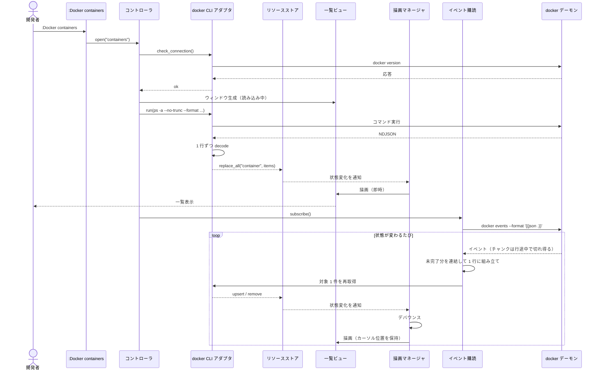
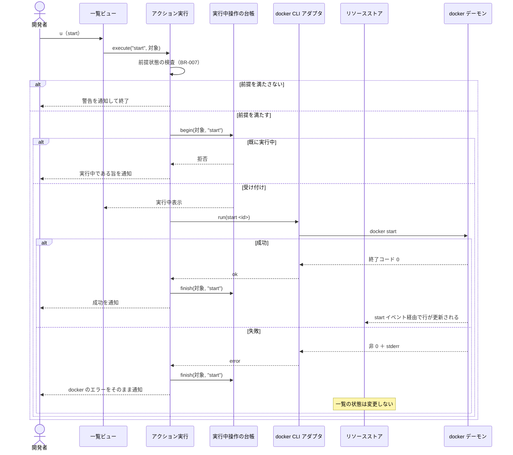
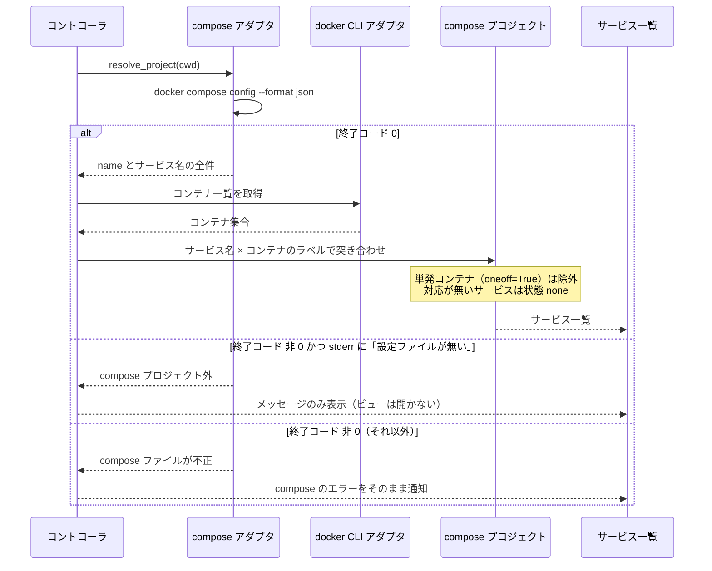
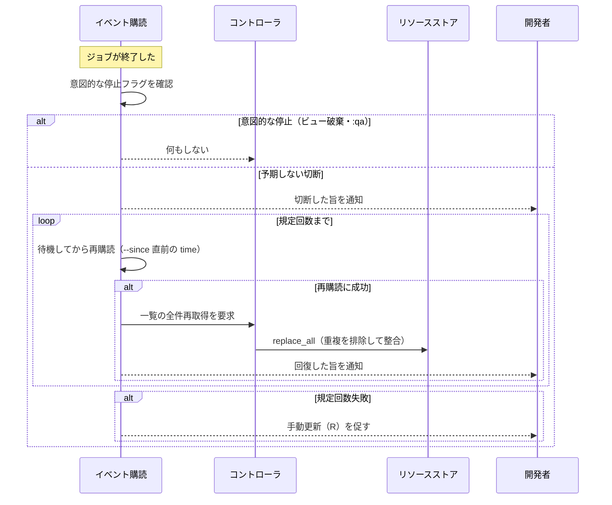

# docker.nvim アプリ詳細設計

- 種別: 詳細設計書（アプリケーション）
- 対象: docker.nvim
- 作成日: 2026-07-29
- 概要設計: [DESIGN.md](DESIGN.md) / インフラ詳細: [DESIGN_DETAIL_INFRA.md](DESIGN_DETAIL_INFRA.md)
- 前提: [USECASES.md](USECASES.md) / [DOMAIN_MODEL.md](DOMAIN_MODEL.md) / [FEASIBILITY.md](FEASIBILITY.md)

## 目次

- [1. プロジェクトセットアップ](#1-プロジェクトセットアップ)
- [2. ディレクトリ構造とモジュール責務](#2-ディレクトリ構造とモジュール責務)
- [3. モジュール間インターフェース](#3-モジュール間インターフェース)
- [4. データ構造](#4-データ構造)
- [5. docker コマンド仕様](#5-docker-コマンド仕様)
- [6. CLI インターフェース仕様](#6-cli-インターフェース仕様)
- [7. データフロー詳細](#7-データフロー詳細)
- [8. エラー戦略](#8-エラー戦略)
- [9. 検証手順](#9-検証手順)
- [10. テスト戦略](#10-テスト戦略)
- [11. 実装ガイド](#11-実装ガイド)

---

## 1. プロジェクトセットアップ

新規リポジトリに次の構成を作る。スキャフォールドツールは使わず、ファイルを直接作成する。

```bash
cd /Users/skanehira/dev/github.com/skanehira/docker.nvim

mkdir -p lua/docker/{resources,state,handlers,adapters/docker,views,ui} plugin doc tests scripts
```

作成する設定ファイル:

| ファイル | 用途 |
| --- | --- |
| `.luacheckrc` | luacheck の設定（`vim` をグローバルとして許可） |
| `stylua.toml` | 整形設定（インデント幅・行長） |
| `.luarc.json` | lua-language-server の設定（Neovim のランタイムパスを型解決に含める） |
| `Makefile` | `test` / `test-file` / `test-e2e` / `lint` / `format` / `format-check` / `typecheck` / `check` |
| `tests/minimal_init.lua` | テスト用の最小 init。plenary.nvim を `runtimepath` に追加する |

CI の定義ファイル（`.github/workflows/`）はアプリのセットアップに含めない。作成は [DESIGN_DETAIL_INFRA.md の 3. CI/CD パイプライン](DESIGN_DETAIL_INFRA.md#3-cicd-パイプライン) が扱う。

`make test-file` は、指定されたファイルが存在しない場合に非 0 で終了すること。ゴールの検証コマンドがファイル名を名指しするため、ファイル不在が「成功」と解釈されると検証が空虚になる。

初回の動作確認:

```bash
make test        # テストが 0 件でも正常終了すること
make lint        # luacheck が警告 0 で終了すること
make typecheck   # lua-language-server が診断 0 で終了すること
```

## 2. ディレクトリ構造とモジュール責務

テストは実装と同じディレクトリに `<名前>_spec.lua` として置く（コロケーション）。

```
plugin/docker.lua                  :Docker コマンドと <Plug> マッピングの定義
lua/docker/init.lua                setup / open / close、キーからアクションへのディスパッチ
lua/docker/config.lua              デフォルト設定・キーマップ定義・合成・検証
lua/docker/notify.lua              利用者への通知（情報・警告・エラー）
lua/docker/format.lua              出力テンプレートの組み立てと NDJSON の解析
lua/docker/resources/registry.lua  リソース種別ごとの宣言的定義
lua/docker/resources/fields.lua    生データから表示値を取り出すヘルパ（状態・ポート・経過時間）
lua/docker/state/store.lua         リソースストアと購読者への通知
lua/docker/state/view.lua          ビュー状態の生成と更新（不変更新）
lua/docker/state/stack.lua         ビュースタック
lua/docker/handlers/actions.lua    アクション名から実処理への振り分け
lua/docker/handlers/render.lua     描画要求の集約とデバウンス
lua/docker/handlers/lifecycle.lua  ビューの生成・表示・破棄とキーマップ設定
lua/docker/handlers/operations.lua 実行中操作の台帳
lua/docker/handlers/jobs.lua       ジョブ台帳（VimLeavePre で一括終了）
lua/docker/handlers/terminal.lua   ターミナルバッファでのコマンド実行
lua/docker/adapters/docker/cli.lua      docker コマンドの実行（単発）
lua/docker/adapters/docker/events.lua   docker events の購読と再購読
lua/docker/adapters/docker/compose.lua  docker compose CLI の実行と compose プロジェクトの解決
lua/docker/views/list.lua          一覧ビュー
lua/docker/views/inspect.lua       詳細ビュー
lua/docker/views/help.lua          ヘルプビュー
lua/docker/views/keymaps.lua       ビュー種別からキーマップを解決
lua/docker/ui/window.lua           ウィンドウの生成・リサイズ・重ね合わせ
lua/docker/ui/table.lua            カラム幅の算出と行の整形
lua/docker/ui/highlight.lua        ハイライトグループの定義と適用
tests/minimal_init.lua             テスト用の最小 init
tests/e2e/e2e_spec.lua             G_E2E の通しシナリオ
scripts/e2e.sh                     G_E2E の起動スクリプト
```

## 3. モジュール間インターフェース

主要な公開関数のシグネチャを定める。型は EmmyLua 注釈で記述し、`lua-language-server` の検査対象とする。

### 3.1 公開 API（利用者向け）

```lua
---@class docker.Config
---@field keymaps table<string, table<string, docker.KeyBinding>>  ビュー種別 → アクション名 → キー定義
---@field debug boolean|nil  デバッグログの出力（既定 false）

--- Neovim が 0.10 未満の場合はメッセージを通知し、コマンドとキーマップを登録せずに終了する
---@param opts docker.Config|nil
require("docker").setup(opts)

---@param kind string  "containers" | "images" | "volumes" | "networks" | "services"
require("docker").open(kind)

require("docker").close()
```

### 3.2 アダプタ層（外界との境界）

外界に触れる関数はすべてこの層に閉じ込め、テストから差し替えられるようにする。

```lua
-- adapters/docker/cli.lua
---@class docker.Result
---@field ok boolean
---@field data any        成功時の解析済みデータ
---@field error string|nil 失敗時のメッセージ（docker の stderr をそのまま入れる）
---@field code integer|nil 終了コード

---@param args string[]                    docker に渡す引数（"docker" 自体は含めない）
---@param on_done fun(result: docker.Result)
---@param opts { parse: "ndjson"|"json"|"raw"|nil, cwd: string|nil }|nil
M.run(args, on_done, opts)

---@param executor fun(cmd: string[], opts: table, on_exit: fun(out: table))
M._set_executor(executor)   -- テスト用の差し替え口

---@param on_done fun(result: docker.Result)  デーモン接続の可否を返す
M.check_connection(on_done)
```

```lua
-- adapters/docker/events.lua
---@class docker.EventSubscription
---@field stop fun()               意図的な停止（停止フラグを立ててからジョブを止める）
---@field is_alive fun(): boolean

---@param opts { since: string|nil, on_event: fun(ev: docker.Event), on_disconnect: fun(intentional: boolean) }
---@return docker.EventSubscription
M.subscribe(opts)
```

```lua
-- adapters/docker/compose.lua
---@class docker.ComposeProject
---@field name string
---@field working_dir string
---@field service_names string[]

---@param cwd string
---@param on_done fun(result: docker.Result)  data は docker.ComposeProject
M.resolve_project(cwd, on_done)

---@param subcommand string[]  例: { "up", "-d", "web" }
---@param cwd string
---@param on_done fun(result: docker.Result)
M.run(subcommand, cwd, on_done)
```

### 3.3 リソース定義

```lua
---@class docker.ColumnDef
---@field header string
---@field value fun(item: table): string

---@class docker.ResourceDefinition
---@field kind string                    "container" | "image" | "volume" | "network" | "service"
---@field display_name string
---@field list_args fun(): string[]      一覧取得の docker 引数
---@field id fun(item: table): string    識別子の取り出し
---@field columns docker.ColumnDef[]
---@field status_column integer|nil      ハイライト対象のカラム位置（1 始まり）
---@field status fun(item: table): string|nil
---@field event_type string|nil          docker events の Type との対応

---@param kind string
---@return docker.ResourceDefinition
registry.get(kind)

---@return string[]  :Docker のサブコマンド名一覧
registry.subcommands()
```

### 3.4 リソースストア

```lua
---@param kind string
---@param items table[]        一覧取得の結果で全置換する
store.replace_all(kind, items)

---@param kind string
---@param item table           1 件を追加または更新する
store.upsert(kind, item)

---@param kind string
---@param id string
store.remove(kind, id)

---@param kind string
---@return table[]
store.list(kind)

---@param listener fun(kind: string)   状態変化の通知先
---@return fun()                       購読解除関数
store.subscribe(listener)
```

## 4. データ構造

永続化を行わないため、データベーススキーマは存在しない。ここではメモリ上の構造を定義する。

### 4.1 コンテナ

一覧取得で得る全フィールド。値はすべて文字列で、数値化は表示側で行わない。

| フィールド | 由来 | 説明 | 空になる条件 |
| --- | --- | --- | --- |
| `id` | `.ID` | コンテナ ID（`--no-trunc` により完全長） | なし |
| `name` | `.Names` | コンテナ名 | なし |
| `image` | `.Image` | イメージ名 | なし |
| `state` | `.State` | `running` / `exited` / `paused` / `created` / `restarting` など | なし |
| `status` | `.Status` | 稼働時間を含む表示用文字列（例: `Up 5 days`） | なし |
| `ports` | `.Ports` | 公開ポートの一覧文字列 | 公開ポートが無い場合は空文字列 |
| `command` | `.Command` | 実行コマンド | なし |
| `created_at` | `.CreatedAt` | 作成日時 | なし |
| `compose_project` | `.Label "com.docker.compose.project"` | compose プロジェクト名 | 非 compose 由来のとき空文字列 |
| `compose_service` | `.Label "com.docker.compose.service"` | compose サービス名 | 同上 |
| `compose_oneoff` | `.Label "com.docker.compose.oneoff"` | `"True"` のとき単発コンテナ | 通常は空文字列 |

ラベル未設定時は `nil` ではなく空文字列が返る（PoC で確認済み）。compose 由来かの判定は `compose_project ~= "" and compose_service ~= ""` とし、`compose_oneoff == "True"` のコンテナはサービスに紐付けない（BR-006）。

### 4.2 イメージ / ボリューム / ネットワーク

| リソース | フィールド | 由来 |
| --- | --- | --- |
| イメージ | `id` / `repository` / `tag` / `created_since` / `size` | `.ID` / `.Repository` / `.Tag` / `.CreatedSince` / `.Size` |
| ボリューム | `name` / `driver` / `mountpoint` | `.Name` / `.Driver` / `.Mountpoint` |
| ネットワーク | `id` / `name` / `driver` / `scope` | `.ID` / `.Name` / `.Driver` / `.Scope` |

`docker image ls` は `.Label` を扱えないため、イメージにラベル由来のフィールドは持たせない（PoC で確認済み）。

### 4.3 compose サービス

| フィールド | 説明 |
| --- | --- |
| `project` | プロジェクト名（`docker compose config --format json` の `.name`） |
| `name` | サービス名（同 `.services` のキー） |
| `container` | 紐付くコンテナ（無ければ `nil`） |
| `status` | `container` があればそのコンテナの `state`、無ければ `"none"`（BR-005） |

### 4.4 イベント

```lua
---@class docker.Event
---@field type string    "container" | "image" | "volume" | "network"
---@field action string  "create" | "start" | "stop" | "die" | "destroy" | "pause" | "unpause" など
---@field id string      対象の ID。volume の場合は Actor.ID にボリューム名が入る
---@field time integer   秒精度の時刻。timeNano は浮動小数点化で桁が落ちるため使わない
```

### 4.5 状態変更操作の一貫性

データベースを持たないため、複数テーブルにまたがる書き込みトランザクションは存在しない。状態変更の一貫性は「1 回の docker コマンド実行」を単位として docker 側が保証する。書き込み系の操作と、その一貫性の単位を次に示す。

| 操作 | 対応キー | 実行するコマンド | 一貫性の単位 | 補足 |
| --- | --- | --- | --- | --- |
| コンテナの起動・停止・再起動・強制終了・一時停止・再開 | `u` / `d` / `r` / `<C-k>` / `p` / `P` | `docker start\|stop\|restart\|kill\|pause\|unpause <id>` | 単一コマンド | 前提状態の検査を事前に行う（BR-007） |
| コンテナ・イメージ・ボリューム・ネットワークの削除 | `<C-d>` | `docker rm\|rmi\|volume rm\|network rm <id>` | 単一コマンド | 強制削除オプションは付けない（BR-002） |
| 複数選択の一括削除 | Visual + `<C-d>` | 対象ごとに削除コマンド | 対象ごとに独立 | 一部失敗しても他は実行し、失敗分をまとめて通知する（原子性は保証しない） |
| サービスの起動・停止・再起動 | `u` / `d` / `r` | `docker compose up -d\|stop\|restart <service>` | 単一コマンド | デタッチで実行する（BR-023） |
| プロジェクトの起動・破棄 | `U` / `D` | `docker compose up -d` / `docker compose down` | 単一コマンド | 途中で失敗すると一部のサービスのみ起動した状態になり得る。一覧は実際の状態を反映する |
| 使い捨てコンテナの起動 | `r`（イメージ一覧） | `docker run --rm -it --entrypoint sh <image>` | 単一コマンド | ターミナルジョブとして起動し、シェル終了時に `--rm` で自動削除される。同一イメージからの複数起動は許可する（対象が毎回別のコンテナになるため BR-009 の排他対象にしない） |
| ファイルのコピー・書き戻し | `ct` / `cf` / `:w` | `docker cp` | 単一コマンド | — |

いずれの操作も、同一対象への同種の操作は同時に 1 つまでとする（BR-009）。この排他は実行中操作の台帳で行い、docker 側のロックには依存しない。

## 5. docker コマンド仕様

PoC で確定した形式をそのまま用いる。テンプレートの組み立てと NDJSON の解析は `lua/docker/format.lua` に集約する。外界に触れない純粋な文字列処理であり、アダプタ層（`adapters/docker/cli.lua`）とリソース定義（`resources/registry.lua`）の双方から使うため、どちらにも属さない共有の位置に置く。

### 5.1 一覧取得

コンテナの取得コマンド（`--no-trunc` は必須。既定では ID が 12 文字、Command が 20 文字に切り詰められる）:

```
docker ps -a --no-trunc --format '{"id":{{json .ID}},"name":{{json .Names}},"image":{{json .Image}},"state":{{json .State}},"status":{{json .Status}},"ports":{{json .Ports}},"command":{{json .Command}},"created_at":{{json .CreatedAt}},"compose_project":{{json (.Label "com.docker.compose.project")}},"compose_service":{{json (.Label "com.docker.compose.service")}},"compose_oneoff":{{json (.Label "com.docker.compose.oneoff")}}}'
```

- 各フィールドを `{{json ...}}` で個別にエスケープするため、値にカンマ・改行・引用符・バックスラッシュが含まれても 1 レコード 1 行が保たれる
- compose ラベルは `.Label` によるキー名指しで取る。`Labels` フィールドの分割は**行ってはならない**（値に含まれるカンマと、ラベル値に偽のラベルを仕込む攻撃の両方で誤った値を掴む）
- `.Size` は参照しない（参照するとサイズ計算が走り実行時間が増える）
- 他のリソースも同じ方式で、`docker image ls` / `docker volume ls` / `docker network ls` に `--format` を与える

出力は NDJSON として 1 行ずつ `vim.json.decode` する。空行は読み飛ばす。

### 5.2 イベント購読

```
docker events --format '{{json .}}'
```

- 単一のジョブで container / image / volume / network すべてのイベントを受け取る
- `on_stdout` のチャンクは行の途中で切れることがあるため、未完了分を保持して次のチャンクと連結してから解析する
- 再購読時は `docker events --since <直前に受信したイベントの time>` を使う。`time` は秒精度のため同一秒のイベントが重複する。重複は ID で排除するか、再購読直後に一覧を全件再取得して整合させる
- 停止は「意図的な停止フラグを立ててからジョブを止める」順序で行う。`jobstop` と外部からの終了がどちらも同じ終了コードになるため、フラグが無いと切断と区別できない

### 5.3 compose

```
docker compose config --format json
```

1 回の実行で次の 3 つを得る:

- **compose プロジェクト内かの判定**: 終了コード 0 なら内側。非 0 のときは stderr を見て 3 つに分ける（終了コードだけでは区別できない）
  - `'compose' is not a docker command` 相当 → **compose サブコマンドが利用できない**。その旨を通知し、コンテナ一覧など他の機能は引き続き使えるようにする（US-014）
  - `no configuration file provided` を含む → **compose プロジェクト外**
  - それ以外 → **compose ファイルが不正**。compose の stderr をそのまま提示する
- **プロジェクト名**: トップレベルの `name`
- **サービス名の全件**: `services` のキー（未起動のサービスも含む）

`config --services` は出力順が実行ごとに変わるため使わない。サービス操作は `docker compose <subcommand> <service>` を、ビューを開いた時点の作業ディレクトリで実行する（BR-003）。

### 5.4 その他の操作

| 目的 | コマンド |
| --- | --- |
| 詳細表示 | `docker inspect <id>` |
| ログ追従 | `docker logs -f <id>`（ターミナル） |
| シェル起動 | `docker exec -it <id> sh -c '<bash があれば bash、なければ sh>'`（ターミナル、BR-019） |
| コマンド実行 | `docker exec -it <id> <command>`（ターミナル） |
| 使い捨て実行 | `docker run --rm -it --entrypoint sh <image>`（ターミナル） |
| ファイルコピー | `docker cp <src> <dst>` |

## 6. CLI インターフェース仕様

このプロダクトは実行可能ファイルではなく Neovim プラグインであるため、インターフェースは「Ex コマンド」と「バッファローカルのキーマップ」の 2 つになる。

### 6.1 コマンド体系

| コマンド | 動作 |
| --- | --- |
| `:Docker containers` | コンテナ一覧を開く |
| `:Docker images` | イメージ一覧を開く |
| `:Docker volumes` | ボリューム一覧を開く |
| `:Docker networks` | ネットワーク一覧を開く |
| `:Docker services` | compose サービス一覧を開く |

引数なしの `:Docker` とサブコマンド補完は今回のスコープ外（[DESIGN.md の非ゴール](DESIGN.md#11-目的とスコープ)）。引数なしで呼ばれた場合は、使い方を示すメッセージを表示する。

### 6.2 キーマップ

すべてバッファローカルに設定する（BR-014）。`<Plug>` マッピングを経由し、利用者が個別に差し替えられるようにする。同じキーをビュー種別ごとに別の操作へ割り当てる（BR-015）。

**全一覧ビュー共通**

| キー | アクション | 説明 |
| --- | --- | --- |
| `<CR>` | `inspect` | 詳細を表示する |
| `R` | `refresh` | 一覧を再取得する |
| `<Tab>` | `switch_view` | 別のリソースの一覧へ切り替える |
| `?` | `help` | このビューのキー一覧を表示する |
| `q` | `close` | ビューを閉じる |
| `<C-f>` | `filter` | 名前で絞り込む（k8s.nvim と同じ割り当て。`/` は Neovim 本来の検索のまま残す） |

**コンテナ一覧（`container_list`）**

| キー | アクション | 説明 |
| --- | --- | --- |
| `u` | `start` | 起動する |
| `d` | `stop` | 停止する |
| `r` | `restart` | 再起動する |
| `<C-k>` | `kill` | 強制終了する |
| `p` | `pause` | 一時停止する |
| `P` | `unpause` | 一時停止を解除する |
| `a` | `shell` | コンテナ内でシェルを開く |
| `e` | `exec` | コンテナ内でコマンドを実行する |
| `t` | `logs` | ログを追従する |
| `<C-d>` | `delete` | 削除する（確認あり） |
| `ct` | `copy_to` | ホストからコンテナへコピーする |
| `cf` | `copy_from` | コンテナからホストへコピーする |
| `E` | `edit_file` | コンテナ内のファイルを編集する |
| `<C-o>` | `open_browser` | 公開ポートをブラウザで開く |
| `gd` | `drilldown` | このコンテナのイメージへ移動する |

**イメージ一覧（`image_list`）**

| キー | アクション | 説明 |
| --- | --- | --- |
| `r` | `quickrun` | 使い捨てコンテナでシェルを開く |
| `<C-d>` | `delete` | 削除する（確認あり） |
| `gd` | `drilldown` | このイメージを使うコンテナへ移動する |

**ボリューム一覧 / ネットワーク一覧（`volume_list` / `network_list`）**

| キー | アクション | 説明 |
| --- | --- | --- |
| `<C-d>` | `delete` | 削除する（確認あり） |

**compose サービス一覧（`service_list`）**

| キー | アクション | 説明 |
| --- | --- | --- |
| `u` | `up` | サービスを起動する |
| `d` | `stop` | サービスを停止する |
| `r` | `restart` | サービスを再起動する |
| `t` | `logs` | サービスのログを追従する |
| `U` | `project_up` | プロジェクト全体を起動する |
| `D` | `project_down` | プロジェクト全体を破棄する（確認あり） |
| `gd` | `drilldown` | このサービスのコンテナへ移動する |

**詳細ビュー / ヘルプビュー**: `q` で直前の一覧に戻る（BR-018）。

### 6.3 入出力

| 経路 | 用途 |
| --- | --- |
| 一覧・詳細・ヘルプのバッファ | リソースの表示。フロートウィンドウに表示し、`buftype=nofile` かつ `nomodifiable`（BR-017）。詳細・ヘルプは `zindex` で一覧の上に重ねる |
| ターミナルバッファ | ログ・シェル・コマンド実行・使い捨て実行の入出力 |
| `vim.notify` | 操作の成否、エラー、環境問題の通知 |
| `vim.ui.input` | パス・コマンド・削除確認の入力 |
| `vim.ui.select` | ポートの選択、切替先ビューの選択 |

### 6.4 終了コード体系

該当なし。Neovim プラグインは終了コードを返さないため、成否は `vim.notify` のメッセージ種別（情報・警告・エラー）で表現する。ただし G_E2E の検証スクリプト（`scripts/e2e.sh`）は終了コードを返し、`0`=全シナリオ成功、`1`=いずれかの assert 失敗、`2`=docker が利用できず検証を実行できない、とする。

### 6.5 メッセージ方針

| 状況 | 種別 | 内容 |
| --- | --- | --- |
| 操作の成功 | 情報 | 「`<名前>` を起動しました」のように対象名を含める |
| docker の失敗 | エラー | docker の標準エラー出力をそのまま提示する（BR-016） |
| 前提を満たさない操作 | 警告 | 「実行中ではないため kill できません」のように理由を示す |
| 環境問題 | エラー | docker 未検出・デーモン未起動・権限不足を区別した文言 |
| 実行中の重複要求 | 警告 | 「`<名前>` の `<操作>` は実行中です」 |

## 7. データフロー詳細

### 7.1 一覧を開いてライブ更新が始まるまで



### 7.2 コンテナ操作（前提検査・重複防止・失敗時）



### 7.3 compose サービス一覧の組み立て



### 7.4 イベント購読の切断と回復



## 8. エラー戦略

### 8.1 エラーの分類と扱い

| 分類 | 例 | 扱い |
| --- | --- | --- |
| 環境エラー（回復不能・利用者起因） | docker 未検出、デーモン未起動、ソケット権限不足 | 3 状況を区別した独自の文言で通知し、ビューを開かない（BR-016 の例外） |
| 環境エラー（compose のみ） | `docker compose` サブコマンドが利用できない | その旨を通知し、サービス一覧を開かない。他のリソースのビューは引き続き利用できる |
| 環境エラー（起動時） | Neovim が 0.10 未満 | `setup()` の時点で検出し、対応バージョンを示すメッセージを通知したうえで、コマンドとキーマップを登録せず機能を無効化する（以降どの操作でも実行時エラーを出さない） |
| 操作の前提エラー（回復可能・利用者起因） | 停止中コンテナへの kill、コンテナの無いサービスのログ | docker を呼ばずに警告を通知する（BR-007） |
| docker 実行エラー（回復可能） | 使用中イメージの削除、ポート競合、実行中コンテナの削除 | docker の stderr をそのまま通知し、内部状態は変更しない（BR-002, BR-016） |
| ストリーム切断（回復可能・システム起因） | デーモン再起動、ネットワーク断 | 自動再購読を試み、規定回数失敗したら手動更新を促す（BR-013） |
| 解析エラー（回復不能・システム起因） | docker の出力が JSON として解析できない | 該当行を読み飛ばし、読み飛ばした件数をデバッグログに残す。全件失敗した場合はエラーとして通知する |
| 重複要求（回復可能・利用者起因） | 実行中の操作に同じキーを再入力 | 警告を通知し、2 つ目のプロセスを起動しない（BR-009） |

### 8.2 リトライ

| 対象 | 方針 |
| --- | --- |
| 状態変更操作（start / stop / 削除など） | リトライしない。失敗は利用者に提示し、再実行は利用者の操作に委ねる（副作用のある操作を自動再試行しない） |
| イベント購読の再接続 | 待機時間を延ばしながら最大 5 回まで再試行する（1 秒 → 2 秒 → 4 秒 → 8 秒 → 16 秒）。5 回失敗したら諦めて手動更新を促す |
| 一覧の取得 | リトライしない。`R` による手動再取得を案内する |

### 8.3 結果の表現

例外を投げず、`{ ok, data, error, code }` の形（`docker.Result`）で返す。呼び出し側は `ok` の検査を強制される。`pcall` を使うのは `vim.json.decode` の呼び出し箇所に限る。

### 8.4 ログ出力

| レベル | 用途 |
| --- | --- |
| エラー | 利用者の操作が失敗した場合。`vim.notify` の ERROR |
| 警告 | 前提を満たさない操作、重複要求。`vim.notify` の WARN |
| 情報 | 操作の成功。`vim.notify` の INFO |
| デバッグ | 実行した docker コマンドと終了コード、解析に失敗した行数。設定で有効にしたときのみ出力する |

デバッグログは既定で無効とし、`setup({ debug = true })` で有効にする。docker コマンドの引数はそのまま出力してよい（認証情報を引数に取る操作を行わないため）。

## 9. 検証手順

[DESIGN.md のゴール](DESIGN.md#13-ゴール)と 1 対 1 で対応させる。すべてローカルと CI で実行できる。

ここで名指しするテストファイルは、[TODO.md](TODO.md) の各 [RED] タスクが作成するファイルと 1 対 1 で対応させる。`make test-file` は対象ファイルが存在しない場合に非 0 で終了するため、ファイル名の食い違いは検証の成功ではなく失敗として現れる。

- G1 検証: `make test-file FILE=lua/docker/views/list_spec.lua`（コンテナ一覧のカラム構成、compose 列の値、非 compose コンテナで空欄になること、0 件表示を検証）＋ `make test-file FILE=lua/docker/resources/registry_spec.lua`（一覧取得の引数に `-a` が含まれ、停止中のコンテナも取得対象になることを検証）
- G2 検証: `make test-file FILE=lua/docker/handlers/actions_spec.lua`（start / stop / restart / kill が発行する docker 引数、前提を満たさない操作の拒否、失敗時に状態を変えないことを検証）＋ `make test-file FILE=lua/docker/views/list_status_spec.lua`（ストアの状態変化が STATUS 列の表示とハイライトに反映されることを検証）
- G3 検証: `make test-file FILE=lua/docker/handlers/actions_delete_spec.lua`（確認プロンプトの応答ごとに、削除コマンドが発行される／されないことを検証）
- G4 検証: `make test-file FILE=lua/docker/handlers/terminal_spec.lua`（ターミナル起動時の引数と、バッファ破棄でジョブ台帳が空になることを検証）。台帳が空になることは実プロセスの不在を保証しないため、バッファを閉じたときに実プロセスが残らないことは G_E2E のシナリオ（ログ追従のターミナルを開いて閉じ、`docker logs -f` のプロセスが残っていないことを確認するステップ）で検証する
- G5 検証: `make test-file FILE=lua/docker/views/inspect_spec.lua`（詳細ビューの内容と、閉じたときのカーソル位置復元を検証）
- G6 検証: `make test-file FILE=lua/docker/resources/registry_spec.lua`（images / volumes / networks の一覧定義と削除コマンドを検証）＋ `make test-file FILE=lua/docker/handlers/actions_delete_spec.lua`（確認プロンプトを経る削除経路が全リソース種別で共通に働くことを検証）＋ `make test-file FILE=lua/docker/views/list_spec.lua`（各種別の一覧が描画されることを検証）
- G7 検証: `make test-file FILE=lua/docker/adapters/docker/compose_spec.lua`（`config --format json` の解析、compose 外／compose 不正／compose サブコマンド不在の 3 区分、未起動サービスが `none` になることを検証）
- G8 検証: `make test-file FILE=lua/docker/handlers/actions_compose_spec.lua`（サービス単位・プロジェクト単位の各キーが発行する compose 引数を検証）
- G9 検証: `make test-file FILE=lua/docker/adapters/docker/events_spec.lua`（チャンク分割された入力の組み立てと、イベントからストア更新までの経路を検証）＋ `make test-file FILE=lua/docker/handlers/render_spec.lua`（偽の時計でデバウンス幅を検査し、イベント受信から 1 秒以内に描画要求が出ることを検証）。実環境での 1 秒以内の反映は G_E2E でも確認する
- G10 検証: `make test-file FILE=lua/docker/handlers/actions_refresh_spec.lua`（`R` による再取得と再描画、カーソル位置の保持、購読が停止していた場合の再開を検証）＋ `make test-file FILE=lua/docker/adapters/docker/events_reconnect_spec.lua`（切断検知・自動再購読・手動更新への切り替えを検証）
- G11 検証: `make test-file FILE=lua/docker/adapters/docker/cli_spec.lua`（docker 未検出・デーモン未起動・権限不足の 3 状況で異なるメッセージが返ることを検証）＋ `make test-file FILE=lua/docker/adapters/docker/compose_spec.lua`（compose サブコマンド不在が他の 3 状況と区別されることを検証）
- G12 検証: `make test-file FILE=lua/docker/config_spec.lua`（設定の合成結果と、キーマップがバッファローカルであることを検証）＋ `make test-file FILE=lua/docker/views/help_spec.lua`（キーマップ定義からヘルプの一覧が生成されることを検証）
- G13 検証: `make test-file FILE=lua/docker/handlers/jobs_spec.lua`（`VimLeavePre` で全ジョブが停止されることを検証）。実プロセスの残留有無は G_E2E の手順 4 で確認する
- G_E2E 検証: `make test-e2e`（`scripts/e2e.sh` を実行する）

`scripts/e2e.sh` の内容:

1. docker が利用できることを確認する（できなければ終了コード 2）
2. 検証用の compose プロジェクトとスタンドアロンコンテナを一時ディレクトリに作成し起動する
3. headless の Neovim を起動し、実際の docker に対して次を通しで実行して各段階を assert する（Must の全ユースケースを網羅する）
   - `:Docker containers` を開き、停止中を含む全コンテナが表示され、compose 由来のコンテナに PROJECT / SERVICE が入り、非 compose のコンテナが空欄で表示されること（US-001）
   - 対象コンテナを停止 → 一覧の STATUS が変わること、再度起動できること（US-002）
   - ログ追従のターミナルを開き、閉じたときに `docker logs -f` のプロセスが残っていないこと（US-004、G4）
   - シェルを起動して終了できること、停止中のコンテナではシェルが開かないこと（US-005）
   - 詳細ビューを開いて閉じ、カーソル位置が戻ること（US-006）
   - 確認プロンプトを経てコンテナを削除でき、`y` 以外では削除されないこと（US-003）
   - `:Docker services` を開き、未起動のサービスが `none` で表示されること、サービス単位の起動が反映されること（US-008、US-009）
   - `U` でプロジェクトが起動し、`D` の確認を経て破棄され各サービスが `none` に戻ること（US-010）
   - `:Docker images` / `volumes` / `networks` が一覧表示され、イメージを削除できること（US-007）
   - `?` でヘルプが表示され、そのビューの有効なキーが並ぶこと（US-015）
   - 別プロセスでコンテナを停止し、1 秒以内に一覧へ反映されること（US-011）
   - `R` による再取得が動作すること（US-012）
   - docker のコマンド実行中に別バッファの編集操作が滞らないこと（US-013）
4. Neovim を終了し、プラグインが起動した子プロセスが 0 件であることを確認する（US-014 の環境エラー系は単体テストで検証するため、ここでは扱わない）
5. 検証用のコンテナ・イメージ・ボリューム・ネットワークをすべて削除する（失敗しても必ず実行する）

## 10. テスト戦略

### 10.1 テストの層

| 層 | 対象 | docker の要否 |
| --- | --- | --- |
| 単体 | リソース定義の変換、出力の解析、設定の合成、カラム整形、URL の組み立て | 不要 |
| 結合 | アクション → アダプタ → ストア → 描画の経路、イベント受信から再描画まで、ビュー遷移 | 不要（アダプタを差し替える） |
| E2E | G_E2E の通しシナリオ 1 本 | 必要 |

### 10.2 外部依存の差し替え

docker コマンドの実行・ジョブ起動・時刻・ターミナル生成は、すべてアダプタ層の差し替え口（`_set_executor` など）を通じて注入する。テストではあらかじめ用意した出力を返す偽の実行器を使う。モックライブラリは使わず、手書きの偽実装を優先する。

### 10.3 テストデータ

PoC で採取した実際の docker 出力を `tests/fixtures/` に置き、解析のテストに使う。特に次のケースを必ず含める。

- ラベル値にカンマ・引用符・改行を含むコンテナ
- ラベル値に偽の `com.docker.compose.project=` を仕込んだコンテナ（誤った値を掴まないことの検証）
- compose 由来でないコンテナ（compose 列が空文字列になること）
- 単発コンテナ（`oneoff=True` がサービスに紐付かないこと）
- 行の途中で分割されたイベントのチャンク列

### 10.4 実行コマンド

| コマンド | 内容 |
| --- | --- |
| `make test` | 単体・結合テストを全実行 |
| `make test-file FILE=<path>` | 単一ファイルの実行 |
| `make test-e2e` | G_E2E（docker が必要） |
| `make lint` | luacheck |
| `make format-check` | stylua の差分チェック |
| `make typecheck` | lua-language-server |
| `make check` | lint・format-check・typecheck・test をまとめて実行 |

CI での実行タイミングは [DESIGN_DETAIL_INFRA.md](DESIGN_DETAIL_INFRA.md#3-cicd-パイプライン) を参照。

## 11. 実装ガイド

### 11.1 採用パターン

| パターン | 適用箇所 | 意図 |
| --- | --- | --- |
| レジストリ（宣言的定義） | `resources/registry.lua` | リソース種別の追加を 1 箇所の定義追加で完結させ、ビューとハンドラの分岐を増やさない |
| アダプタ | `adapters/docker/` | 外界（docker コマンド）との境界を 1 箇所に集め、テストで差し替え可能にする |
| 結果型 | `docker.Result` | 例外に頼らず、呼び出し側に成否の検査を強制する |
| 観測者（Observer） | `state/store.lua` | ストアがビューを知らないまま更新を伝える |
| 状態からの投影 | `handlers/render.lua` → `views/` | 状態を唯一の源とし、描画をその関数として保つ |
| 台帳 | `handlers/jobs.lua`, `handlers/operations.lua` | 起動したジョブと実行中の操作を 1 箇所で追跡し、後始末と重複防止を確実にする |

### 11.2 実装の順序

依存の少ないところから積み上げ、各段階でテストが書ける状態を保つ。

1. アダプタ層（出力形式の組み立てと解析、コマンド実行、結果型）
2. リソース定義とリソースストア
3. UI ヘルパ（カラム整形、ウィンドウ）と一覧ビュー
4. コントローラとキーマップ、コンテナのアクション
5. イベント購読と描画のデバウンス、ジョブ台帳
6. compose アダプタとサービス一覧、compose のアクション
7. 詳細ビュー・ヘルプビュー、その他のリソース種別
8. 拡張機能（ファイル連携、ブラウザ起動、ビュー切替、絞り込みなど）

### 11.3 未確定要素

<!-- POC_NEEDED: id=container-file-edit, scope=コンテナ内ファイルの編集を BufWriteCmd での書き戻しで実現できるか検証, risk=low, blocker=false -->

コンテナ内ファイルの編集（US-023）は、`docker cp` で一時領域へ取得し、`docker://<container>/<path>` という名前のバッファで開き、`BufWriteCmd` で書き戻す方式を想定している。保存の横取りが期待どおり動くか、失敗時にバッファの変更が保持されるかは実装時に確認する。困難な場合は明示コマンドでの書き戻しに切り替える。

<!-- POC_NEEDED: id=large-list-performance, scope=コンテナ200件規模での一覧描画時間とデバウンス値の確定, risk=low, blocker=false -->

大量コンテナ時の描画性能（NFR-4）とデバウンスの具体値は、一覧ビューが動く段階で計測して確定する。目安は初回描画 500 ms 以内、イベント受信から反映まで 1 秒以内。

### 11.4 実装上の注意

PoC で判明した、踏みやすい落とし穴を列挙する。

- 一覧取得では `--no-trunc` を必ず付ける。付けないと ID が 12 文字、Command が 20 文字で切り詰められる
- `Labels` フィールドを分割してラベルを取り出してはならない。`.Label` によるキー名指しを使う
- イベントの `timeNano` は使わない（浮動小数点化で下位桁が落ちる）。再購読の起点には `time` を使う
- ボリュームのイベントでは名前が `Actor.Attributes.name` ではなく `Actor.ID` に入る
- イベント購読のジョブを止めるときは、先に意図的な停止フラグを立てる（終了コードだけでは外部要因の終了と区別できない）
- `docker events` にはデーモン全体のイベントが流れる（他プロセスの操作も混入する）。デバウンスを前提に組む
- 一覧のヘッダーはバッファに入れず `winbar` に置く。カーソル行とデータ行の添字が 1 対 1 になり、行番号の補正が不要になる
- ビューの重ね合わせは `zindex` で行う。上層を閉じたときに下層の内容とカーソル位置がそのまま残る
