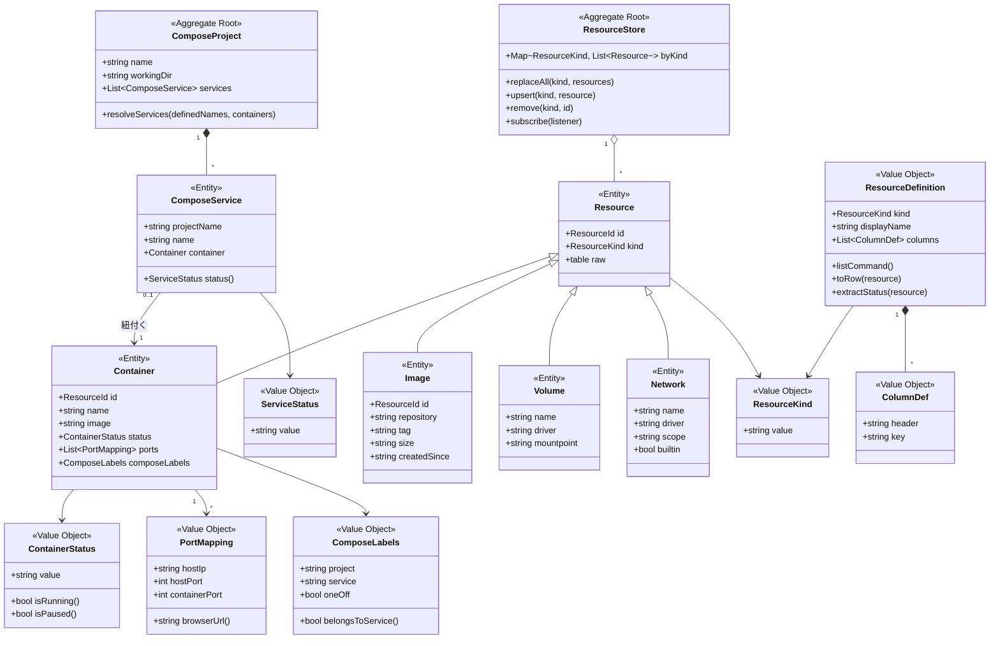
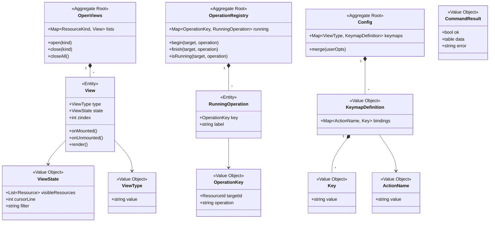

# ドメインモデル

- 種別: ドメインモデル
- 対象: docker.nvim
- 前提ドキュメント: [GLOSSARY.md](GLOSSARY.md), [USECASES.md](USECASES.md)
- 作成日: 2026-07-29
- 最終更新日: 2026-07-31

## モデリングの前提

docker.nvim は永続ストアを持たない。リソースの真の値は常に docker デーモン側にあり、プラグインが保持するのは「最後に観測した状態のコピー」である。したがって:

- **一貫性の境界はデータベースのトランザクションではなく、1 回の描画で矛盾なく見える範囲**である。集約は「同時に更新して同時に描画されるまとまり」として定義する
- **リソースの生成・削除の権限は docker 側にある**。プラグインは操作を要求し、結果はイベントまたは再取得を通じて観測する。プラグイン内でリソースを新規に作り出すことはない
- 「エンティティ」は識別子で同一性を判断するもの、「値オブジェクト」は属性の組で等価性を判断する不変のものとして分類する

## コンテキストの関係

```mermaid
graph LR
    subgraph 設定コンテキスト
        Config[設定]
        KeymapDef[キーマップ定義]
    end

    subgraph Docker リソースコンテキスト
        Store[リソースストア]
        Compose[compose プロジェクト]
        Ops[実行中操作の台帳]
    end

    subgraph ビュー表示コンテキスト
        OpenViews[開いているビュー]
        View[ビュー]
    end

    Docker[(docker CLI / デーモン)]

    Docker -->|一覧・イベント| Store
    Docker -->|サービス定義| Compose
    Store -->|状態変化の通知| View
    Compose -->|状態変化の通知| View
    Ops -->|実行中の表示| View
    KeymapDef -->|アクションとキー| View
    Config --> KeymapDef
    View -->|操作の要求| Ops
    Ops -->|docker コマンド| Docker
    OpenViews o-- View
```

依存の向きは「ビュー表示 → Docker リソース → docker CLI」の一方向とする。Docker リソースコンテキストはビューを知らない（状態変化の通知は購読者への通知として抽象化する）。

## 集約

| 集約ルート | 含むもの | 一貫性の範囲 | 変更のきっかけ |
| --- | --- | --- | --- |
| リソースストア | リソース種別ごとのリソース集合 | 1 つのリソース種別の一覧は、1 回の描画で矛盾なく見える | 一覧の再取得、docker イベントの受信 |
| compose プロジェクト | プロジェクト名と compose サービスの集合 | サービス集合とその状態は同時に更新される | サービス定義の再取得、コンテナ状態の変化 |
| 開いているビュー | リソース種別ごとの一覧ビュー（リソース種別 → 一覧ビュー 1 つの写像）と、その上に重ね合わせた詳細ビュー・ヘルプビュー | 同じリソース種別の一覧ビューは同時に 1 つしか存在せず、そのビュー状態と描画内容は常に整合する | ビューを開く・閉じる・切り替える |
| 実行中操作の台帳 | 実行中操作の集合 | 同一対象への同種の操作の重複を判定できる | 操作の開始・完了 |
| 設定 | 全ビュー種別のキーマップ定義 | 起動時に一度合成され、以後変わらない | `setup()` の呼び出し |

## クラス図





## エンティティと値オブジェクトの分類根拠

| 要素 | 分類 | 根拠 |
| --- | --- | --- |
| コンテナ / イメージ | エンティティ | ID で同一性を判断する。状態が変化しても同じコンテナである |
| ボリューム / ネットワーク | エンティティ | 名前で同一性を判断する。属性が同じでも名前が違えば別物 |
| compose サービス | エンティティ | プロジェクト名とサービス名の組で同一性を判断する。紐付くコンテナが入れ替わっても同じサービスである |
| compose プロジェクト | エンティティ（集約ルート） | プロジェクト名で同一性を判断し、サービス集合というライフサイクルを持つ |
| コンテナ状態 / サービス状態 | 値オブジェクト | 値そのものが意味を持ち、同じ文字列なら等価。変更ではなく置き換えで扱う |
| compose ラベル | 値オブジェクト | project / service / oneoff の組で等価性が決まる不変の値 |
| ポートマッピング | 値オブジェクト | ホスト IP・ポートの組で等価。単体で識別する必要がない |
| リソース定義 / カラム定義 | 値オブジェクト | 起動時に決まる不変の宣言。実行中に変化しない |
| ビュー | エンティティ | 一覧ビューはリソース種別で、詳細・ヘルプビューはウィンドウで個別に追跡され、状態を持つ |
| ビュー状態 | 値オブジェクト | 表示情報の組。更新は新しい値への置き換えで行い、ビューを閉じるときに破棄する |
| 実行中操作 | エンティティ | 対象と操作の組で識別され、開始から完了までのライフサイクルを持つ |
| コマンド結果 | 値オブジェクト | 1 回の実行結果を表す不変の値 |
| キーマップ定義 / キー | 値オブジェクト | 設定の合成結果として決まる不変の値。アクション名からキー文字列への対応だけを持ち、説明文は持たない |

## ドメインイベント

外部（docker デーモン）から届くイベントと、プラグイン内部で発生する通知を区別する。

| イベント | 発生源 | 契機 | 受け手と反応 |
| --- | --- | --- | --- |
| リソース状態変化 | docker デーモン | コンテナ・イメージ・ボリューム・ネットワークの create / start / stop / die / destroy など | リソースストアが該当リソースを更新し、購読者へ状態変化を通知する |
| ストリーム切断 | docker デーモン / ジョブ | イベント購読のプロセスが終了した | 再購読を試み、規定回数失敗したら手動更新を促す（BR-013） |
| ストア更新 | リソースストア | 一覧の再取得、リソースの追加・更新・削除 | ビューが描画を要求する（デバウンスされる） |
| 操作開始 | 実行中操作の台帳 | 操作が受け付けられた | ビューが実行中であることを表示する |
| 操作完了 | 実行中操作の台帳 | docker コマンドが終了した | ビューが実行中表示を解除し、結果を通知する |
| ビュー遷移 | 開いているビュー | ビューを開く・閉じる・切り替える | 対象ビューの `onMounted` / `onUnmounted` が呼ばれ、購読の開始・終了が行われる。切り替えは切替先の `onMounted` を終えてから元のビューの `onUnmounted` を呼ぶ |

## 不変条件

モデルが常に満たすべき条件。実装では該当箇所の検査として現れる。

| ID | 不変条件 | 対応するビジネスルール |
| --- | --- | --- |
| INV-1 | リソースストアには、同一リソース種別・同一識別子のリソースが 2 つ以上存在しない | — |
| INV-2 | compose サービスに紐付くコンテナは、同じプロジェクト名・サービス名のラベルを持ち、単発コンテナではない | BR-006 |
| INV-3 | compose サービスの状態は、紐付くコンテナがあればそのコンテナ状態、無ければ `none` である | BR-005 |
| INV-4 | 実行中操作の台帳に、同一の対象と操作の組が 2 つ以上存在しない | BR-009 |
| INV-5 | 一覧ビューのキーマップはその一覧バッファにローカルで、他のバッファ（詳細・ヘルプ・ターミナル・通常のバッファ）には及ばない。詳細ビュー・ヘルプビューが持つキーマップは、自分を閉じる `q` だけである | BR-014 |
| INV-6 | 一覧ビューは、リソース種別ごとに同時に 1 つしか存在しない | BR-010 |
| INV-7 | ビューが破棄されたとき、そのビューが開始したジョブは 1 つも残っていない | BR-011 |
| INV-8 | ビューに設定されているキーは、すべてそのビュー種別のキーマップ定義に存在するアクションに対応する | BR-015 |
| INV-9 | 詳細ビュー・ヘルプビューの `zindex`（詳細=150 / ヘルプ=200）は、一覧ビューの `zindex`（指定なしで Neovim 既定の 50）より常に大きい。重ね合わせた上層を閉じても下層の一覧は変更されない | BR-018 |

## 主要な振る舞い

| 振る舞い | 所属 | 内容 |
| --- | --- | --- |
| サービスの解決 | compose プロジェクト | 定義済みサービス名の一覧とコンテナ集合から、サービスとコンテナの対応を決める。単発コンテナは除外し、対応が無いサービスは `none` とする |
| 状態の取り出し | リソース定義 | 種別ごとに異なるリソースの生データから、ハイライト対象となる状態文字列を取り出す |
| 行への変換 | リソース定義 | リソースの生データをカラム定義に沿った表示値の並びに変換する |
| 操作の受け付け | 実行中操作の台帳 | 同一対象への同種の操作が実行中でないことを確かめてから受け付ける |
| ブラウザ URL の組み立て | ポートマッピング | バインドアドレスが `0.0.0.0` / `::` の場合に `localhost` へ読み替えて URL を作る |
| 設定の合成 | 設定 | 利用者の指定とデフォルトを深く合成し、未指定の項目にデフォルトを残す |
