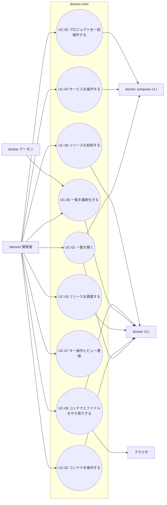

# ユースケース記述

- 種別: ユースケース記述
- 対象: docker.nvim
- 前提ドキュメント: [USER_STORIES.md](USER_STORIES.md)
- 作成日: 2026-07-29
- 最終更新日: 2026-07-31

## アクター

| 種類 | アクター | 説明 |
| --- | --- | --- |
| 主アクター | Neovim 開発者 | 一覧ビューを開き、キー操作でリソースを操作する人 |
| 主アクター | docker デーモン | UC-06（自動更新）でのみ主アクターとなる。状態変化をイベントとして送出し、一覧の更新を起動する |
| 副アクター | docker CLI / docker デーモン | `docker` コマンド経由でコンテナ・イメージ・ボリューム・ネットワークを操作し、状態変化をイベントとして通知する |
| 副アクター | docker compose CLI | `docker compose` サブコマンド経由で compose ファイルを解決し、サービス／プロジェクトを操作する |
| 副アクター | Neovim ランタイム | ジョブ実行（`vim.system` / `jobstart`）、バッファ・ウィンドウ、ターミナルを提供する |
| 副アクター | ブラウザ | OS のデフォルトブラウザ。公開ポートの URL を開く（UC-08） |

外部の Docker Engine API は直接叩かず、すべて docker CLI を介する（詳細な選定理由は DESIGN.md に記載する）。

## 用語

| 用語 | 定義 |
| --- | --- |
| リソース | docker が管理するコンテナ／イメージ／ボリューム／ネットワーク、および compose のサービス／プロジェクト |
| 一覧ビュー | あるリソース種別の一覧を表示する画面。リソース種別ごとに 1 つのバッファと、それを表示するウィンドウで構成する |
| 詳細ビュー | `docker inspect` の結果 JSON を表示する一時的な画面。一覧ビューの上に重ねて開き、`q` で閉じると下層の一覧ビューが現れる |
| ヘルプビュー | 現在のビューで有効な「キー」と「アクション名」を 2 列で表示する一時的な画面。一覧ビューの上に重ねて開き、`q` で閉じると下層の一覧ビューが現れる |
| ターミナルバッファ | ログ追従・シェル・コマンド実行に使う、ジョブの出力を表示するバッファ |
| 操作実行中 | ある対象に対する docker / compose の実行が完了していない状態。一覧上に表示し、同一対象の同種操作の二重起動を防ぐ（BR-009） |

「ビュー」は画面としての単位、「バッファ」「ウィンドウ」は Neovim の実体を指す語として使い分ける。

## ユースケース図

Neovim ランタイムはすべてのユースケースが利用するため、図では省略する。

---

## UC-01: リソース一覧を開く

- **対応ストーリー**: US-001, US-007（一覧部分）, US-008, US-013, US-014, US-018（一覧部分）, US-019（一覧部分）, US-026, US-032
- **主アクター**: Neovim 開発者
- **副アクター**: docker CLI, docker compose CLI, Neovim ランタイム
- **概要**: コンテナ／イメージ／ボリューム／ネットワーク／compose サービスのいずれかの一覧ビューを開く

**事前条件**:

- Neovim 0.10 以上が起動している
- `docker` コマンドが PATH 上にあり、デーモンに接続できる
- （サービス一覧の場合のみ）`docker compose` サブコマンドが使える

**事後条件（成功時）**:

- 該当リソースの一覧が専用ウィンドウに描画され、カーソルが先頭行にある
- 一覧バッファは編集不可（`buftype=nofile` かつ `nomodifiable`）であり、開発者の文字入力で内容が変わらない
- そのリソース種別に対応するキーマップがバッファローカルに設定されている
- 状態変化を受け取るための `docker events` の購読が開始されている

**基本フロー**:

1. 開発者が `:Docker containers`（または `images` / `volumes` / `networks` / `services`）を実行する。サブコマンドはコマンドライン補完で選べ、単数形のリソース種別名（`container` など）でも受け付ける
2. システムが `docker` コマンドの存在とデーモンへの接続可否を確認する
3. システムが docker CLI に一覧取得を非同期で要求する（コンテナの場合は停止中を含む全件）
4. docker CLI が JSON 形式で一覧を返す
5. システムが JSON を解析し、リソース種別ごとに定義されたカラムへ変換する
6. システムが一覧ウィンドウを生成する（最初の取得が成功してから開くため、「読み込み中」の状態は存在しない）
7. システムが一覧を描画し、状態カラムに状態別のハイライトを適用する
8. システムが `docker events` の購読を開始する（UC-06 へ接続）

**代替フロー**:

- **A1: 同じ一覧が既に開かれている**（ステップ 1 で分岐）
  1. システムが該当リソース種別のバッファが既に存在することを検出する
  2. システムが新規バッファを作らず、既存の一覧ウィンドウへカーソルを移動する
  3. → ユースケース終了（購読は 1 本のまま維持される）

- **A2: サービス一覧を開く**（ステップ 3 で分岐）
  1. システムが次の 3 つを並列に実行し、すべて揃うまで待つ
     - `docker compose ls -a --format json`: 全 compose プロジェクトの名前（`Name`）と compose ファイルのパス（`ConfigFiles`）。`-a` で停止中のプロジェクトも含む
     - `docker ps -a`: 全コンテナと、その compose ラベル（`com.docker.compose.project` / `com.docker.compose.service` / `com.docker.compose.project.working_dir`）
     - カレントディレクトリでの `docker compose config --format json`: カレントディレクトリのプロジェクト名（`.name`）と定義済みサービス名（`.services` のキー）。一度も起動していないプロジェクトはコンテナが無く `docker compose ls` にも現れないため、この経路でのみ一覧へ合流する。カレントディレクトリが compose プロジェクト外で失敗するのは正常系として扱い、通知しない
  2. システムがプロジェクト名で重複排除してプロジェクト集合を作る（カレントディレクトリ由来のものはサービス定義まで分かっているため、同名なら優先する）
  3. システムが各プロジェクトの compose ファイルの場所を、次の優先順で決める
     1. カレントディレクトリの `config` が解決したプロジェクトは、そのカレントディレクトリ（例: `/Users/me/shop`）
     2. そのプロジェクトのコンテナのラベル `com.docker.compose.project.working_dir`
     3. `docker compose ls` の `ConfigFiles` の先頭（カンマ区切り）のディレクトリ部分
     4. どれも得られなければ空文字列（場所が分からない）
  4. システムがサービス定義の分かっていないプロジェクトごとに、そのプロジェクトの compose ファイルの場所で `docker compose -p <project> config --format json` を並列に実行し、サービス定義を得る（ディレクトリ名から決まる既定のプロジェクト名と実際の名前がずれるため `-p` で名指しする）
  5. システムがコンテナ一覧の compose ラベルからサービスに対応するコンテナを解決し、コンテナが存在しないサービスを状態 `none` として表示する
  6. システムがプロジェクト名の昇順、同一プロジェクト内はサービス名の昇順に行を連結する
  7. → ステップ 6 に戻る

- **A3: compose ファイルの場所が分からないプロジェクトを組み立てる**（代替フロー A2 のステップ 4 で分岐）
  1. システムは `docker compose -p <project> config --format json` を実行しない（実行して失敗した場合も同じ経路に入る）
  2. システムがコンテナの `com.docker.compose.service` ラベルからサービス名を逆算し、コンテナが実在するサービスのみを行にする（定義されているが未起動のサービスは出ない）
  3. → 代替フロー A2 のステップ 6 に戻る

- **A4: 対象が 0 件**（ステップ 5 で分岐）
  1. システムが変換後の行が 0 件であることを検出する
  2. システムはウィンドウを開いたうえで、本文にリソース種別ごとの 0 件文言を 1 行だけ描く（コンテナ一覧は `コンテナがありません`、イメージ一覧は `イメージがありません`、ボリューム一覧は `ボリュームがありません`、ネットワーク一覧は `ネットワークがありません`、サービス一覧は `compose プロジェクトがありません`）。エラーとしては扱わない
  3. → ステップ 6 に戻る

**例外フロー**:

- **E1: docker コマンドが見つからない**（ステップ 2）
  1. システムが docker が PATH 上に無い旨を通知する
  2. システムはウィンドウを開かずに終了する

- **E2: docker デーモンに接続できない**（ステップ 2）
  1. システムがデーモンへ接続できない旨を通知する
  2. システムはウィンドウを開かずに終了する

- **E3: docker ソケットへの権限が無い**（ステップ 2）
  1. システムが権限不足である旨を、デーモン未起動とは区別できる文言で通知する
  2. システムはウィンドウを開かずに終了する

- **E4: compose サブコマンドが使えない**（代替フロー A2 のステップ 1）
  1. `docker compose ls -a --format json` が compose サブコマンドの不在で失敗する
  2. システムが `docker compose サブコマンドが使えません。compose プラグインの導入を確認してください。` を通知する
  3. システムはサービス一覧を開かずに終了する。コンテナ一覧など他のビューは引き続き利用できる

- **E5: カレントディレクトリの compose ファイルの記述が不正**（代替フロー A2 のステップ 1）
  1. カレントディレクトリでの `docker compose config --format json` が記述エラーで失敗する
  2. システムはサービス一覧を開いたうえで、docker の標準エラー出力をそのまま警告として通知する（BR-016）
  3. システムは同じ文言を繰り返さない（イベントによる取り直しのたびには通知しない）
  4. → 代替フロー A2 のステップ 2 に戻る（他のプロジェクトは通常どおり一覧に出る）

- **E6: 一覧取得コマンドが失敗する**（ステップ 4）
  1. システムが docker の標準エラー出力を通知する
  2. システムはウィンドウを開かずに終了する（空のフロートを残さない）。サービス一覧では `docker compose ls -a --format json`（理由を問わない）または `docker ps -a --no-trunc --format ...` の失敗がこれに当たる
  3. 既に開いている一覧での取得失敗（`R` による再取得やイベント由来の取り直し）はここではなく UC-06 が扱い、直前の内容を保ったまま通知だけを行う

- **E7: 引数が無い、または受け付けられない引数が渡される**（ステップ 1）
  1. システムが引数からリソース定義を引けないことを検出する（`:Docker` を引数なしで実行した場合も同じ経路に入る）
  2. システムが `使い方: :Docker {containers|images|volumes|networks|services}` を警告として通知する（文言はリソース定義の一覧から組み立てる）
  3. システムは docker へ問い合わせずに終了する

---

## UC-02: コンテナのライフサイクルを操作する

- **対応ストーリー**: US-002, US-003, US-025, US-029（コンテナの一括削除）, US-030
- **主アクター**: Neovim 開発者
- **副アクター**: docker CLI
- **概要**: 一覧上のコンテナを start / stop / restart / kill / pause / unpause / 削除する

**事前条件**:

- コンテナ一覧ビューが開かれ、操作対象の行にカーソルがある

**事後条件（成功時）**:

- 対象コンテナの状態が要求どおりに変化している
- `docker events` 経由で一覧の該当行が更新されている（削除時は行が消えている）

**基本フロー**:

1. 開発者が対象コンテナの行にカーソルを合わせる
2. 開発者が操作キー（`u`=start / `d`=stop / `r`=restart / `<C-k>`=kill / `p`=pause / `P`=unpause）を押す
3. システムがカーソル行から対象コンテナを特定する
4. システムが操作の前提条件（対象の現在状態）を検証する
5. システムが対象を「操作実行中」として記録し、その旨を表示する
6. システムが対応する docker コマンドを非同期で実行する
7. docker CLI が操作を完了する
8. システムが実行中の記録を解除し、成功メッセージを通知する
9. docker デーモンが状態変化イベントを発行し、一覧が更新される（UC-06）

**代替フロー**:

- **A1: コンテナを削除する**（ステップ 2 で分岐）
  1. 開発者が `D` を押す
  2. システムが対象名を含む削除確認のプロンプトを表示する
  3. 開発者が `y` を入力する
  4. → ステップ 5 に戻る（`docker rm` を実行する。強制削除オプションは付けない）

- **A2: 削除をキャンセルする**（代替フロー A1 のステップ 3）
  1. 開発者が `n` を入力する、または空のまま確定する
  2. システムは何も実行せずに終了する

- **A3: 複数行を選択して一括削除する**（ステップ 1 で分岐）
  1. 開発者が Visual モードで複数行を選択して `D` を押す
  2. システムが対象件数を含む確認プロンプトを表示する
  3. 開発者が `y` を入力する
  4. システムが対象ごとに削除を実行し、成功したものと失敗したものを集計する
  5. システムが失敗した対象を名前付きでまとめて通知する

**例外フロー**:

- **E1: 操作の前提を満たさない**（ステップ 4）
  1. 停止中のコンテナに対する kill / pause / シェル起動、一時停止していないコンテナに対する unpause、実行中のコンテナの削除など、docker が受け付けない操作を検出する
  2. システムがその旨のエラーを通知し、docker コマンドを実行せずに終了する

- **E2: docker コマンドが失敗する**（ステップ 7）
  1. docker CLI が非 0 の終了コードとエラーメッセージを返す（例: ホスト側ポートの占有、実行中コンテナの削除）
  2. システムが実行中の記録を解除し、docker のエラーメッセージをそのまま通知する
  3. システムは一覧の状態を変更しない

- **E3: 同じ対象への操作が既に実行中**（ステップ 5）
  1. システムが対象が実行中として記録済みであることを検出する
  2. システムが実行中である旨を通知し、2 つ目のプロセスは起動しない

---

## UC-03: リソースを調査する（ログ・シェル・詳細）

- **対応ストーリー**: US-004, US-005, US-006, US-017, US-018（詳細部分）, US-019（詳細部分）, US-020
- **主アクター**: Neovim 開発者
- **副アクター**: docker CLI, Neovim ランタイム
- **概要**: コンテナのログ追従・シェル起動・コマンド実行、イメージからの使い捨てコンテナ起動、および各リソースの inspect 表示を行う

**事前条件**:

- いずれかの一覧ビューが開かれ、対象行にカーソルがある
  - ログ追従・シェル起動・コマンド実行: コンテナ一覧
  - 使い捨てコンテナの起動: イメージ一覧
  - 詳細表示: コンテナ／イメージ／ボリューム／ネットワーク／サービスのいずれかの一覧（サービスは docker のオブジェクトではないため、紐付くコンテナの詳細に読み替える）
- シェル起動・コマンド実行の場合、対象コンテナが実行中である

**事後条件（成功時）**:

- ログ／シェル／使い捨てコンテナの場合: ターミナルバッファが開き、対応する docker プロセスが動作している
- 詳細表示の場合: JSON がシンタックスハイライト付きの詳細ビューとして一覧ビューの上に重なり、`q` で閉じると下層の一覧ビューが現れる

**基本フロー（ログ追従）**:

1. 開発者が対象コンテナの行で `t` を押す
2. システムがカーソル行から対象コンテナを特定する
3. システムがターミナルバッファを開き、`docker logs -f <container>` をジョブとして起動する
4. システムがログ出力をターミナルバッファに流し続ける
5. 開発者がバッファを閉じる
6. システムがジョブを終了し、プロセスを残さない

**代替フロー**:

- **A1: シェルを開く**（ステップ 1 で分岐）
  1. 開発者が `a` を押す
  2. システムが対象が実行中であることを確認する
  3. システムがターミナルバッファで `docker exec -it` を起動し、bash が存在すれば bash、なければ sh を実行する

- **A2: 任意コマンドを実行する**（ステップ 1 で分岐）
  1. 開発者が `e` を押す
  2. システムが実行するコマンドの入力を求める
  3. 開発者がコマンドを入力する
  4. システムがターミナルバッファで `docker exec -it <container> <command>` を実行する

- **A3: 詳細を表示する**（ステップ 1 で分岐）
  1. 開発者が `<CR>` を押す
  2. システムが `docker inspect <target>` を非同期で実行する
  3. システムが結果を JSON として詳細ビューに表示し、シンタックスハイライトを適用する。詳細ビューは一覧ビューの上に重ねて開く
  4. 開発者が `q` を押すと、システムは詳細ビューを閉じる。下層の一覧ビューには触っていないため、内容とカーソル位置がそのまま現れる

- **A4: 入力をキャンセルする**（代替フロー A2 のステップ 3）
  1. 開発者が空のまま確定する、または中断する
  2. システムは何も実行せずに終了する

- **A5: イメージから使い捨てコンテナを起動する**（ステップ 1 で分岐、イメージ一覧のみ）
  1. 開発者がイメージの行で `r` を押す
  2. システムがターミナルバッファで `docker run --rm -it --entrypoint sh <image>` を実行する（`--entrypoint sh` でイメージ本来のエントリポイントを置き換えないと、シェルではなくそのイメージのプロセスが起動してしまう）
  3. 開発者が `exit` でシェルを終了すると、`--rm` によりコンテナが削除され、コンテナ一覧に残らない

- **A6: サービスの詳細を表示する**（代替フロー A3 のステップ 1 で分岐、サービス一覧のみ）
  1. システムがカーソル行のサービスに紐付くコンテナ ID を取り出す
  2. システムが `docker inspect <container>` を実行し、そのコンテナの詳細ビューを開く（サービスは docker のオブジェクトではないため、inspect の対象をコンテナへ読み替える）
  3. → 代替フロー A3 のステップ 3 に戻る

**例外フロー**:

- **E1: 対象コンテナが実行中でない**（代替フロー A1 のステップ 2 / A2）
  1. システムが実行中でない旨のエラーを通知する
  2. システムはターミナルバッファを開かずに終了する

- **E2: inspect が失敗する**（代替フロー A3 のステップ 2）
  1. 対象が既に削除されている等の理由で docker が失敗する
  2. システムが docker のエラーメッセージを通知し、詳細ビューは開かない

- **E3: Neovim 終了時にジョブが残る**（ステップ 4 の最中に `:qa`）
  1. システムが Neovim 終了時のイベントを検知する
  2. システムが起動中のログ・ターミナルジョブをすべて終了させる

- **E4: 使い捨てコンテナのシェルが起動できない**（代替フロー A5 のステップ 2）
  1. イメージにシェルが含まれない等の理由で docker が失敗する
  2. システムが docker のエラー出力をターミナルバッファに表示する
  3. `--rm` によりコンテナは残らず、コンテナ一覧にも現れない

- **E5: サービスに紐付くコンテナが無い**（代替フロー A6 のステップ 1）
  1. システムが対象サービスのコンテナ ID が空であることを検出する
  2. システムが `<サービス名> は起動していないため詳細を表示できません` と警告し、`docker inspect` を実行せずに終了する

---

## UC-04: compose サービスを操作する

- **対応ストーリー**: US-009
- **主アクター**: Neovim 開発者
- **副アクター**: docker compose CLI, docker CLI
- **概要**: サービス一覧上のサービスを up / stop / restart し、ログを追う

**事前条件**:

- サービス一覧ビューが開かれ、対象サービスの行にカーソルがある

**事後条件（成功時）**:

- 対象サービスに対応するコンテナが要求どおりの状態になっている
- サービス一覧の状態表示が更新されている

**基本フロー**:

1. 開発者が対象サービスの行にカーソルを合わせる
2. 開発者が操作キー（`u`=up / `d`=stop / `r`=restart）を押す
3. システムがカーソル行から対象のプロジェクト名とサービス名を特定する
4. システムが対象を「操作実行中」として記録し、その旨を表示する
5. システムが `docker compose -p <project> <subcommand> <service>` を非同期で実行する（up は `-d` を付けてデタッチ実行し、compose ファイルの定義が要るため行のプロジェクトの compose ファイルの場所を実行時の作業ディレクトリにする。stop / restart はプロジェクト名の名指しだけで足りるため、実行時の作業ディレクトリを指定しない）
6. compose CLI が操作を完了する
7. システムが実行中の記録を解除し、結果を通知する
8. コンテナの状態変化イベントによりサービス一覧の状態が更新される（UC-06）

**代替フロー**:

- **A1: サービスのログを追う**（ステップ 2 で分岐）
  1. 開発者が `t` を押す
  2. システムが対象サービスにコンテナが存在することを確認する
  3. システムがターミナルバッファで `docker compose -p <project> logs -f <service>` を起動する（実行時の作業ディレクトリは指定しない）

**例外フロー**:

- **E1: 対象サービスにコンテナが存在しない**（代替フロー A1 のステップ 2）
  1. システムがコンテナが無い旨を通知する
  2. システムはターミナルバッファを開かずに終了する

- **E2: compose コマンドが失敗する**（ステップ 6）
  1. イメージの取得失敗・compose ファイルの記述エラー等で compose CLI が失敗する
  2. システムが実行中の記録を解除し、compose の標準エラー出力を通知する

- **E3: 同じサービスへの操作が既に実行中**（ステップ 4）
  1. システムが対象が実行中として記録済みであることを検出する
  2. システムが実行中である旨を通知し、2 つ目のプロセスは起動しない

- **E4: compose ファイルの場所が分からないプロジェクトのサービスを起動する**（ステップ 5）
  1. システムが行のプロジェクトの compose ファイルの場所が空であることを検出する
  2. システムが `<サービス名> は compose ファイルの場所が分からないため起動できません` と警告し、docker を実行せずに終了する
  3. stop / restart / ログはプロジェクト名の名指しだけで足りるため、この制約を受けない

---

## UC-05: compose プロジェクトを一括操作する

- **対応ストーリー**: US-010, US-025
- **主アクター**: Neovim 開発者
- **副アクター**: docker compose CLI
- **概要**: カーソル行のプロジェクト全体を `up -d` で起動、または `down` で停止・破棄する

**事前条件**:

- サービス一覧ビューが開かれ、操作したいプロジェクトのサービス行にカーソルがある

**事後条件（成功時）**:

- `up` の場合: 対象プロジェクトの全サービスのコンテナが作成・起動されている
- `down` の場合: 対象プロジェクトのコンテナとネットワークが破棄され、そのプロジェクトの全サービスが `none` になっている

**基本フロー（プロジェクト起動）**:

1. 開発者がサービス一覧で `U` を押す
2. システムがカーソル行から対象のプロジェクト名と compose ファイルの場所を特定する（場所が空なら E3 へ分岐する。実行中の表示より前に判定するため、拒否されたときは実行中表示が出ない）
3. システムがそのプロジェクトの操作が実行中であることを表示し、compose ファイルの場所で `docker compose -p <project> up -d` を非同期で実行する
4. compose CLI がイメージの取得・コンテナの作成・起動を行う
5. システムが完了を検知し、実行中表示を解除して結果を通知する
6. 各コンテナの起動イベントにより一覧が順次更新される（UC-06）

**代替フロー**:

- **A1: プロジェクトを破棄する**（ステップ 1 で分岐）
  1. 開発者が `D` を押す
  2. システムが対象プロジェクト名を含む破棄の確認プロンプトを表示する
  3. 開発者が `y` を入力する
  4. システムが `docker compose -p <project> down` を非同期で実行する（実行時の作業ディレクトリは指定しない）
  5. → ステップ 5 に戻る

- **A2: 破棄をキャンセルする**（代替フロー A1 のステップ 3）
  1. 開発者が `n` を入力する、または空のまま確定する
  2. システムは何も実行せずに終了する

**例外フロー**:

- **E1: 実行中に同じ操作が要求される**（ステップ 2）
  1. システムがプロジェクト操作が実行中であることを検出する
  2. システムが実行中である旨を通知し、2 つ目のプロセスは起動しない

- **E2: compose の実行が失敗する**（ステップ 4）
  1. イメージの取得失敗・ポート競合等で compose CLI が失敗する
  2. システムが実行中表示を解除し、compose の標準エラー出力を通知する
  3. 一部のサービスだけ起動した状態になり得るため、一覧は実際の状態を反映する

- **E3: compose ファイルの場所が分からないプロジェクトを起動する**（ステップ 3）
  1. システムが対象プロジェクトの compose ファイルの場所が空であることを検出する
  2. システムが `<プロジェクト名> は compose ファイルの場所が分からないため起動できません` と警告し、docker を実行せずに終了する
  3. 破棄（`down`）はプロジェクト名の名指しだけで足りるため、この制約を受けない

---

## UC-06: 一覧を最新の状態に保つ

- **対応ストーリー**: US-011, US-012, US-027
- **主アクター**: Neovim 開発者（手動更新時）／docker デーモン（自動更新時のイベント送出元）
- **副アクター**: docker CLI, Neovim ランタイム
- **概要**: `docker events` の購読による自動更新と、`R` キーによる手動再取得

**事前条件**:

- いずれかの一覧ビューが開かれている

**事後条件（成功時）**:

- 一覧の内容が docker の実際の状態と一致している（自動更新の場合、イベント受信から 1 秒以内に反映される）
- カーソル位置が保持されている

**基本フロー（自動更新）**:

1. システムが一覧ビューの表示開始時に `docker events` の購読ジョブを起動する
2. docker デーモンが状態変化（create / start / stop / die / destroy など）をイベントとして送出する
3. システムがイベントを受信し、対象リソースの種別と ID を解析する
4. システムが対象リソースの最新情報を取得し、内部状態を更新する
5. システムが再描画を要求する（短時間に連続するイベントはデバウンスして 1 回にまとめる）
6. システムが一覧を再描画し、カーソル位置を復元する

**代替フロー**:

- **A1: 手動で再取得する**（任意のタイミング）
  1. 開発者が `R` を押す
  2. システムが一覧全体を docker から再取得する
  3. システムが内部状態を置き換えて再描画し、カーソル位置を復元する
  4. イベント購読が停止していた場合は、あわせて購読を再開する

- **A2: サービス一覧を更新する**（ステップ 3 で分岐）
  1. システムがコンテナのイベントを受け取る（サービスの状態はコンテナの状態から決まるため、購読するのはコンテナのイベントである）
  2. システムが一覧を組み立て直す（UC-01 の代替フロー A2 の手順を、一覧を開いた時点のカレントディレクトリのまま再実行する）
  3. システムが再描画し、カーソル位置を復元する
  4. 組み立てのたびに出る警告（例: カレントディレクトリの compose ファイルの記述エラー）は、直前と同じ文言なら通知しない

- **A3: ビューを破棄する**
  1. 開発者がビューを閉じる（`q` / `:bd` / タブを閉じる のいずれか）
  2. システムが該当ビューのイベント購読ジョブを終了する

- **A4: Neovim を終了する**
  1. 開発者が `:qa` を実行する
  2. システムが購読ジョブとターミナルジョブをすべて終了させ、孤児プロセスを残さない

**例外フロー**:

- **E1: イベントストリームが切断される**（ステップ 2）
  1. docker デーモンの再起動などでストリームが切れる
  2. システムが切断を検知し、その旨を通知する
  3. システムが待機時間を空けて再購読を試み、成功したら一覧を再取得して整合させる
  4. 再購読に規定回数失敗したら、システムが購読を諦め、`R` による手動更新を促すメッセージを表示する

- **E2: イベント受信時のリソース取得が失敗する**（ステップ 4）
  1. 対象が既に削除されている等の理由で取得に失敗する
  2. システムはその対象を一覧から除外し、エラーは通知しない（イベントと実状態の競合は正常な状況として扱う）

---

## UC-07: キー操作の確認・変更とビュー遷移

- **対応ストーリー**: US-015, US-016, US-024, US-031
- **主アクター**: Neovim 開発者
- **副アクター**: Neovim ランタイム
- **概要**: ビューで使えるキーをヘルプで確認し、`setup()` で変更する。ビュー間の切り替えと絞り込みも含む

**事前条件**:

- （ヘルプ／切替／絞り込み）いずれかの一覧ビューが開かれている
- （キー変更）`setup()` を呼び出せる設定ファイルがある

**事後条件（成功時）**:

- ヘルプ: 現在のビューで有効な「キー」と「アクション名」の 2 列がヘルプビューに表示されている
- キー変更: 変更後のキーで操作が実行され、デフォルトキーでは実行されない
- キー未設定: `setup()` を呼ばなくても、デフォルトのキーマップで全操作が利用できる
- ビュー切替: 選んだリソースの一覧のフロートが開き、切替前のフロートが閉じている

**基本フロー（ヘルプ表示）**:

1. 開発者が一覧ビューで `?` を押す
2. システムが現在のビュー種別に対して設定されているキーマップ定義を取得する
3. システムが「キー」と「アクション名」の 2 列（`u` → `start` など）をキー順に並べ、一覧ビューの上に重ねたヘルプビューとして表示する。キーマップ定義は説明文を持たないため、日本語の操作説明は出さない
4. 開発者が `q` を押すと、システムはヘルプビューを閉じる。下層の一覧ビューには触っていないため、内容とカーソル位置がそのまま現れる

**代替フロー**:

- **A1: キーマップを変更する**（プラグイン読み込み時）
  1. 開発者が `setup()` にビュー種別ごとのキー設定を渡す
  2. システムがデフォルト設定と利用者設定を深くマージする
  3. システムが一覧ビューを開く際、マージ結果に基づいてバッファローカルのキーマップを設定する
  4. 指定のなかったビュー・操作はデフォルトのキーのまま動作する

- **A2: ビューを切り替える**（ステップ 1 で分岐）
  1. 開発者がビュー切替キー（`<Tab>`）を押し、移動先のリソース種別を選ぶ
  2. システムが移動先の一覧のフロートを開く（UC-01 の手順を再利用する）
  3. 開き終えてから、システムが切替前のビューを閉じる（先に開いてから閉じるため、開けなかったときは切替前のビューが残る）
  4. 閉じたビューのビュー状態は破棄する。そのビューへ戻ったときは開き直しになり、カーソルは先頭行に置かれる（切替前のカーソル位置は復元しない）

- **A3: 一覧を絞り込む**（ステップ 1 で分岐）
  1. 開発者が `<C-f>` を押し、プロンプト `絞り込み (空で解除): ` に文字列を入力する（`/` は割り当てず、Neovim 本来の検索のままにする）
  2. システムが、表示中のカラムの値のいずれか 1 つでもその文字列を含む行だけを描画する（大文字小文字は区別しない。例: コンテナ一覧で `nginx` と入力すると、NAME が `web` でも IMAGE が `nginx:latest` の行は残る）
  3. システムがカーソルを先頭行へ戻す（絞り込みで行と項目の対応が変わるため）
  4. 開発者が `<C-f>` を押し、プロンプトを空のまま確定すると、システムは絞り込みを解除して全行を再描画する

**例外フロー**:

- **E1: 切替先がサービス一覧で、compose サブコマンドが使えない**（代替フロー A2 のステップ 2）
  1. システムが `docker compose サブコマンドが使えません。compose プラグインの導入を確認してください。` を通知する（UC-01 E4）
  2. 切替先が開けなかったため、システムは切替前のビューを閉じずに維持する

- **E2: `setup()` に未知のビュー種別・操作名が指定される**（代替フロー A1 のステップ 2）
  1. システムが不正な設定項目を通知する
  2. システムは該当項目を無視し、残りの設定とデフォルトで動作を継続する

- **E3: 絞り込みの結果が 0 件**（代替フロー A3 のステップ 2）
  1. システムが見出し（winbar）を残したまま、本文にリソース種別ごとの 0 件文言を 1 行だけ描く（コンテナ一覧なら `コンテナがありません`）
  2. 絞り込み専用の文言は持たないため、この表示は「そのリソースが本当に 0 件」（UC-01 A4）と同じになる。区別は入力した絞り込みの語を覚えているかどうかに委ねる
  3. システムは絞り込みの語を保持し、空文字列での解除で全行に戻せる状態を保つ

---

## UC-08: コンテナとファイルをやり取りする

- **対応ストーリー**: US-021, US-022, US-023
- **主アクター**: Neovim 開発者
- **副アクター**: docker CLI, Neovim ランタイム, ブラウザ
- **概要**: ホスト⇄コンテナのファイルコピー、コンテナ内ファイルの編集、公開ポートのブラウザ起動

**事前条件**:

- コンテナ一覧ビューが開かれ、対象コンテナの行にカーソルがある

**事後条件（成功時）**:

- コピー: 指定先にファイルが存在する
- 編集: 保存操作でコンテナ内のファイルが更新されている
- ブラウザ: 対象ポートの URL がブラウザで開かれている

**基本フロー（ファイルコピー）**:

1. 開発者が `ct`（ホスト→コンテナ）または `cf`（コンテナ→ホスト）を押す
2. システムがコピー元とコピー先のパスの入力を求める
3. 開発者がパスを入力する
4. システムが `docker cp` を非同期で実行する
5. システムが完了メッセージを通知する

**代替フロー**:

- **A1: コンテナ内のファイルを編集する**（ステップ 1 で分岐）
  1. 開発者が `E` を押し、コンテナ内のパスを入力する
  2. システムが `docker cp` でファイルを一時領域へ取得する
  3. システムが `docker://<container>/<path>` という名前のバッファでその内容を開く（バッファ名にコンテナを含むため、同じパスを別コンテナで開いても別バッファになる）
  4. 開発者が編集して `:w` で保存する
  5. システムが `docker cp` でコンテナへ書き戻し、完了メッセージを通知する

- **A2: 公開ポートをブラウザで開く**（ステップ 1 で分岐）
  1. 開発者が `<C-o>` を押す
  2. システムが対象コンテナの公開ポートを列挙する
  3. 公開ポートが複数ある場合、システムが選択を求め、開発者が 1 つ選ぶ
  4. システムがバインドアドレスが `0.0.0.0` / `::` の場合は `localhost` に読み替えて URL を組み立てる
  5. システムがブラウザでその URL を開く

- **A3: パス入力・ポート選択をキャンセルする**（ステップ 3 / 代替フロー A1 のステップ 1 / A2 のステップ 3）
  1. 開発者が空のまま確定する、または中断する
  2. システムは何も実行せずに終了する

**例外フロー**:

- **E1: コピー元のパスが存在しない**（ステップ 4）
  1. docker CLI がエラーを返す
  2. システムが docker のエラーメッセージを通知し、コピーは行われない

- **E2: コンテナ内のファイルが存在しない**（代替フロー A1 のステップ 2）
  1. システムがファイルが存在しない旨を通知する
  2. システムはバッファを開かずに終了する

- **E3: コンテナへの書き戻しに失敗する**（代替フロー A1 のステップ 5）
  1. 読み取り専用ファイルシステム・権限不足・コンテナ停止などで `docker cp` が失敗する
  2. システムが docker のエラーメッセージを通知する
  3. システムはバッファを modified のまま保持し、変更を失わせない

- **E4: 公開ポートが無い**（代替フロー A2 のステップ 2）
  1. システムが公開ポートが無い旨を通知する
  2. システムはブラウザを起動しない

- **E5: ブラウザを起動できない**（代替フロー A2 のステップ 5）
  1. 起動コマンドが存在しない等の理由でブラウザを開けない
  2. システムが組み立てた URL を添えてその旨を通知し、開発者が手動で開ける状態にする

---

## UC-09: イメージ・ボリューム・ネットワークを削除する

- **対応ストーリー**: US-007（削除部分）, US-018（削除部分）, US-019（削除部分）, US-029
- **主アクター**: Neovim 開発者
- **副アクター**: docker CLI
- **概要**: イメージ／ボリューム／ネットワークの一覧上で対象を削除する（コンテナの削除は UC-02 A1）

**事前条件**:

- イメージ／ボリューム／ネットワークいずれかの一覧ビューが開かれ、対象行にカーソルがある

**事後条件（成功時）**:

- 対象が docker から削除されている
- `docker events` 経由で一覧から該当行が消えている

**基本フロー**:

1. 開発者が対象の行にカーソルを合わせる
2. 開発者が `D` を押す
3. システムがカーソル行から対象を特定する
4. システムが対象名を含む削除確認のプロンプトを表示する
5. 開発者が `y` を入力する
6. システムが対象を「操作実行中」として記録し、その旨を表示する
7. システムがリソース種別に応じた削除コマンド（`docker rmi` / `docker volume rm` / `docker network rm`）を非同期で実行する（強制削除オプションは付けない）
8. システムが実行中の記録を解除し、成功メッセージを通知する
9. docker デーモンの削除イベントにより一覧が更新される（UC-06）

**代替フロー**:

- **A1: 削除をキャンセルする**（ステップ 5）
  1. 開発者が `n` を入力する、または空のまま確定する
  2. システムは何も実行せずに終了する

- **A2: 複数行を選択して一括削除する**（ステップ 1 で分岐）
  1. 開発者が Visual モードで複数行を選択して `D` を押す
  2. システムが対象件数を含む確認プロンプトを表示する
  3. 開発者が `y` を入力する
  4. システムが対象ごとに削除を実行し、成功したものと失敗したものを集計する
  5. システムが失敗した対象を名前付きでまとめて通知する

**例外フロー**:

- **E1: 対象が使用中で削除できない**（ステップ 7）
  1. コンテナが使用中のイメージ、マウント中のボリューム、コンテナが接続中のネットワークで docker が失敗する
  2. システムが実行中の記録を解除し、docker のエラーメッセージをそのまま通知する
  3. システムは一覧の内容を変更しない

- **E2: 組み込みネットワークを削除しようとする**（ステップ 7）
  1. `bridge` / `host` / `none` の削除に対して docker がエラーを返す
  2. システムが docker のエラーメッセージをそのまま通知し、一覧は変化しない

- **E3: 同じ対象への削除が既に実行中**（ステップ 6）
  1. システムが対象が実行中として記録済みであることを検出する
  2. システムが実行中である旨を通知し、2 つ目のプロセスは起動しない

---

## ビジネスルール

| ID | ルール | 根拠となるユースケース |
| --- | --- | --- |
| BR-001 | リソースの削除・compose プロジェクトの破棄は、必ず対象（名前または件数）を明示した確認プロンプトを経てから実行する | UC-02 A1, A3, UC-05 A1, UC-09 基本フロー, A2 |
| BR-002 | 削除で強制削除オプション（`-f`）は使わない。使用中・実行中で削除できない場合は docker のエラーをそのまま提示する | UC-02 E2, UC-09 E1, E2 |
| BR-003 | サービス一覧は存在するすべての compose プロジェクトを対象とし、各操作は行のプロジェクトを `-p` で名指しして実行する。カレントディレクトリは一覧を開いた時点で固定し、そのディレクトリの compose プロジェクト（未起動でラベルに現れないもの）を一覧へ合流させることと、そのプロジェクトの compose ファイルの場所を決めることに使う | UC-01 A2 ステップ 1・ステップ 3, UC-04 ステップ 5, UC-05 ステップ 3, UC-06 A2 |
| BR-004 | compose ファイルの探索・オーバーライド・`COMPOSE_FILE` の解釈はプラグインで実装せず、`docker compose` CLI に委ねる | UC-01 A2 ステップ 1, 4 |
| BR-005 | サービスの状態は、対応するコンテナが存在すればそのコンテナの状態、存在しなければ `none` とする | UC-01 A2 ステップ 5 |
| BR-006 | コンテナが compose 由来かどうかは `com.docker.compose.project` / `com.docker.compose.service` ラベルで判定する。`com.docker.compose.oneoff` が真のコンテナはサービスに紐付けない | UC-01 A2 ステップ 5, A3, UC-06 A2 |
| BR-007 | 停止中のコンテナに対する kill / pause / シェル起動・コマンド実行、および一時停止していないコンテナに対する unpause は実行しない。前提を満たさない操作は docker を呼ばずにエラーを返す | UC-02 E1, UC-03 E1 |
| BR-008 | docker コマンドの実行はすべて非同期で行い、Neovim の UI をブロックしない | UC-01 ステップ 3, UC-02 ステップ 6 |
| BR-009 | 同一対象への同種の操作は同時に 1 つまで。実行中は 2 つ目を起動せず、実行中である旨を提示する | UC-02 E3, UC-04 E3, UC-05 E1, UC-09 E3 |
| BR-010 | 一覧はリソース種別ごとに単一のバッファとし、既に開いている場合は既存ウィンドウへ移動する。イベント購読もビューごとに 1 本に保つ | UC-01 A1 |
| BR-011 | ビューの破棄（`q` / `:bd` / タブを閉じる）と Neovim の終了時に、プラグインが起動したジョブをすべて終了する | UC-06 A3, A4, UC-03 E3 |
| BR-012 | 短時間に連続するイベントによる再描画はデバウンスして 1 回にまとめ、再描画後もカーソル位置を保持する。デバウンス幅はイベント受信から 1 秒以内に画面へ反映される範囲に収める | UC-06 ステップ 5, 事後条件 |
| BR-013 | イベントストリームの切断は自動再購読で回復を試み、規定回数失敗したら手動更新（`R`）を促す | UC-06 E1 |
| BR-014 | キーマップはバッファローカルに設定し、一覧ビュー以外の Neovim の挙動を変更しない | UC-07 A1 |
| BR-015 | そのビューで実行できない操作にはキーマップを設定しない（ヘルプに出るキーは常に実行可能）。同じキーをビューごとに別操作へ割り当ててよい（例: `r` はコンテナ一覧で restart、イメージ一覧で使い捨て実行） | UC-07 基本フロー, UC-03 A5 |
| BR-016 | docker が返したエラーメッセージは加工せずに提示する。プラグイン独自の言い換えは、環境問題の切り分け（docker 未検出・デーモン未起動・権限不足・compose サブコマンド不在）に限る | UC-01 E1〜E5, UC-02 E2 |
| BR-017 | 一覧・詳細・ヘルプの各ビューのバッファは `buftype=nofile` かつ `nomodifiable` とし、開発者の入力で内容が変わらない | UC-01 事後条件 |
| BR-018 | 一時的なビュー（詳細・ヘルプ）は一覧ビューの上に `zindex` で重ねて開き、下層の一覧には触らない。`q` で閉じると一覧の内容とカーソル位置がそのまま現れる。ビュー切替はこれと異なり、切替先を開いてから元のビューを閉じてビュー状態を破棄するため、戻ったときのカーソルは先頭行になる | UC-03 A3, UC-07 基本フロー, A2 |
| BR-019 | コンテナ内のシェル起動は bash が存在すれば bash、なければ sh を使う | UC-03 A1 |
| BR-020 | 公開ポートの URL は、バインドアドレスが `0.0.0.0` / `::` の場合 `localhost` に読み替えて組み立てる | UC-08 A2 |
| BR-021 | コンテナ内ファイルのバッファ名は `docker://<container>/<path>` とし、書き戻し先はバッファ名から一意に決まる | UC-08 A1 |
| BR-022 | 一覧の取得は種別ごとの全件を対象とし、コンテナは停止中も含める | UC-01 ステップ 3 |
| BR-023 | サービス・プロジェクトの起動は `-d`（デタッチ）で実行し、compose の常駐プロセスを Neovim に抱えさせない | UC-04 ステップ 5, UC-05 ステップ 3 |
| BR-024 | compose の定義を引けないプロジェクト（compose ファイルの場所が分からない、または場所で `config` に失敗した）は、コンテナが実在するサービスのみ一覧に出す。起動（up / project_up）は場所が分からないときだけ docker を呼ばずに警告し、停止・再起動・破棄・ログはプロジェクト名の名指しで実行する | UC-01 A3, UC-04 E4, UC-05 E3 |

## ユースケースとストーリーの対応

| ユースケース | 対応ストーリー |
| --- | --- |
| UC-01 リソース一覧を開く | US-001, US-007（一覧）, US-008, US-013, US-014, US-018（一覧）, US-019（一覧）, US-026, US-032 |
| UC-02 コンテナのライフサイクルを操作する | US-002, US-003, US-025, US-029（コンテナ）, US-030 |
| UC-03 リソースを調査する | US-004, US-005, US-006, US-017, US-018（詳細）, US-019（詳細）, US-020 |
| UC-04 compose サービスを操作する | US-009 |
| UC-05 compose プロジェクトを一括操作する | US-010, US-025 |
| UC-06 一覧を最新の状態に保つ | US-011, US-012, US-027 |
| UC-07 キー操作の確認・変更とビュー遷移 | US-015, US-016, US-024, US-031 |
| UC-08 コンテナとファイルをやり取りする | US-021, US-022, US-023 |
| UC-09 イメージ・ボリューム・ネットワークを削除する | US-007（削除）, US-018（削除）, US-019（削除）, US-029 |

US-028（関連リソースへのドリルダウン）は Could 優先度で、単一操作で完結し独立したフロー分岐を持たないため、ユースケース記述は設けず受け入れ基準をそのまま仕様とする。
