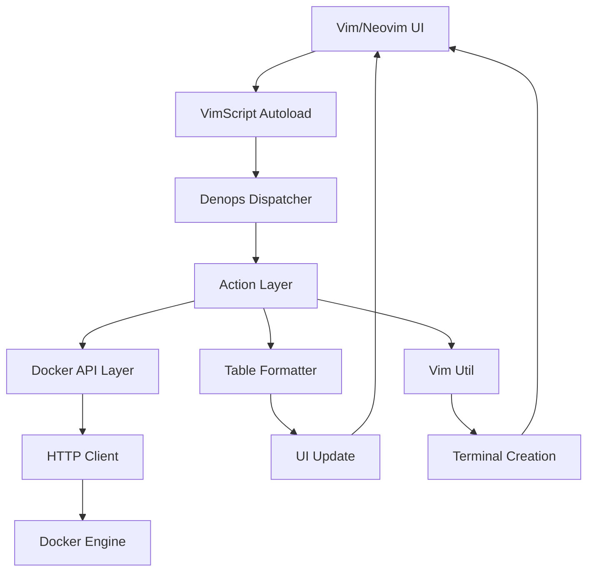

# denops-docker.vim Architecture Analysis

## Overview
denops-docker.vim is a Docker management plugin for Vim/Neovim built on the [denops.vim](https://github.com/vim-denops/denops.vim) framework. Implemented in TypeScript (Deno), it provides high performance and rich functionality.

## Architecture

### Core Components

#### 1. Main Entry Point (`main.ts`)
- **Role**: Primary plugin entry point
- **Features**:
  - Vim command registration (`DockerImages`, `DockerContainers`, etc.)
  - autocmd event setup
  - Keymap configuration and action assignment
  - Dispatcher function definitions

#### 2. Docker API Layer (`docker.ts`)
- **Role**: HTTP communication with Docker Engine API
- **Key Features**:
  - Container listing (`containers()`)
  - Image listing (`images()`)
  - Container operations (`start`, `stop`, `kill`, `restart`)
  - Attach and exec functionality
  - File operations (`copyFileToContainer`, `copyFileFromContainer`)

#### 3. Action Layer (`action.ts`)
- **Role**: High-level action processing
- **Features**:
  - UI update handling (`updateContainersBuffer`, `updateImagesBuffer`)
  - Terminal operation integration
  - Error handling

#### 4. HTTP Client (`http.ts`)
- **Role**: Low-level communication with Docker Unix Socket
- **Features**:
  - HTTP communication via Unix Socket
  - JSON response processing

#### 5. Table Formatter (`table.ts`)
- **Role**: Tabular data display
- **Features**:
  - Table generation using Cliffy library
  - Container and image data formatting

#### 6. Vim Integration (`vim_util.ts`)
- **Role**: Vim/Neovim-specific feature integration
- **Features**:
  - Terminal creation (`runTerminal`)
  - Editor-specific optimizations

#### 7. VimScript Bridge (`autoload/docker.vim`)
- **Role**: VimScript-side helper functions
- **Features**:
  - Command completion functionality
  - Container name caching
  - File editing capabilities

### Important Design Patterns

#### Attach Functionality Implementation
```typescript
export async function attachContainer(denops: Denops, name: string) {
  const shell = "[ -e /bin/bash ] || [ -e /usr/local/bin/bash ] && bash || sh";
  const cmd = <string[]> [
    "docker",
    "exec",
    "-it",
    "--detach-keys=ctrl-_",
    name,
    "sh",
    "-c",
    denops.meta.host === "vim" ? `'${shell}'` : `${shell}`,
  ];
  await runTerminal(denops, cmd);
}
```

**Key Points**:
1. **Uses `docker exec`**: Uses `docker exec` instead of `docker attach`
2. **Auto shell detection**: Prefers bash, falls back to sh
3. **Detach keys**: Set to `ctrl-_`
4. **Editor detection**: Different quote handling for Vim and Neovim

#### Terminal Creation Implementation
```typescript
export async function runTerminal(denops: Denops, cmd: string[]) {
  if (denops.meta.host === "nvim") {
    await denops.cmd("new");
    await denops.call("termopen", cmd);
  } else {
    await denops.cmd(`terminal ++shell ${cmd.join(" ")}`);
  }
}
```

**Key Points**:
1. **New window**: Creates split window with `new`
2. **Editor-specific APIs**: Neovim uses `termopen`, Vim uses `terminal`
3. **Shell integration**: Proper shell execution with `++shell` option

### Data Flow



### Keymap Design

#### Container Management
- `q`: Close buffer
- `u`: Start container
- `d`: Stop container
- `<C-k>`: Force kill container
- **`a`: Attach** ← Important
- `e`: Execute command
- `t`: Show logs
- `<C-d>`: Remove container
- `<CR>`: Inspect
- `r`: Restart
- `ct`: Copy file (to container)
- `cf`: Copy file (from container)
- `E`: Edit file
- `<C-o>`: Open in browser

#### Image Management
- `q`: Close buffer
- `r`: Quick run
- `<C-d>`: Remove image
- `<CR>`: Inspect

## Application to docker.nvim Implementation

### 1. Attach Functionality Corrections

Key differences from current docker.nvim implementation:

1. **`docker attach` → `docker exec`**:
   - denops-docker.vim uses `docker exec`
   - Creates new session and launches bash/sh
   - More flexible and safer

2. **Auto shell detection**:
   - Prefers bash, falls back to sh
   - Adapts to container environment

3. **Detach keys**:
   - Uses `ctrl-_`
   - Standard detach key

### 2. Recommended Modifications

```lua
-- api.lua modification
function M.attach_container(container_id, callback)
  local shell = "[ -e /bin/bash ] || [ -e /usr/local/bin/bash ] && bash || sh"
  local cmd = {
    "docker",
    "exec", 
    "-it",
    "--detach-keys=ctrl-_",
    container_id,
    "sh",
    "-c",
    shell
  }
  
  vim.schedule(function()
    vim.cmd("new")
    vim.fn.termopen(cmd)
    vim.cmd("startinsert")
    callback(nil, nil)
  end)
end
```

### 3. Design Principles

1. **Separated Responsibilities**: Each module has a clear role
2. **Error Handling**: Proper error handling at each layer
3. **Asynchronous Processing**: Safe UI updates with vim.schedule
4. **Platform Support**: Compatible with both Vim/Neovim
5. **Usability**: Intuitive keymaps and feedback

### 4. Table Display Format

denops-docker.vim table format:
```
ID           NAME        IMAGE                STATUS               CREATED             PORTS
abc123456789 nginx-app   nginx:latest         Up 2 hours          2023/12/01 10:00:00 0.0.0.0:8080->80/tcp
```

This format is already implemented in docker.nvim.

## Summary

The design of denops-docker.vim is robust and extensible, making it extremely valuable as a reference for docker.nvim. Particularly, the attach functionality using `docker exec` is excellent, providing a safer and more flexible implementation.

Future docker.nvim implementations should reference these design principles and patterns, implementing them in a form optimized for the Lua/Neovim environment.